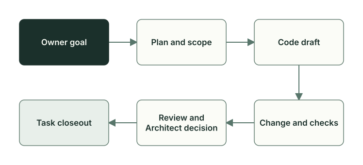

# How Planveyor works

**English** · [Русский](README.ru.md)

Planveyor organizes AI work on a project. A person, Owner, sets the goal. The Architect, Planner, Coder, and Reviewer roles carry out the task, and Manager, the coordinator, starts the next of them by the plan status. The roles hand over the work through files in the repository (the plan, the code draft, the review), so that the result can be checked from these files without reading the chat with the model. The models do the substantive work, and Planveyor scripts watch the formal conditions: whether the work can be handed on, whether the needed files are in place, and whether the checks are out of date.

This section explains how everything works. The step-by-step commands for your own project are in the [stack sibling guide](../stack-sibling.md).

## What you need before you start

- macOS: the first version works only on it.
- Git, zsh, rg, Python 3.12, and the dependencies from `requirements-dev.lock` (Copier 9.18.2, PyYAML).
- Codex CLI that you are signed in to, with five configured role agents: `architect`, `planner`, `coder`, and the two Reviewer lanes; see [Codex setup](../launch-and-role-modes.md#codex-setup). The `planveyor sibling run` command starts all roles as Codex agents. Planner and Reviewer can also run in Claude Code: in a single-role launch or in the custom pipeline, which the [launch chapter](runtime-launch.md) describes.
- The tools and the dev environment of your stack are prepared separately from Planveyor.

If something is missing, the command tells you exactly what. It does not install or configure anything itself. What the first version cannot do yet is listed in the [What works now and what comes next](capabilities-boundaries.md) chapter.

## Task path and Owner commands

Your project lives in a separate repository (a sibling), and the engine lives in a separate Planveyor checkout. You run the task with the `planveyor sibling …` commands:

1. Create the project once with `planveyor sibling init ~/my-stack` and go to its directory.
2. In a Codex chat, call the `$planveyor-plan-draft` skill and ask it to create a task plan and make it current; in ZCode, the skill is called as `/planveyor-plan-draft`. The first plan of a new project is the adaptation to your stack. `planveyor sibling plan` shows which plan is current and which step is next.
3. Run the plan in one of two modes ([Two ways to work on a plan](../stack-sibling.md#two-ways-to-work-on-a-plan)):
   - **TUI mode**, the main path. Start a Manager session, switch it to command approval requests, and open its window: `planveyor --project "$PWD" planveyor_manager_init`, then the approval step with `planveyor --project "$PWD" planveyor_manager_resume` from the [guide](../stack-sibling.md#run-the-plan-in-tui-mode), then `planveyor sibling tui`. The window does not open while the plan has open Owner questions: answer them first with `planveyor sibling answer` and the printed `architect`. In the window, Manager discusses the task with Architect and asks you questions, then by the plan status starts Planner, Coder, Reviewer, and Architect again for acceptance. Architect commits the implementation, the same roles do the docs closeout, and, if the closeout requires it, Architect commits the documents. The description is based on how the engine works. The corresponding route has been checked by live passes in Planveyor itself. Do not close the window before the end of the docs closeout.
   - **Manual console mode.** Discuss the task with Architect: `planveyor sibling architect`; answer its questions with `planveyor sibling answer` and run `architect` again. Then start Manager: `planveyor sibling run`. If Manager waits for your decision, answer with `answer` and run `run` again; on the step limit, repeat the same `run`. When Architect has accepted the work, look at the exact bundle of the plan with `planveyor sibling close` and authorize the commit: `planveyor sibling close --commit`. For the docs closeout, run `planveyor sibling run` once more, then `close` again and, if the documents need a separate commit, `close --commit`.

   If there are no choices for you to make, Architect moves the plan to `Architect draft` itself; it does not ask for a confirmation. The plan always has the `## Как я понял задачу` section (how I understood the task): read it before the roles start the work. The [stack sibling guide](../stack-sibling.md#the-task-understanding-section) says how to print the section with a command or ask an agent to show it. The docs closeout is the step at which the roles carry over to the shared project documents whatever is worth keeping after the task, and propose process changes and follow-ups.
4. Make sure that the task is closed: `planveyor sibling ready`.

A real example: in the SQL project, the roles solved the task “which products to reorder” in 2 hours 11 minutes, from the first line of the plan to the code commit. At that time, the `planveyor sibling` commands did not exist yet, and an operator started the roles by hand. The [Roles and task files](roles-artifacts.md) chapter tells who did what in this task, and the [running example](sql-example.md) describes its data and tests.

## Section map

**Part 1. The task and the roles.** For everyone who sets and accepts tasks.

| Chapter | Question it answers |
| --- | --- |
| [Roles and task files](roles-artifacts.md) | Who decides what, and which files do they hand on? |
| [Running example: which products to reorder](sql-example.md) | How does a business rule turn into a procedure and tests? |
| [The plan and its statuses](plan-lifecycle.md) | Where is the current step of the task recorded, and who reads it? |
| [Development, analysis, and decomposition](work-contours.md) | When do you write code right away, when do you research first, and when do you split the task? |
| [Review and acceptance](review-acceptance.md) | What do the two Reviewer lanes check, how does Architect accept the work, and who makes the commit? |
| [Task closeout](closeout.md) | What happens after acceptance, and when is the task finished? |
| [Tests and evidence: what you can trust](testing-evidence.md) | What does each check actually prove? |

**Part 2. A project on your own stack.** For the owner of a sibling.

| Chapter | Question it answers |
| --- | --- |
| [Sibling: creation and upgrade](sibling-lifecycle.md) | How do you create the project, what does it own itself, and how do you accept a new Planveyor version? |
| [Exchanging changes with Planveyor](change-packets.md) | How do you pass a shared problem to Planveyor, and how does the solution come back to the project? |
| [What works now and what comes next](capabilities-boundaries.md) | What can the first version not do, and what comes next? |

**Part 3. How Planveyor is built.** For those who change the engine itself.

| Chapter | Question it answers |
| --- | --- |
| [Launch: commands, wrappers, agent harnesses](runtime-launch.md) | How does a command connect the project, the instructions, the session, and the agent harness? |
| [How Planveyor changes itself](self-development.md) | How do the prompts, wrappers, rules, and the engine itself change? What happens to process improvements (PIs)? |
| [Post-merge check](postmerge.md) | What is checked when several tasks are already merged into the main branch? |
| [Engine tests](engine-tests.md) | How is the Planveyor test suite built, and how do you run it? |

**Appendices.** [Glossary](glossary.md): all terms of the section. [Code map](code-map.md): which files and functions to start reading the code from, and what the tests check.

## Who should read what

| Who you are | Where to start | What next |
| --- | --- | --- |
| Project owner: you set and accept tasks | [Roles and task files](roles-artifacts.md), [Running example: which products to reorder](sql-example.md), [Task closeout](closeout.md) | [What works now and what comes next](capabilities-boundaries.md), then the [stack sibling guide](../stack-sibling.md) and the other chapters of part 2 |
| Product developer: you work in a sibling | [The plan and its statuses](plan-lifecycle.md), [Review and acceptance](review-acceptance.md) | [Tests and evidence: what you can trust](testing-evidence.md) |
| Planveyor developer: you change the engine | [Launch: commands, wrappers, agent harnesses](runtime-launch.md), [How Planveyor changes itself](self-development.md) | [Engine tests](engine-tests.md), the [code map](code-map.md), and [CONTRIBUTING](../../../CONTRIBUTING.md) |

## Short glossary

| Term | What it means |
| --- | --- |
| Sibling | A separate repository of your project, created from Planveyor: the product code, the stack settings, the plans, and the local role rules |
| Engine | Shared Planveyor mechanisms: commands, role launch, and lifecycle checks |
| Runtime | The Planveyor checkout from which the commands run |
| Plan | The task file in `docs/plans/`. The status in its header shows whose turn it is now |
| Code draft | The Planner file with the list of target files and the steps for Coder |
| Exact bundle | All task files that are checked together: the target files, the plan, the draft, the review, and its assets. The changed ones among them go into the commit |
| Oracle | The script that reads the plan status and reports what blocks the transition |
| Wrapper | The engine function that prepares a role call and runs it |
| Agent harness | The program in which a role session runs: Codex CLI, Claude Code, or ZCode |
| Runner | The agent harness selected for a role |
| Receipt | A record of a completed action and its result |
| SID | The id of an agent harness session. It is used to continue the session |
| Evidence | Check results tied to a version of the files; in the plan, the `## Evidence` section, the evidence log |
| Contract | Written rules, formats, and boundaries of responsibility. The consumer contract is the files and rules that came from Planveyor |

The other terms are in the [glossary](glossary.md).

## If a command stops

What to do is in the [If a command stops](../stack-sibling.md#if-a-command-stops) section of the stack sibling guide. The chapters explain why the commands behave this way:

| What you see | Where to read |
| --- | --- |
| The bundle check reports `MISSING-PATH` | [The plan and its statuses](plan-lifecycle.md): which declared file is missing and at which step it is already required |
| `sibling close` does not close the task | [Review and acceptance](review-acceptance.md): whether the review is stale, whether there is an Architect verdict, and whether it is the same bundle |
| The closeout check reports `semantic_closeout_commit_pending` or `semantic_closeout_has_unstaged_delta` | [Task closeout](closeout.md): the plan is already in `Done`, but there is no task commit |
| The risk selector returned `missing` or `blocked` | [Review and acceptance](review-acceptance.md): whether the result of the first lane, on which the second one relies, is ready |
| An unaccepted candidate remains after an upgrade | [Sibling: creation and upgrade](sibling-lifecycle.md): why this happened, what happened to the local sections, and how to accept the candidate |

Do not edit the status, a receipt, or the queue by hand to get around a stop: first remove the cause. The known exception for the status is F49 in the [What works now and what comes next](capabilities-boundaries.md#limits-of-the-first-version) chapter.

You can check the environment and the engine without starting roles; see the [Quick readback](../launch-and-role-modes.md#quick-readback) section of the launch guide. A successful environment check does not yet mean that a role will start or that the result will be accepted.

## Where things are in Planveyor

Similar paths in Planveyor and in a sibling do not mean that the files have the same owner. In Planveyor itself:

| What | Where to start |
| --- | --- |
| Role responsibilities and process rules | [role definitions](../../roles/index.md) (in Russian), [playbooks](../../playbooks/README.md) (in Russian) |
| Phase prompts | [prompt index](../../tools/prompts/README.md) |
| Commands, wrappers, and helper scripts | [bin/planveyor](../../../bin/planveyor), [module map](../../../scripts/planveyor/README.md) |
| Files that a new sibling gets | [sibling README template](../../../copier_template/docs/README.md.jinja) |
| Tests of the mechanisms, the contract, and the documentation | [verification routes](../../tools/verify_suite.md) |

The chapters link to Planveyor files and functions. Line numbers in the code change, so look for a function or a test by its name. The test descriptions in the code map are written from their source code; only a run shows whether the tests pass on your version.
