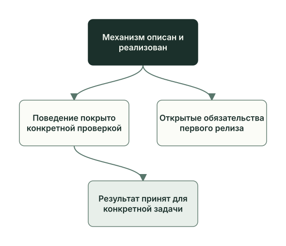

<!-- i18n: pair=docs/guides/learn/capabilities-boundaries.md pair-sha256=c8c5781e4d8d4887164f068e98406cbdf049a9dbea08f99251a4a9e37a34bf3b self-sha256=6c7442472e7e4b5aebd8312f4fb85321dcafcdeebab1fd93e03db037a727a206 -->
# Что уже работает и что дальше

[English](capabilities-boundaries.md) · **Русский**

Первая версия Planveyor ведёт задачу от плана до коммита, но у неё есть границы, а часть доработок записана на потом. Глава завершает часть 2: прочитайте её до того, как пробовать Planveyor на своём проекте, и вы заранее увидите, не упрётесь ли в одну из границ.

Как отличить механизм, который просто есть, от проверенного тестом и от принятого в настоящей задаче, рассказано в главе [«Тесты и доказательства: чему можно доверять»](testing-evidence.ru.md).

## Что умеет первая версия

| Возможность | Где читать |
| --- | --- |
| Вести задачу через роли: Architect пишет план, Planner — черновик кода, Coder реализует, две линии Reviewer проверяют, Architect принимает. Manager запускает роли по статусу плана | [Роли и файлы задачи](roles-artifacts.ru.md), [План и его статусы](plan-lifecycle.ru.md), [Ревью и приёмка](review-acceptance.ru.md) |
| В sibling коммитить только с согласия Owner: в режиме TUI Architect коммитит после того, как Owner одобрит в окне Manager его запросы на запись в `.git`; в ручном режиме Owner выполняет `planveyor sibling close --commit` после просмотра точного набора файлов плана. Затем закрыть документы задачи | [Закрытие задачи](closeout.ru.md) |
| Создать sibling, адаптировать его под стек и обновить до новой версии Planveyor с планом обновления | [Sibling: создание и обновление](sibling-lifecycle.ru.md) |
| Передать общую проблему в Planveyor запросом через GitHub issue. Решение возвращается обновлением sibling вместе с извещением | [Обмен изменениями с Planveyor](change-packets.ru.md) |
| Сначала исследовать большую задачу или разделить её на несколько планов | [Разработка, анализ и декомпозиция](work-contours.ru.md) |
| Проверить диапазон коммитов после слияния; пока только в самом Planveyor | [Проверка после слияния](postmerge.ru.md) |
| Менять сам Planveyor тем же процессом | [Как Planveyor меняет себя](self-development.ru.md) |

На настоящем SQL-проекте 27 и 28 сентября 2026 года прошли создание sibling, адаптация под SQL Server, задача `GetReorderCandidates` и обновление на следующую версию Planveyor. Адаптацию и задачу закрыли отдельными коммитами документов, а план обновления получил `Done` отдельным коммитом. Всё это было до команд `planveyor sibling` (см. [«Роли и файлы задачи»](roles-artifacts.ru.md)): они появились 3 октября, и их проверяют тесты движка. Настоящей задачи, проведённой этими командами, в примерах раздела нет.

## Границы первой версии

Номера F — пункты списка [«Обязательства первого релиза»](../../release_backlog.md), там же их полный текст.

| Область | Граница | Пункты |
| --- | --- | --- |
| Среда | Поддерживается одна среда: macOS и активированное окружение с Python 3.12 и зависимостями из `requirements-dev.lock`. Проверка версии при запуске пропускает Python 3.10–3.12, но поддерживается только 3.12. Первую версию проверяли локально на macOS; первый прогон GitHub CI на коммите выпуска упал, зелёного CI пока нет | F1, F2, F5, F6 |
| Зависимости и агентный харнес | Недостающую предпосылку команда назовёт, но сама её не установит и не настроит. Codex CLI, вход в него и пять агентов ролей в `config.toml` готовит Owner; этот файл Planveyor не создаёт и не меняет ([настройка Codex](../launch-and-role-modes.ru.md#настройка-codex)) | — |
| Агентные харнесы | Режим TUI и `planveyor sibling run` запускают пять агентов ролей в Codex; в режиме TUI это вложенные субагенты сессии Manager, такая возможность есть у Codex CLI. Planner и Reviewer можно запускать в Claude Code там, где роль запускает обёртка: по отдельности или в пошаговом режиме Manager; Architect, Coder и Manager работают только в Codex ([Запуск: команды, обёртки, харнесы](runtime-launch.ru.md)). Manager в ZCode работает только в корне Planveyor: в sibling его файлы запуска не доставляются | F20 про ZCode закрыт: эта граница описана |
| Восстановление Manager | Как прерванная сессия Manager узнаёт, на каком шаге остановилась, и продолжает работу, пока не решено | F7 |
| Тупик после вопроса Reviewer | Если Reviewer на линии рисков задал вопрос Architect, линия контракта не запускается. Линия рисков статус менять не может, поэтому `Ready for Architect response` поставить некому, и Manager останавливается с `stop_class=semantic_blocker`. Тогда Owner ставит этот статус в шапке плана сам: это известное исключение из правила не править статус вручную | F49 |
| Очередь планов | Очередь связанных планов в движке есть, но сквозной проверки у неё нет, и работа с ней отложена на время после первой публикации. `planveyor sibling run` ведёт один выбранный план и очередь не создаёт. Для прерванной операции очереди есть только явное восстановление `planveyor_q_recover`, и решение о нём принимает Owner | Отсрочка без номера; F23 закрыт: добавлено только явное восстановление |
| Извещения | Обновление sibling проверяет, как оформлено извещение, но не требует его. Когда извещение обязательно, не определено, и изменение шаблона sibling или рабочих скриптов без извещения сейчас ничто не остановит | F27 |
| Проверка после слияния в sibling | Команды `planveyor sibling …` для неё нет. Низкоуровневым командам нужны два файла настроек в `docs/_meta/`; шаблон sibling их не создаёт, и без них команды останавливаются ([Проверка после слияния](postmerge.ru.md)) | В списке нет |
| Адресная доставка | Sibling адресных пакетов (`planveyor_rollout_packet_*`) не получает: изменения приходят к нему обновлением с извещением. Убрать механизм или оставить его только для самого Planveyor, ещё не решили | F29 |
| Нейтральность к стеку | Часть правил движка писалась для веб-проекта на Django. Когда Reviewer проверяет диапазон коммитов, изменения SQL-проекта в `db/`, `src/` и `tests/` попадут в список вспомогательных файлов вместо кода продукта. Методика проверки интерфейса требует веб-терминов | F43, F45 |

Если граница мешает вашему проекту, опишите проблему запросом в Planveyor: порядок действий — в разделе [«Предложить изменение Planveyor»](../stack-sibling.ru.md#предложить-изменение-planveyor) руководства по sibling.

## Куда идёт развитие

В «Обязательствах первого релиза» закрыты 18 пунктов и открыты 45: F1–F62 и один пункт без номера. Отдельно там четыре предложения по процессу: PI1–PI3 и отдельное предложение исходного плана. Из пунктов F5–F62 и пункта без номера незакрытые 41 отложены на время после выпуска первой версии, F1–F4 остаются отдельными открытыми обязательствами. Сроков у доработок нет.

| Направление | Что предстоит | Пункты |
| --- | --- | --- |
| Надёжность | Восстанавливать прерванную сессию Manager: в одном из прогонов sibling на SQL Server после перегрузки модели сброс одной роли обошёлся примерно в 0,8 млн токенов. Проверять права на запись в `.git` до первой подготовки коммита: сейчас это выясняется только после ревью. Убрать ручные шаги Owner: статус в тупике после вопроса Reviewer и закрытие вопросов анкеты стека, которые сейчас Owner закрывает сам | F7, F40, F49, F50 |
| Среды | Проверить Windows, затем Linux; другие версии Python; сделать GitHub CI зелёным | F1, F2, F5, F6 |
| Обновление sibling | Переход через версию, перенос переименованного файла, который приходит из Planveyor, две версии движка одновременно при смене его API, doctor, который показывает отставание sibling от движка. Удачное обновление на одном переходе эти случаи не проверяет. Правило и проверка для извещений. Разбор обновления ролями вместо списка изменённых путей | F8, F27, F30, F32 |
| Обмен с Planveyor | Pull request прямо из sibling; команды для запросов в Planveyor из sibling; решение об адресной доставке | F26, F28, F29 |
| Большие задачи | Анализ большой задачи, в котором Coder сразу пишет результаты в отдельный файл; доработки декомпозиции; тесты анализа и декомпозиции, включая сквозной прогон с поддельным Codex. Сквозная проверка очереди планов отложена отдельно, без номера | F33, F34, F35 |
| Скорость и расход | Сначала измерения. После них кэш проверок, которые сейчас повторяются в каждой команде, параллельные шаги проверки после слияния и ускорение `bin/planveyor`: сейчас вызов занимает около 8 секунд | F3, F9, F10, F39 |

Чтобы взять пункт в работу, заводят обычный план по шаблонам: при большой неопределённости сначала исследование, для широкого решения декомпозицию, для ограниченной правки план разработки ([Разработка, анализ и декомпозиция](work-contours.ru.md)).

## Частые ошибки

- Считать пункт списка обещанием срока.
- Считать закрытый пункт закрытым целиком. У закрытых пунктов указано, что именно закрыто: например, F23 добавил явное восстановление операции очереди, а сквозной проверки очереди не дал.

## Как поддерживать эту документацию

Эта глава коротко пересказывает [«Обязательства первого релиза»](../../release_backlog.md) и может от них отстать; при расхождении прав список. Новую возможность вносите в главу, когда у неё есть свежее доказательство: проверка или принятая задача. Меняя роль, команду или обёртку, поправьте и главу раздела, которая их описывает. Перед ревью правки выполните проверки из [архитектуры документации](../../playbooks/docs_architecture.md) и [CONTRIBUTING](../../../CONTRIBUTING.ru.md): линтер документации и поиск личных путей и устаревших результатов прошлых прогонов.

Функции и тесты, о которых шла речь, — в [справочнике по коду](code-map.ru.md#что-уже-работает-и-что-дальше).

Дальше: [«Запуск: команды, обёртки, харнесы»](runtime-launch.ru.md).
