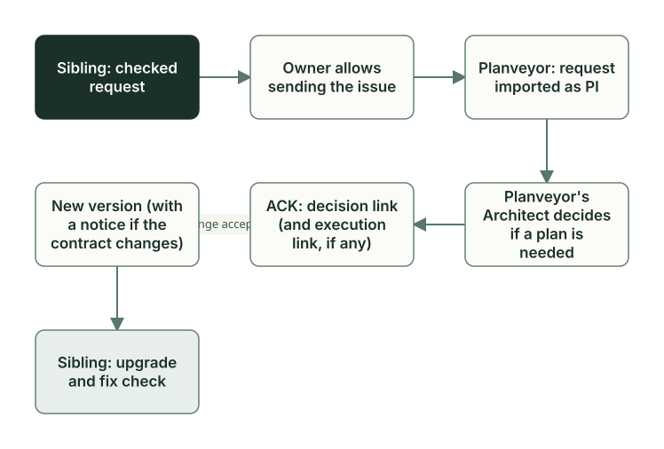

# Exchanging changes with Planveyor

**English** · [Русский](change-packets.ru.md)

Changes travel between the project and Planveyor in both directions. You pass a shared problem found in a sibling to Planveyor with an upstream request. The accepted solution comes back to the project with a new Planveyor version, and if it changes the contract or the engine behavior, a contract notice comes with it. The steps are described in the [Propose a change to Planveyor](../stack-sibling.md#propose-a-change-to-planveyor) section of the stack sibling guide.



## What to send to Planveyor

You change the rules of your stack in the project, with an ordinary plan. Shared problems go to Planveyor: in role definitions, prompts, templates, playbooks, and the engine itself.

In the SQL project, process improvements (PIs) appeared twice, both times during the docs closeout (the [Task closeout](closeout.md) chapter). The first one appeared after the adaptation and concerned the review templates from Planveyor; it is quoted as written in the project, in Russian:

```markdown
- symptom: `Шаблоны code/doc review закрепляют `GPT-5.2` и `GPT-5.5` в заголовках lanes, хотя текущий принятый review фиксирует фактический `gpt-6-sol` в runner metadata.`
- suggested_fix: `В source-owned шаблонах code/doc review сделать заголовки lanes нейтральными к модели и оставить фактические runner/model/session данные в metadata текущего запуска.`
```

The review templates come with the contract as a whole and belong to Planveyor; they have no local sections. They must be fixed in Planveyor, and this is a reason for an upstream request. The project has no request for this proposal: its `docs/upstream_packets/` holds only the template.

The second one appeared after the `GetReorderCandidates` task. The local section of the review playbook, which allows Reviewer not to repeat the operator's run, referred to the JUnit report from the adaptation plan, although Reviewer must look at the report of the current task. This text belongs to the project, and it is fixed in the project itself.

## Upstream request

An upstream request is a file in a sibling made from the [template](../../upstream_packets/_template.md) `docs/upstream_packets/_template.md`. It has three main fields: `symptom` describes what you observed, `process_gap` names what the shared process lacks, and `suggested_fix` proposes a fix. The facts of your stack go into the `Target-Specific Facts To Filter` section: when the request is examined, they are separated from the shared rules. Do not put secrets, server addresses, or absolute paths into the request.

The agent harness prepares the request in a regular project chat, outside the roles. You read the file and commit it with a regular `git commit`: `planveyor sibling close --commit` commits only the exact bundle of the plan, and the request is not part of it. Sending the request is your separate decision; asking to prepare the file does not replace it. The GitHub CLI `gh`, which you installed and authorized yourself, sends the request with the command `gh issue create --body-file <request file> --repo planveyor/planveyor` and the prepared file. The issue goes to the Planveyor repository on GitHub: the `--repo` flag is needed, otherwise `gh` takes the repository of your project. Before sending, look at the ready command and the issue text. If `gh` is not set up, sending stops and names the reason.

Then the Planveyor maintainer takes over. The request lands in `docs/upstream_packets/` of the Planveyor repository, and Planveyor gets its own copy. The `planveyor_upstream_request_import` command creates a PI record from it and moves the copy to the `imported` status. Planveyor's own Architect decides whether a fix plan is needed, and the fix goes through an ordinary plan. The `planveyor_upstream_request_ack` command writes into the Planveyor copy a link to the decision and, if there is one, to the execution plan, and sets the `decided` status; this mark is called ACK. Both commands work only in the Planveyor root.

The file in your project changes later. The accepted fix comes out in a new Planveyor version. If it changes the contract or the engine behavior, a contract notice comes out with it, and its `sibling_actions` say what to do with the local copy of the request: move it to `decided` and write a link to the notice in `source_decision_ref`. The roles do this in the upgrade plan that `planveyor sibling upgrade` creates.

The inconveniences of this path are recorded in item [F28](../../release_backlog.md#f28) (in Russian) of the First-release backlog:

- there is no command or skill step that creates a request;
- the `show` and `lint` commands for requests do not work normally in a sibling, so there is no standard command to check the request format there;
- the contract notice has no field with a link to the request.

A pull request straight from a sibling instead of an issue is deferred to the next stage; this is item [F26](../../release_backlog.md#f26).

## Contract notice: what a new version brings

A contract notice is a JSON file in the `docs/contract_notices/` directory of Planveyor. By the Planveyor rule ([docs_architecture.md](../../playbooks/docs_architecture.md), in Russian), it comes with a change of the shared contract or of the engine mechanics. It is not defined exactly when a notice is required, and nothing currently stops a change of the contract template or the engine scripts without a notice (item [F27](../../release_backlog.md#f27)). So in the upgrade plan, read the lists of changed files too.

A notice has five fields: a one-line `summary` and the string arrays `contract_changes`, `engine_changes`, `sibling_actions`, and `checks`; the format is described in the [README of the notices directory](../../contract_notices/README.md) (in Russian). A notice has no addressee: every project whose upgrade passes through this version gets it. A sample from the Planveyor development history is the notice that came out together with the `planveyor sibling` commands, quoted as written, in Russian:

```text
"summary": "Обычная работа с sibling выполняется через одну группу human-команд с автоматическим техническим контекстом и явными точными коммитами.",
…
"sibling_actions": [
  …
  "Перед каждым close --commit просмотреть текущий точный набор; после semantic commit отдельно провести Manager docs tail и его закрытие.",
  …
]
```

This action asks you to look at the bundle before each `close --commit` and, after the task commit, to do the docs closeout separately.

The upgrade reads the notices between the Planveyor version the project was built from and the new one. A notice that was already in the earlier version with the same text does not come again. A notice goes into the upgrade plan in parts. The command writes the notice path, the commit, and the `summary` to `## Scope`. It adds the `checks` lines to `## Tests`, and turns each `sibling_actions` line into an entry `Действие: …` (action) in `## Evidence`. The `contract_changes` and `engine_changes` fields are not copied into the plan: the command makes the lists of changed files itself.

On the upgrade, the SQL project got one notice: `Уточнено общее правило проверки обновления sibling после Copier.` (the shared rule for checking a sibling upgrade after Copier is clarified). Below is the text from a trial run of the same upgrade on a copy of the project, quoted as written, in Russian. In the project itself, Architect later rewrote these sections in its own words.

```markdown
## Tests
- Проверить локальные stack/Reviewer overrides и точный diff.
- Проверить exact diff shared-файла, raw bytes локальных секций и результат planveyor_consumer_doctor.
…
## Evidence (chronological, append-only)
- План создан механическим обновлением; проверки sibling и решения Architect/Reviewer ещё открыты.
- Действие: В локальном плане адаптации записать прежний и новый source commit, затем сверить локальные секции до и после Copier.
```

The command always writes the first `## Tests` line; the second came from the notice. The roles performed this action; the [Sibling: creation and upgrade](sibling-lifecycle.md) chapter tells how the upgrade went.

## Rollout

A sibling does not receive rollout packets now: changes come to it through an upgrade with a contract notice. Planveyor issues a rollout packet for a specific repository. The recipient adopts it with its own plan and records the outcome, for example `adopted`, `parked`, or `rejected`, and Planveyor separately records that the packet was received; the commands are described in the [Lifecycle and packets](../lifecycle-and-packets.md#rollout-adoption-and-ack) guide. In the SQL project, all three plans (the adaptation, the task, and the upgrade) filled in the `## Rollout packet handoff` section with `N/A`. Whether to remove the mechanism or to keep it only for work on Planveyor itself will be decided in item [F29](../../release_backlog.md#f29).

## What Owner does

1. Decides whether the problem is shared. If it is about the rules of their own stack, sets up an ordinary plan in the project.
2. Asks in a regular project chat to prepare a request from the template, reads it, and commits it.
3. Separately authorizes sending, after looking at the `gh issue create --body-file … --repo planveyor/planveyor` command and the issue text.
4. When the fix gets into a new Planveyor version, updates the Planveyor checkout, runs `planveyor --project ~/my-stack sibling upgrade` from outside the project, and runs the upgrade plan through to the docs closeout.

Wording for the chat and a hypothetical example of a request from the SQL project are in the [stack sibling guide](../stack-sibling.md#propose-a-change-to-planveyor).

## Common mistakes

- Taking a created issue or the `decided` status in Planveyor for a fix in your own project. The fix appears in the project after the upgrade and the accepted upgrade plan.

The functions and tests discussed here are in the [code map](code-map.md#exchanging-changes-with-planveyor).

Next: [What works now and what comes next](capabilities-boundaries.md).
