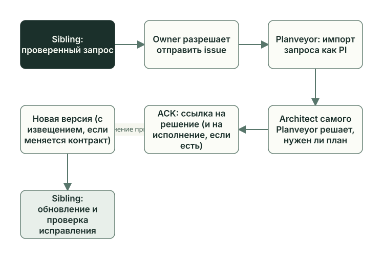

<!-- i18n: pair=docs/guides/learn/change-packets.md pair-sha256=853512f7e23a9fb55c1eca15e39a778fd378393bd174e10da511fef70f5e1ed2 self-sha256=f4254f28f5fa005494b1f5904f8e73141125c32f7de3909fd90e7ec0927997a0 -->
# Обмен изменениями с Planveyor

[English](change-packets.md) · **Русский**

Изменения ходят между проектом и Planveyor в обе стороны. Общую проблему, найденную в sibling, вы передаёте в Planveyor запросом. Принятое решение возвращается в проект с новой версией Planveyor, а если оно меняет контракт или поведение движка, вместе с ним приходит извещение. Порядок действий описан в разделе [«Предложить изменение Planveyor»](../stack-sibling.ru.md#предложить-изменение-planveyor) руководства по sibling.



## Что отправлять в Planveyor

Правила своего стека вы меняете в проекте, обычным планом. В Planveyor отправляют общие проблемы: в документах ролей, промптах, шаблонах, плейбуках и самом движке.

В SQL-проекте предложения по процессу (PI) появились дважды, оба раза при закрытии документов (глава [«Закрытие задачи»](closeout.ru.md)). Первое появилось после адаптации и касалось шаблонов ревью из Planveyor:

```markdown
- symptom: `Шаблоны code/doc review закрепляют `GPT-5.2` и `GPT-5.5` в заголовках lanes, хотя текущий принятый review фиксирует фактический `gpt-6-sol` в runner metadata.`
- suggested_fix: `В source-owned шаблонах code/doc review сделать заголовки lanes нейтральными к модели и оставить фактические runner/model/session данные в metadata текущего запуска.`
```

Шаблоны ревью приходят с контрактом целиком и принадлежат Planveyor, локальных разделов в них нет. Исправлять их нужно в Planveyor, и это повод для запроса. Запроса по этому предложению в проекте нет: в его `docs/upstream_packets/` лежит только шаблон.

Второе появилось после задачи `GetReorderCandidates`. Локальный раздел плейбука ревью, который разрешает Reviewer не повторять прогон оператора, ссылался на отчёт JUnit из плана адаптации, хотя Reviewer должен смотреть отчёт текущей задачи. Этот текст принадлежит проекту, и правят его в самом проекте.

## Запрос в Planveyor

Запрос в Planveyor (upstream request) — это файл в sibling по [шаблону](../../upstream_packets/_template.md) `docs/upstream_packets/_template.md`. В нём три главных поля: `symptom` описывает, что вы наблюдали, `process_gap` называет, чего не хватает в общем процессе, `suggested_fix` предлагает исправление. Факты своего стека выносят в раздел `Target-Specific Facts To Filter`: при разборе их отделяют от общих правил. Не пишите в запрос секреты, адреса серверов и абсолютные пути.

Запрос готовит агентный харнес в обычном чате проекта, вне ролей. Вы читаете файл и коммитите его обычным `git commit`: `planveyor sibling close --commit` коммитит только точный набор файлов плана, а запрос в него не входит. Отправить запрос — отдельное ваше решение, просьба подготовить файл его не заменяет. Отправляет запрос GitHub CLI `gh`, который вы сами установили и авторизовали, командой `gh issue create --body-file <файл запроса> --repo planveyor/planveyor` с подготовленным файлом. Issue уходит в репозиторий Planveyor на GitHub: флаг `--repo` нужен, иначе `gh` возьмёт репозиторий вашего проекта. Перед отправкой посмотрите готовую команду и текст issue. Если `gh` не настроен, отправка остановится и назовёт причину.

Дальше работает сопровождающий Planveyor. Запрос попадает в `docs/upstream_packets/` репозитория Planveyor, и у Planveyor появляется своя копия. Команда `planveyor_upstream_request_import` создаёт по ней запись PI и переводит копию в статус `imported`. Нужен ли план исправления, решает Architect самого Planveyor, и исправление проходит обычный план. Команда `planveyor_upstream_request_ack` записывает в копию Planveyor ссылку на решение и, если есть, на план исполнения и ставит статус `decided`; такую отметку называют ACK. Обе команды работают только в корне Planveyor.

Файл в вашем проекте меняется позже. Принятое исправление выходит в новой версии Planveyor. Если оно меняет контракт или поведение движка, вместе с ним выходит извещение, и в его `sibling_actions` сказано, что сделать с локальной копией запроса: перевести её в `decided` и записать в `source_decision_ref` ссылку на извещение. Это делают роли в плане обновления, который создаёт `planveyor sibling upgrade`.

Неудобства этого пути записаны в пункте [F28](../../release_backlog.md#f28) «Обязательств первого релиза»:

- нет команды или шага скилла, которые создают запрос;
- команды `show` и `lint` для запросов в sibling штатно не работают, поэтому штатной команды проверки формата запроса там нет;
- в извещении нет поля со ссылкой на запрос.

Pull request прямо из sibling вместо issue отложен на следующий этап, это пункт [F26](../../release_backlog.md#f26).

## Извещение: что приносит новая версия

Извещение (contract notice) — это JSON-файл в каталоге `docs/contract_notices/` Planveyor. По правилу Planveyor ([docs_architecture.md](../../playbooks/docs_architecture.md)) оно сопровождает изменение общего контракта или механики движка. Когда извещение обязательно, точно не определено, и изменение шаблона контракта или скриптов движка без извещения сейчас ничто не остановит (пункт [F27](../../release_backlog.md#f27)). Поэтому в плане обновления читайте и списки изменённых файлов.

В извещении пять полей: однострочный `summary` и массивы строк `contract_changes`, `engine_changes`, `sibling_actions` и `checks`; формат описан в [README каталога извещений](../../contract_notices/README.md). Адресата у извещения нет: его получает каждый проект, чьё обновление проходит через эту версию. Образец из истории разработки Planveyor — извещение, которое вышло вместе с командами `planveyor sibling`:

```text
"summary": "Обычная работа с sibling выполняется через одну группу human-команд с автоматическим техническим контекстом и явными точными коммитами.",
…
"sibling_actions": [
  …
  "Перед каждым close --commit просмотреть текущий точный набор; после semantic commit отдельно провести Manager docs tail и его закрытие.",
  …
]
```

Это действие просит перед каждым `close --commit` смотреть набор файлов, а после коммита задачи отдельно закрывать документы.

Обновление читает извещения между версией Planveyor, из которой собран проект, и новой. Извещение, которое уже было в прежней версии с тем же текстом, повторно не приходит. В план обновления извещение попадает по частям. Путь извещения, коммит и `summary` команда пишет в `## Scope`. Строки `checks` она добавляет в `## Tests`, а каждую строку `sibling_actions` превращает в запись «Действие: …» в `## Evidence`. Поля `contract_changes` и `engine_changes` в план не копируются: списки изменённых файлов команда составляет сама.

SQL-проект получил при обновлении одно извещение: «Уточнено общее правило проверки обновления sibling после Copier.» Ниже — текст пробного прогона того же обновления на копии проекта. В самом проекте Architect потом переписал эти разделы своими словами.

```markdown
## Tests
- Проверить локальные stack/Reviewer overrides и точный diff.
- Проверить exact diff shared-файла, raw bytes локальных секций и результат planveyor_consumer_doctor.
…
## Evidence (chronological, append-only)
- План создан механическим обновлением; проверки sibling и решения Architect/Reviewer ещё открыты.
- Действие: В локальном плане адаптации записать прежний и новый source commit, затем сверить локальные секции до и после Copier.
```

Первую строку `## Tests` команда пишет всегда, вторая пришла из извещения. Роли выполнили это действие; как прошло обновление, рассказано в главе [«Sibling: создание и обновление»](sibling-lifecycle.ru.md).

## Адресная доставка

Адресных пакетов sibling сейчас не получает: изменения приходят к нему обновлением с извещением. Адресный пакет (rollout packet) Planveyor выпускает для конкретного репозитория. Получатель принимает его своим планом и записывает исход, например `adopted`, `parked` или `rejected`, а Planveyor отдельно отмечает получение; команды описаны в руководстве [«Жизненный цикл и пакеты»](../lifecycle-and-packets.ru.md#адресная-доставка-принятие-и-ack). В SQL-проекте все три плана (адаптация, задача и обновление) заполнили раздел `## Rollout packet handoff` значением `N/A`. Убрать механизм или оставить его только для работы над самим Planveyor, решат в пункте [F29](../../release_backlog.md#f29).

## Что делает Owner

1. Решает, общая ли проблема. Если дело в правилах своего стека, ставит обычный план в проекте.
2. Просит в обычном чате проекта подготовить запрос по шаблону, читает его и коммитит.
3. Отдельно разрешает отправку, посмотрев команду `gh issue create --body-file … --repo planveyor/planveyor` и текст issue.
4. Когда исправление войдёт в новую версию Planveyor, обновляет копию Planveyor, запускает снаружи проекта `planveyor --project ~/my-stack sibling upgrade` и проводит план обновления до закрытия документов.

Формулировки для чата и условный пример запроса из SQL-проекта есть в [руководстве по sibling](../stack-sibling.ru.md#предложить-изменение-planveyor).

## Частые ошибки

- Считать созданный issue или статус `decided` в Planveyor исправлением в своём проекте. Исправление появится в проекте после обновления и принятого плана обновления.

Функции и тесты, о которых шла речь, — в [справочнике по коду](code-map.ru.md#обмен-изменениями-с-planveyor).

Дальше: [«Что уже работает и что дальше»](capabilities-boundaries.ru.md).
