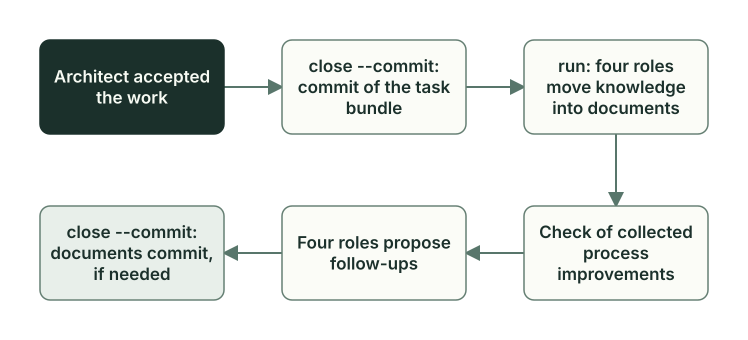

# Task closeout

**English** · [Русский](closeout.ru.md)

Architect has accepted the work, but the task is still open: its files need a commit, and what the roles learned along the way needs to go into the project documents. In a [sibling](glossary.md) in TUI mode, both steps happen in the Manager window: Architect commits the bundle, the same roles do the docs closeout, and, if the closeout requires it, Architect commits the documents. In manual console mode, Owner goes through them with the `planveyor sibling close` and `planveyor sibling run` commands.



## The task commit

The task commit takes what has changed from the exact bundle of the plan: the target files that the task changed, the plan, the code draft, the review file, and the review assets. How the bundle builds up during the task is shown in the chapter [The plan and its statuses](plan-lifecycle.md#the-bundle-and-its-two-checks).

In a sibling, Owner authorizes the commit. First, the preview:

```sh
planveyor sibling close
```

The command checks the acceptance (the [Review and acceptance](review-acceptance.md) chapter lists what exactly it checks), prints the file list and the commit message, and does nothing else. The message is built from the plan title: `plan: <title>` and the line `Planveyor-Plan: <path to the plan>`; you can pass your own text with `--message`. Read the list and look at the changes in an editor. If files were edited after the preview, repeat `close`. An edit of a target file makes the review stale, and then `close` refuses and suggests `planveyor sibling run`.

Then the commit:

```sh
planveyor sibling close --commit
```

The `--commit` flag is Owner's permission for this bundle. The command repeats the checks, stages the bundle, moves the plan to `Done`, and commits only these paths. Before the commit, it checks `HEAD`, the index, the files, and the review once more. If something has changed or a check fails, there is no commit: the plan status returns to the previous one, the bundle files may stay in the index, and you need to repeat `close`. After the commit, the command prints `План закоммичен. Следующий шаг: planveyor sibling run для документов.` (the plan is committed; next step: `planveyor sibling run` for the documents).

When the roles run outside the `planveyor sibling` commands, Architect does the same steps: it sets `Done` and commits the bundle itself (the [Who makes the commit](review-acceptance.md#who-makes-the-commit) section).

## The `## Post-merge gate` section

The template of every plan has the `## Post-merge gate (before deleting plan)` section. It is a checklist for the time after the merge into the main branch, before the temporary plans and reviews are deleted: the post-merge audit, the range review, moving decisions into the shared documents, follow-ups, and links to the files being deleted.

`close` checks the plan as if it were already in `Done`, and a plan in `Done` cannot keep open `- [ ]` items in this section. An item is marked `- [x]` when it is really done and there is evidence for it. If the task is closed with a local commit and there has been no merge yet, the whole section is written as `N/A (why=…)` with the reason. Architect edits this section. If `close` refused because of it, return the turn to Architect: `planveyor sibling architect`.

In the `GetReorderCandidates` task, the first plan check before `Done` failed precisely because of this section. Architect replaced the checklist with a “not applicable” line and its reason, quoted as written in the project, in Russian:

```markdown
## Post-merge gate (before deleting plan)
N/A (why=задача закрывается локальным exact code commit без push/merge; post-merge audit и удаление временного плана не являются частью этого unmerged closeout и не считаются выполненными).
```

The post-merge check itself is described in the [Post-merge check](postmerge.md) chapter; in a sibling, there is no `planveyor sibling …` command for it.

## Docs closeout

After the commit, the roles record what they learned during the task while their sessions still remember it. So the docs closeout is best done in the same TUI window where the plan ran: the roles in it are the same. In manual mode, a new `planveyor sibling run` starts the docs closeout, and after the commit these are already a new Manager and new roles: they know the plan only from its files ([Sessions and commits](../stack-sibling.md#sessions-and-commits)). In both modes, Manager sees the `Done` status and usually calls the four roles in two stages.

| Stage | What the roles do | Who records the result |
| --- | --- | --- |
| Shared documents (`general`) | They move the decisions and rules worth keeping into the shared documents that the project declares: architecture, data, and API descriptions, and guides. In a separate section of its answer, each role states whether it has a process improvement | The roles edit the documents themselves. Manager passes the process section to the `process_improvements_collect.py` script, and the script records the improvement; about a format error in this section, see [How Planveyor changes itself](self-development.md#process-improvements-pis) |
| Follow-ups (`followups`) | They propose work for later or explain why there is none | In plans of the current schema (`plan.v2`), the `followups_apply.py` script, in the `followups.v2` format, once all four roles have answered |

The roles go in the order Architect, Coder, Planner, Reviewer. Between the stages, Manager checks that the proposals of all four roles are collected. Manager itself does not write documents: it calls the roles and the scripts and checks their answers. After `Done`, the plan, the code draft, the review, the prompts, and the playbooks do not change. If a role wants to change the process, it writes a proposal.

A process improvement (PI) is a record of a symptom, a process gap, a suggested fix, an owner, and a link to the source. If there are no proposals, the role writes one line, `NO PROCESS IMPROVEMENTS — why: <reason>`. The records of the task are in the `docs/process_improvements/` directory, in the `<plan name>__process_improvements_backlog.md` file; the script rebuilds the `index.md`, `deferred.md`, and `promotion_surface.md` tables next to it by itself. Later, Architect triages the record, and Owner assigns its priority (the [How Planveyor changes itself](self-development.md) chapter).

At the end, Manager calls the closeout script `planveyor_docs_closeout`. The `state=completed` field in its answer refers to the task commit. Whether the documents are closed is shown by the `final_docs_commit` field and the states of the process improvement and follow-up collection. `final_docs_commit` is `required` when there are changes and they need a commit, `no_op` when there is nothing to commit, and `landed` when the commit already exists. While the collection is not finished, `close` answers `Документы ещё не закрыты` (the documents are not closed yet) with the reason and suggests `planveyor sibling run`.

If the documents need a commit, Owner authorizes it separately, with the same pair of commands. While the plan is not in `Done`, `close` works with the task bundle; after that, with the documents:

```sh
planveyor sibling close
planveyor sibling close --commit
```

`close` shows the set of documents, and `close --commit` commits it with the message `docs(closeout): finalize <plan name>` and checks the closeout right away. When the documents are closed, with a commit or without one, the command answers `План и документы закрыты. Можно начать следующую задачу.` (the plan and the documents are closed; you can start the next task). With this message, the task is finished. Outside the `planveyor sibling` commands, Architect makes this commit when the documents need one.

## How it went: the GetReorderCandidates documents

The commit `edac1b9` closed the documents 48 minutes after the code commit `70526ee`; this was before the `planveyor sibling` commands existed (see [Roles and task files](roles-artifacts.md)). Before that, the closeout script answered `state=completed` and, at the same time, `final_docs_commit=required` with four changed files. Here they are in the output of `git show --stat edac1b9`:

```text
commit edac1b9b8816229d7a1d05a4c007aea8bd6ba640
[…]
Date:   Mon Sep 28 03:05:51 2026 +0300

    docs(closeout): finalize 260928_0006_get_reorder_candidates

    Planveyor-Plan: docs/plans/260928_0006_get_reorder_candidates.md

 ...der_candidates__process_improvements_backlog.md | 45 ++++++++++++++++++++++
 docs/process_improvements/deferred.md              |  3 +-
 docs/process_improvements/index.md                 |  3 +-
 docs/process_improvements/promotion_surface.md     |  3 +-
 4 files changed, 51 insertions(+), 3 deletions(-)
```

All four files are about one process improvement. The new file `260928_0006_get_reorder_candidates__process_improvements_backlog.md` in the `docs/process_improvements/` directory of the project holds the only record, PI-001. Each of the three tables next to it got one row about it, and their build time was updated. The roles did not change the shared documents of the project. There are no follow-ups either, and each of the four roles explained why. Reviewer, for example, answered that the review finished without S1, S2, or S3 findings, and that the observation about the playbook was already recorded as a process improvement.

The PI-001 record, quoted as written in the project, in Russian:

```markdown
### PI-001
- status: `open`
- priority: `P?`
- role: `Architect`
- owner: `Architect`
- promotion_class: `canon_update`
[…]
- trigger_ref: `docs/code_reviews/260928_0006_get_reorder_candidates.md`
- source_ref: `docs/plans/260928_0006_get_reorder_candidates.md`
- symptom: `docs/playbooks/review_staged_or_commit.md требует proof текущего плана, но указывает однотестовый JUnit [предыдущей задачи].`
- process_gap: `При повторном использовании операторского proof Reviewer может принять исторический asset вместо текущего набора из восьми тестов.`
- suggested_fix: `В локальной секции playbook брать путь JUnit и точный набор тестов из текущего PLAN_PATH; сверять объявленный прямой proof порядка и байты источников без жёсткой ссылки на asset [предыдущей задачи].`
- created_at: `2026-09-28 02:39 MSK`
- triage_note: `auto-collected from memory-finalize general lane`
```

The review playbook in this project referred to the one-test JUnit report of the previous task. The reference is in the local section that allows Reviewer not to repeat the operator's run ([Sibling: creation and upgrade](sibling-lifecycle.md#local-sections)). The live run of this task checked eight: the seven procedure tests and the earlier `SqlHarnessSmoke.test_schema_present`. Architect proposed to take the report path from the current plan; `triage_note` shows that the proposal came at the `general` stage. For now, it is raw: the status is `open`, and no priority is assigned (`P?`). This commit did not change the playbook itself, because playbooks are not edited during the docs closeout.

## A plan in `Done` without a commit

The docs closeout starts only after the task commit. If the plan is already in `Done` but its bundle is not in the history yet, the closeout script answers `blocked`: with the reason `semantic_closeout_commit_pending` if the whole bundle is already staged, or `semantic_closeout_has_unstaged_delta` if it is not, for example after a manual `Done`. In both cases, run `planveyor sibling close`: if the acceptance of Architect is recorded by the rules, the command shows the bundle and suggests `close --commit`.

## How to check that the task is closed

```sh
planveyor sibling ready
```

At any time, `ready` first checks the project contract, that is, the files and rules that came from Planveyor, then reads the current plan (you select it with `planveyor sibling plan`) and checks its closeout. If everything is closed, it answers `Consumer contract и выбранный план закрыты. Готовность отдельного release или SQL не проверялась.` (the consumer contract and the selected plan are closed; the readiness of a separate release or SQL was not checked). If the contract check succeeds and the plan or docs closeout is pending, it names the next command: `planveyor sibling run` or `planveyor sibling close`. A failed contract check or an unreadable current plan can stop the command with a diagnostic and no next command. `ready` does not run the stack checks again and does not confirm a publication or a post-merge check. Owner can publish the result themselves with `git push`.

## What Owner does

In TUI mode, the commits and the docs closeout happen in the Manager window: Owner approves there the requests of Architect to write to `.git`, does not close the window before the end of the docs closeout, and at the end checks `planveyor sibling ready`. The description is based on how the engine works. The corresponding route has been checked by live passes in Planveyor itself. In manual console mode:

```sh
planveyor sibling close            # look at the task bundle
planveyor sibling close --commit   # task commit
planveyor sibling run              # docs closeout
planveyor sibling close            # look at the documents
planveyor sibling close --commit   # documents commit, if one is needed
planveyor sibling ready            # make sure that everything is closed
```

If `close` stopped, the causes and the next steps are in the [Review and acceptance](review-acceptance.md) chapter and in the [If a command stops](../stack-sibling.md#if-a-command-stops) section of the stack sibling guide; the full order is in the [Commit and docs closeout](../stack-sibling.md#commit-and-docs-closeout) section.

## Common mistakes

- Owner keeps their own files in the index during `close --commit`: the command refuses and commits nothing.
- Owner edits the `index.md`, `deferred.md`, and `promotion_surface.md` tables in `docs/process_improvements/` by hand: the script rebuilds them.

The functions and tests discussed here are in the [code map](code-map.md#task-closeout).

Next: [Tests and evidence: what you can trust](testing-evidence.md).
