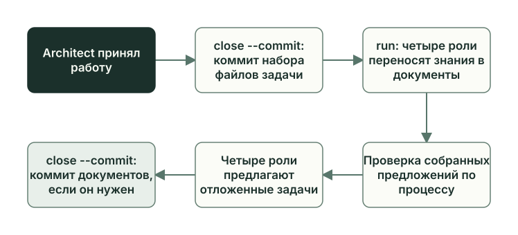

<!-- i18n: pair=docs/guides/learn/closeout.md pair-sha256=62bab51d6fab498069371bbee9c8696baf253fea9642070cddb8aef1ca854f31 self-sha256=1dd3178006197c57013e7f3f858c72b2fe52fa954ac14419a9f05e5dc8a52cbe -->
# Закрытие задачи

[English](closeout.md) · **Русский**

Architect принял работу, но задача ещё открыта: её файлы надо закоммитить, а то, что роли узнали по ходу, записать в документы проекта. В [sibling](glossary.ru.md) в режиме TUI оба шага идут в окне Manager: Architect коммитит набор файлов, те же роли закрывают документы, и, если закрытие этого требует, Architect коммитит документы. В ручном режиме в консоли Owner проходит их командами `planveyor sibling close` и `planveyor sibling run`.



## Коммит задачи

Коммит задачи берёт из точного набора файлов плана то, что изменилось: целевые файлы, которые поменяла задача, план, черновик, файл ревью и приложения к нему. Как набор складывается по ходу задачи, показано в главе [«План и его статусы»](plan-lifecycle.ru.md#набор-файлов-и-две-его-проверки).

В sibling коммит разрешает Owner. Сначала просмотр:

```sh
planveyor sibling close
```

Команда проверяет приёмку (что именно, перечислено в главе [«Ревью и приёмка»](review-acceptance.ru.md)), печатает список файлов и сообщение коммита и больше ничего не делает. Сообщение строится из заголовка плана: `plan: <заголовок>` и строка `Planveyor-Plan: <путь к плану>`; свой текст можно передать через `--message`. Прочитайте список и посмотрите изменения в редакторе. Если после просмотра правили файлы, повторите `close`. Правка целевого файла делает ревью устаревшим, и тогда `close` откажет и предложит `planveyor sibling run`.

Затем коммит:

```sh
planveyor sibling close --commit
```

Флаг `--commit` — разрешение Owner на этот набор. Команда повторяет проверки, ставит набор в индекс, переводит план в `Done` и коммитит только эти пути. Перед коммитом она ещё раз сверяет `HEAD`, индекс, файлы и ревью. Если что-то изменилось или проверка не прошла, коммита не будет: статус плана вернётся к прежнему, файлы набора могут остаться в индексе, и `close` нужно повторить. После коммита команда пишет: «План закоммичен. Следующий шаг: planveyor sibling run для документов.»

Когда роли запущены вне команд `planveyor sibling`, те же шаги делает Architect: сам ставит `Done` и коммитит набор (раздел [«Кто делает коммит»](review-acceptance.ru.md#кто-делает-коммит)).

## Раздел `## Post-merge gate`

В шаблоне каждого плана есть раздел `## Post-merge gate (before deleting plan)`. Это чек-лист на время после слияния в основную ветку, перед удалением временных планов и ревью: аудит после слияния, ревью диапазона, перенос решений в общие документы, отложенные задачи, ссылки на удаляемые файлы.

`close` проверяет план так, будто он уже в `Done`, а план в `Done` не может держать в этом разделе открытые пункты `- [ ]`. Пункт отмечают `- [x]`, когда он действительно выполнен и есть доказательство. Если задача закрывается локальным коммитом и слияния ещё не было, весь раздел пишут как `N/A (why=…)` с причиной. Раздел правит Architect. Если `close` отказал из-за него, верните ход Architect: `planveyor sibling architect`.

В задаче `GetReorderCandidates` первая проверка плана перед `Done` не прошла именно из-за этого раздела. Architect заменил чек-лист строкой «не применимо» с причиной:

```markdown
## Post-merge gate (before deleting plan)
N/A (why=задача закрывается локальным exact code commit без push/merge; post-merge audit и удаление временного плана не являются частью этого unmerged closeout и не считаются выполненными).
```

Сама проверка после слияния описана в главе [«Проверка после слияния»](postmerge.ru.md); в sibling для неё нет команды `planveyor sibling …`.

## Закрытие документов

После коммита роли сохраняют то, что узнали за время задачи, пока их сессии это помнят. Поэтому закрытие документов лучше вести в том же окне TUI, где шёл план: роли в нём те же. В ручном режиме закрытие документов запускает новый `planveyor sibling run`, и после коммита это уже новые Manager и роли: план они знают только по файлам ([«Сессии и коммиты»](../stack-sibling.ru.md#сессии-и-коммиты)). В обоих режимах Manager видит статус `Done` и обычно вызывает четыре роли в два этапа.

| Этап | Что делают роли | Кто записывает результат |
| --- | --- | --- |
| Общие документы (`general`) | Переносят решения и правила, которые стоит закрепить, в общие документы, объявленные проектом: описание архитектуры, данных, API, руководства. Каждая роль отдельным разделом ответа пишет, есть ли у неё предложение по процессу | Документы правят сами роли. Раздел о процессе Manager передаёт скрипту `process_improvements_collect.py`, и тот записывает предложение; об ошибке формата в этом разделе — в главе [«Как Planveyor меняет себя»](self-development.ru.md#предложения-по-процессу-pi) |
| Отложенные задачи (`followups`) | Предлагают работу на потом или объясняют, почему её нет | В планах текущей схемы (`plan.v2`) — скрипт `followups_apply.py` в формате `followups.v2`, когда ответят все четыре роли |

Роли идут в порядке Architect, Coder, Planner, Reviewer. Между этапами Manager проверяет, что предложения всех четырёх ролей собраны. Сам Manager документов не пишет: он вызывает роли и скрипты и проверяет их ответы. План, черновик, ревью, промпты и плейбуки после `Done` неизменны. Если роль хочет поменять процесс, она пишет предложение.

Предложение по процессу (PI) — запись из симптома, пробела в процессе, предлагаемого исправления, владельца и ссылки на источник. Если предложений нет, роль пишет одну строку `NO PROCESS IMPROVEMENTS — why: <причина>`. Записи задачи лежат в каталоге `docs/process_improvements/`, в файле `<имя плана>__process_improvements_backlog.md`; таблицы `index.md`, `deferred.md` и `promotion_surface.md` рядом скрипт пересобирает сам. Позже Architect разбирает запись, а Owner назначает ей приоритет (глава [«Как Planveyor меняет себя»](self-development.ru.md)).

В конце Manager вызывает скрипт закрытия `planveyor_docs_closeout`. Поле `state=completed` в его ответе относится к коммиту задачи. Закрыты ли документы, показывают поле `final_docs_commit` и состояния сбора предложений и отложенных задач. `final_docs_commit` бывает `required` — изменения есть и их нужно закоммитить, `no_op` — коммитить нечего, `landed` — коммит уже есть. Пока сбор не закончен, `close` отвечает «Документы ещё не закрыты» с причиной и предлагает `planveyor sibling run`.

Если документам нужен коммит, Owner разрешает его отдельно, той же парой команд. Пока план не в `Done`, `close` работает с набором задачи, после — с документами:

```sh
planveyor sibling close
planveyor sibling close --commit
```

`close` показывает набор документов, `close --commit` коммитит его с сообщением `docs(closeout): finalize <имя плана>` и сразу проверяет закрытие. Когда документы закрыты, с коммитом или без него, команда отвечает: «План и документы закрыты. Можно начать следующую задачу.» На этом сообщении задача закончена. Вне команд `planveyor sibling` этот коммит, если он нужен, делает Architect.

## Как это было: документы GetReorderCandidates

Через 48 минут после коммита кода `70526ee` коммит `edac1b9` закрыл документы; это было до команд `planveyor sibling` (см. [«Роли и файлы задачи»](roles-artifacts.ru.md)). Скрипт закрытия перед этим ответил `state=completed` и одновременно `final_docs_commit=required` с четырьмя изменёнными файлами. Вот они в выводе `git show --stat edac1b9`:

```text
commit edac1b9b8816229d7a1d05a4c007aea8bd6ba640
[…]
Date:   Mon Sep 28 03:05:51 2026 +0300

    docs(closeout): finalize 260928_0006_get_reorder_candidates

    Planveyor-Plan: docs/plans/260928_0006_get_reorder_candidates.md

 ...der_candidates__process_improvements_backlog.md | 45 ++++++++++++++++++++++
 docs/process_improvements/deferred.md              |  3 +-
 docs/process_improvements/index.md                 |  3 +-
 docs/process_improvements/promotion_surface.md     |  3 +-
 4 files changed, 51 insertions(+), 3 deletions(-)
```

Все четыре файла — об одном предложении по процессу. Новый файл `260928_0006_get_reorder_candidates__process_improvements_backlog.md` в каталоге `docs/process_improvements/` проекта хранит единственную запись PI-001. В трёх таблицах рядом появилось по строке о ней, и обновилось время сборки. Общие документы проекта роли не меняли. Отложенных задач тоже нет, и каждая из четырёх ролей объяснила почему. Reviewer, например, ответил, что ревью закончено без замечаний S1, S2 и S3, а замечание к плейбуку уже записано как предложение по процессу.

Запись PI-001:

```markdown
### PI-001
- status: `open`
- priority: `P?`
- role: `Architect`
- owner: `Architect`
- promotion_class: `canon_update`
[…]
- trigger_ref: `docs/code_reviews/260928_0006_get_reorder_candidates.md`
- source_ref: `docs/plans/260928_0006_get_reorder_candidates.md`
- symptom: `docs/playbooks/review_staged_or_commit.md требует proof текущего плана, но указывает однотестовый JUnit [предыдущей задачи].`
- process_gap: `При повторном использовании операторского proof Reviewer может принять исторический asset вместо текущего набора из восьми тестов.`
- suggested_fix: `В локальной секции playbook брать путь JUnit и точный набор тестов из текущего PLAN_PATH; сверять объявленный прямой proof порядка и байты источников без жёсткой ссылки на asset [предыдущей задачи].`
- created_at: `2026-09-28 02:39 MSK`
- triage_note: `auto-collected from memory-finalize general lane`
```

Плейбук ревью в этом проекте ссылался на отчёт JUnit предыдущей задачи с одним тестом. Ссылка стоит в том локальном разделе, который разрешает Reviewer не повторять прогон оператора ([«Sibling: создание и обновление»](sibling-lifecycle.ru.md#локальные-разделы)). Живой прогон этой задачи проверял восемь: семь тестов процедуры и прежний `SqlHarnessSmoke.test_schema_present`. Architect предложил брать путь к отчёту из текущего плана; `triage_note` показывает, что предложение пришло на этапе `general`. Пока оно сырое: статус `open`, приоритет не назначен (`P?`). Сам плейбук этот коммит не изменил, потому что при закрытии документов плейбуки не правят.

## План в `Done` без коммита

Закрытие документов начинается только после коммита задачи. Если план уже в `Done`, а его набор ещё не в истории, скрипт закрытия отвечает `blocked`: с причиной `semantic_closeout_commit_pending`, если весь набор уже в индексе, или `semantic_closeout_has_unstaged_delta`, если нет, например после ручного `Done`. В обоих случаях выполните `planveyor sibling close`: если приёмка Architect записана по правилам, команда покажет набор и предложит `close --commit`.

## Как проверить, что задача закрыта

```sh
planveyor sibling ready
```

`ready` в любой момент сначала проверяет контракт проекта, то есть файлы и правила, пришедшие из Planveyor, затем читает текущий план (его выбирают командой `planveyor sibling plan`) и проверяет его закрытие. Если всё закрыто, она отвечает: «Consumer contract и выбранный план закрыты. Готовность отдельного release или SQL не проверялась.» Если проверка контракта прошла, а план или документы ещё не закрыты, она называет следующую команду: `planveyor sibling run` или `planveyor sibling close`. Отказ проверки контракта или ошибка чтения текущего плана могут остановить команду с диагностикой без следующей команды. Проверки стека `ready` заново не запускает, публикацию и проверку после слияния не подтверждает. Опубликовать результат Owner может сам, командой `git push`.

## Что делает Owner

В режиме TUI коммиты и закрытие документов идут в окне Manager: Owner одобряет в нём запросы Architect на запись в `.git`, держит окно открытым, пока закрытие документов не закончится, а затем проверяет `planveyor sibling ready`. Описание основано на устройстве движка. Соответствующий маршрут проверен живыми проходами в самом Planveyor. В ручном режиме в консоли:

```sh
planveyor sibling close            # посмотреть набор файлов задачи
planveyor sibling close --commit   # коммит задачи
planveyor sibling run              # закрытие документов
planveyor sibling close            # посмотреть документы
planveyor sibling close --commit   # коммит документов, если он нужен
planveyor sibling ready            # убедиться, что всё закрыто
```

Если `close` остановился, причины и следующие шаги — в главе [«Ревью и приёмка»](review-acceptance.ru.md) и в разделе [«Если команда остановилась»](../stack-sibling.ru.md#если-команда-остановилась) руководства по sibling; полный порядок — в разделе [«Коммит и закрытие документов»](../stack-sibling.ru.md#коммит-и-закрытие-документов).

## Частые ошибки

- Owner держит в индексе свои файлы при `close --commit`: команда откажет и ничего не закоммитит.
- Owner правит руками таблицы `index.md`, `deferred.md` и `promotion_surface.md` в `docs/process_improvements/`: их пересобирает скрипт.

Функции и тесты, о которых шла речь, — в [справочнике по коду](code-map.ru.md#закрытие-задачи).

Дальше: [«Тесты и доказательства: чему можно доверять»](testing-evidence.ru.md).
