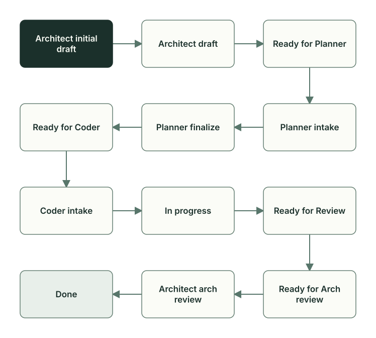

# The plan and its statuses

**English** · [Русский](plan-lifecycle.ru.md)

A plan is the task file in `docs/plans/`. It records the goal, the scope, the decisions, the questions, and the evidence log. The status in the plan header shows whose turn it is now: Manager, the coordinator, uses it to launch the next role, and you, the task owner (Owner), see where the task is.

## The plan file

The file name is the creation date and time and the topic: `docs/plans/YYMMDD_HHMM_topic.md`. This way, plans sort by creation time and do not get mixed up. The plan of the task “which products to reorder” is named `260928_0006_get_reorder_candidates.md`: it was created on September 28, 2026, at 00:06. The code draft and the review get the same name: `260928_0006_get_reorder_candidates__code_draft.md` in `docs/code_drafts/` and `260928_0006_get_reorder_candidates.md` in `docs/code_reviews/`.

The `$planveyor-plan-draft` skill in a Codex chat sets up the plan: it creates the plan from the [template](../../plans/_template.md) (in Russian) with the `Architect initial draft` status. Later, Planner makes the code draft from [its own template](../../code_drafts/_template.md) (in Russian). The roles Architect, Planner, Coder, and Reviewer and the sections that each of them writes are described in the [Roles and task files](roles-artifacts.md) chapter; the full status vocabulary is given in the [plan rules](../../plans/README.md) (in Russian).

In a [sibling](glossary.md), the task is driven in one of two modes: in the Manager window (TUI mode) or with the `planveyor sibling …` commands (manual console mode). Both work with one current plan, and you can make another plan current with `planveyor sibling plan docs/plans/YYMMDD_HHMM_topic.md`. A queue of several plans is a separate Manager mode, described in the [launch guide](../launch-and-role-modes.md).

## Statuses and who sets them



A status of the form `Ready for …` hands the work over to the next role. The other statuses are usually set by the role that is working now.

| Status | Who sets it | What happens |
| --- | --- | --- |
| `Architect initial draft` | Architect | Architect discusses the task with Owner and writes the `## Как я понял задачу` section (how I understood the task) |
| `Architect draft` | Architect | No more Owner decisions are needed; Architect writes up the plan by the template |
| `Ready for Planner` | Architect | The decisions are recorded; the plan is handed over to Planner |
| `Planner intake`, `Planner finalize` | Planner | Planner asks questions, then writes the code draft |
| `Ready for Coder` | Planner | The draft is ready; the preflight of the exact bundle of the plan has passed |
| `Coder intake`, `In progress` | Coder | Coder asks questions, then writes the code and runs the checks |
| `Ready for Review` | Coder | The code and the check results are ready for review |
| `Ready for Arch review` | Reviewer | The review is recorded; it is the turn of Architect |
| `Architect arch review` | Architect | Architect checks the review and decides whether to accept the work |
| `Done` | Architect or the `planveyor sibling close --commit` command | The work is accepted and committed |

Work can go back. With a question about the meaning of the task, a role sets `Ready for Architect response`; Architect answers in the `Architect response` status and returns the plan to `Ready for Planner`. Reviewer returns a gap in the plan to Planner with the `Planner finalize` status and an implementation error to Coder with the `In progress` status, and Architect, at acceptance, returns the work to Coder with the `Coder intake` status. Reviewer has intermediate statuses, for example `Reviewer visual review` for tasks with a user interface. A plan replaced by a new one is marked `Superseded` by Architect; plans in `Done` and `Superseded` are not resumed. The order of returns is described in the [Manager rules](../../roles/manager.md).

`Done` is written together with the commit: the status is set right before the commit, and if the commit fails, `Architect arch review` is restored. When the roles are launched with the `planveyor sibling` commands, `planveyor sibling close --commit` does this after your preview; in other launches, Architect does it (the [Who makes the commit](review-acceptance.md#who-makes-the-commit) section).

Closeout takes two steps: the task commit and the docs closeout. In the second step, the roles carry over into the shared project documents what is worth keeping, and propose follow-ups. The task is finished when `close` answers `План и документы закрыты` (the plan and the documents are closed); the order of commands is in the [Task closeout](closeout.md) chapter. The plan itself is deleted after the merge into the main branch, when Owner decides so.

## What Oracle reads and reports

Oracle is the `scripts/plan_status_oracle.py` script; from the command line, `planveyor_plan_status_oracle` calls it. Oracle reads the plan and the files linked to it and changes nothing in them. Manager chooses the next role by its answer, and you see the same answer in a short form through `planveyor sibling plan`.

Oracle takes the status only from the header, from the single `**Status:**` line; if there are two such lines, it exits with code 3 and prints both. A `Done` entry in a log or in a role's message does not change the status. Oracle also reads the Q&A log, the review file, and the service block `## Meta`. In this block, Architect records the `machine_authority_decision`: whether the task brings a new machine-readable record or format by which Planveyor scripts admit, route, record, or close work on their own. An ordinary task needs only the short form `not_applicable` with a reason; in GetReorderCandidates, the reason is `no_machine_authority_change`. The full form describes the record itself: where it lies, who writes and reads it, and what happens on an error. Owner confirms it with an answer in the Q&A log. While the decision is missing, unconfirmed, rejected, or recorded twice, the plan linter and Oracle do not let the plan go to Planner ([format](../../plans/README.md#machine-authority-admission)).

In the answer with the `--json` flag, the fields people look at most often are the status (`status_norm`), the open questions to Owner (`open_owner_questions`), and the review state (`review_readback_state`). The `route_guard_triggered` field means that Oracle has found a contradiction and the work cannot go on by the current status; `route_guard_reason` and `route_guard_next_owner` name the reason and the role to which the work will return. The [Lifecycle and packets](../lifecycle-and-packets.md) guide shows how to call Oracle for your project.

## The bundle and its two checks

The exact bundle of a plan is precisely the paths that are checked together; the changed ones among them go into the task commit. The `planveyor_plan_bundle` script builds it only from explicitly named paths:

- the target files from `code_draft_meta.targets` in the code draft and the files to delete from `code_draft_meta.deleted_paths`: these may already be gone from the disk, but they must be in the last commit;
- the plan itself and the code draft;
- the review file from the `## Review artifacts` section of the plan;
- the review assets: the files from `docs/code_reviews/assets/…` that the review links to, and the risk lane report that the evidence log links to.

Other changed files of the working tree do not go into the task commit. This decision is recorded in [ADR 004](../../adr/004-exact-bundle-truth-and-closeout.md) (in Russian).

The plan is part of the bundle but is never a target file: Reviewer records the checksum of the target files ([how it works](review-acceptance.md#the-review-file)) and then itself appends the entry of its lane to the evidence log, so the checksum of the plan would go stale at once. The plan linter (the `scripts/plan_lint.py` script, the `planveyor_plan_lint` command) rejects such a draft with the `origin_plan_in_review_targets` error ([rule](../../plans/README.md#planner-finalize-exact-executable-bundle-sync)).

The bundle is checked twice. The preflight finds mismatches in the list before Coder starts work. The final check, after review, confirms that everything that goes into the commit is in place.

| | Preflight | Final check |
| --- | --- | --- |
| Command | `planveyor_plan_bundle --preflight` | `planveyor_plan_bundle --check` |
| Who runs it and when | Planner before `Ready for Coder` | Reviewer and Architect after review |
| Review file | may not exist yet, marked `PLANNED` | must exist |
| Target files, plan, draft | must exist | must exist |

If a declared file is not on disk, the check marks it `MISSING-PATH` and exits with an error. At the preflight, this is a target file that does not exist yet or no longer exists: the list in the draft has diverged from the disk. Planner either fixes the list or, in place of a new file, creates a stub with a link to the plan and the `replace before Ready for Review` mark, and Coder replaces it before review. At the final check, the review becomes required too: without its file, the task will not close until Reviewer writes it.

Besides these two checks, Reviewer runs `planveyor_plan_bundle --scope-check` before the diff. This command checks only the composition and the integrity of the bundle and prints one JSON document `planveyor_plan_bundle_scope.v1`. Exit code 0 means only `scope_ok=true`: the bundle does not become green from it, and the check gives no right to hand off the work or to commit; an ordinary scope problem, for example a missing target file, gives code 1. A review file that is declared but not written yet, and a red or stale review remain a debt of the task. The strict final `--check` after review stays as before.

## The evidence log and questions

The `## Evidence` section is the evidence log: roles append to its end what they ran and with what result. An item in the `## Acceptance criteria / DoD` section is marked `[x]` only on the basis of an entry in the log or a file with the result.

Questions go into the Q&A log, the `## Q&A log` section: the number, whom the question is for, whether it blocks the work (`blocker`), whether Owner is needed (`needs_owner`), and `status=open`. Usually the role that asked the question closes it with a `status=closed` line, and closes a reworded question with a `status=superseded` line. An answer in the chat does not count as closing, and with open questions, the linter does not let the plan into `Done`.

For an ordinary question to you, `planveyor sibling answer` writes your answer into the Q&A log with a timestamp and closes the question. If the question is reserved for confirming `machine_authority_decision`, the command passes your answer to Architect without closing the question itself. If there are several questions, name the number, for example `planveyor sibling answer Q2`; the command asks you to type the answer text. If there are no open questions and the plan is still in `Architect initial draft`, the command shows the `## Как я понял задачу` section and passes your decision to Architect for the next turn, which `planveyor sibling architect` starts.

## How it went: the GetReorderCandidates plan

The task ran on September 28, 2026, before the `planveyor sibling` commands existed: Architect set `Done` and made the commit itself. Who did what is told in the [Roles and task files](roles-artifacts.md) chapter; here is how the plan itself changed.

| Time | Status | What happened |
| --- | --- | --- |
| 00:06 | `Architect initial draft` | Architect created the plan |
| 00:13 | `Ready for Planner` | The linter passed on the second attempt; there was nothing to decide with Owner, and the plan was handed over without `Architect draft` |
| 00:21 | `Ready for Coder` | Planner went through `Planner intake` and `Planner finalize`; the preflight counted 19 files |
| 01:05 | `In progress` | Coder wrote the code; the status stayed `In progress` until the check on the dev database |
| 01:40 | `Ready for Review` | The second run on the dev database passed, and Coder handed over the work |
| 01:54 | `Ready for Arch review` | A review without findings; the final check counted 22 files |
| 01:58 | `Architect arch review` | The linter did not let the plan into `Done` because of the `## Post-merge gate` section |
| 02:03–02:09 | `Done`, then `Architect arch review` again | The first closeout attempt did not create a commit, and Architect restored the status |
| 02:14–02:17 | `Done` | The second attempt: commit `70526ee` with the plan in the `Done` status |

The first handoffs remained in the log like this, quoted as written in the project, in Russian (rc is the return code of a command; the excerpts are shortened):

```markdown
- 2026-09-28 00:13 MSK: первый `planveyor_plan_lint` rc1 указал три недостатка формы
  (`Rollout packet handoff`, `Mode`, `Terminal outcome`); они исправлены. Повторный lint rc0
  с единственным ожидаемым WARN: Planner-owned code draft ещё не создан. …
- 2026-09-28 00:19 MSK (Planner): первый … `plan_lint` дал `rc=1` из-за отсутствовавшего в новом
  draft явного `NO SUGGESTIONS` review stamp; stamp добавлен. `planveyor_plan_bundle --preflight`
  дал `rc=0`, 19 paths, 16 targets, один repo root, 0 issues, review artifact `PLANNED`. …
  oracle: `status_norm=planner finalize`, `route_guard_triggered=false`, …,
  `owner_qna_readback_state=clean`.
- 2026-09-28 00:20 MSK (Planner): после review stamp … `plan_lint` дал `rc=0`; повторный
  `planveyor_plan_bundle --preflight` дал `rc=0`, 19 paths, 16 targets, 0 issues, review
  artifact `PLANNED`. …
```

The plan linter stopped the handoff twice because of the form. First, it found three form defects in the plan of Architect. Then Planner wrote “no suggestions” (`NO SUGGESTIONS`) in the plan but did not put the matching mark in the code draft, which the linter requires in this case. Both times, the role fixed the file and repeated the check, and both attempts remained in the log. The Oracle entries confirm the status and that there are no blocks and no open questions to Owner.

The two new SQL files did not exist yet at this step, and the preflight would have marked them `MISSING-PATH`, so Planner created stubs in their place.

By the final check, the bundle had grown from 19 to 22 files because of three review assets:

| Where the path comes from | Preflight, 00:19 | Final check, after review |
| --- | --- | --- |
| `code_draft_meta.targets`: 6 files to change and 10 unchanged files that the check depends on | 16 | 16 |
| The plan and the code draft | 2 | 2 |
| The review file from `## Review artifacts` | 1, marked `PLANNED` | 1 |
| Assets: the operator receipt for the run on the dev database, the JUnit report, the report of the Reviewer risk lane | — | 3 |
| Total | 19 | 22 |

At 01:58, Architect checked whether the linter would accept the plan in the `Done` status, without changing the file itself:

```markdown
- 2026-09-28 01:58 MSK (Architect pre-Done lint): public `planveyor_plan_lint --as-status Done`
  дал `rc=1` только из-за открытого template `## Post-merge gate`. Локальный slice ещё не merged
  и не имеет Owner-only push/merge; gate ниже явно `N/A`, без ложного зачёта будущего аудита.
  Status сохранён `Architect arch review`, stage/commit до исправления не выполнялись.
```

Open items of `## Post-merge gate` are not allowed in `Done`, and Architect replaced the section with an `N/A` line with a reason (the rule and the text are in the [Task closeout](closeout.md) chapter).

After that, the check passed, and Architect wrote `Done`. The first closeout attempt at 02:09 did not create a commit: following a wrong instruction from the operator, Architect called the `--commit-exact` mode, which is meant for the documents commit ([Task closeout](closeout.md#docs-closeout)). Architect removed `Done` and restored `Architect arch review`, repeated the closeout the usual way at 02:14, and at 02:17, commit `70526ee` carried the plan with the `Done` status. Now, when the roles are launched with the `planveyor sibling` commands, `planveyor sibling close --commit` does these steps and runs the same linter before it writes `Done`.

## What Owner does

```sh
planveyor sibling plan
planveyor sibling plan docs/plans/YYMMDD_HHMM_topic.md
planveyor sibling answer Q2
```

`planveyor sibling plan` prints the current plan, the status, the open questions to you with their numbers, and the next step: `answer`, `architect`, `run`, `close`, or the stop reason from Oracle; with a file path, the command makes another plan current. The full order of commands is described in the [stack sibling guide](../stack-sibling.md).

## Common mistakes

- Editing the status in the header by hand to move the task along. The status is set by the role whose step it is, and `Done` by Architect or `close --commit`. A known exception is the deadlock after a Reviewer question to Architect: for now, Owner sets the `Ready for Architect response` status personally (F49 in the [What works now and what comes next](capabilities-boundaries.md#limits-of-the-first-version) chapter).
- Adding a directory or files “for context” to the target files. Only the files that the task changes or that its check depends on can be targets.
- Starting the next plan without closing the documents of the current one. The commands work with the current plan and will not remind you of the earlier one.

The functions and tests mentioned here are in the [code map](code-map.md#the-plan-and-its-statuses).

Next: [Development, analysis, and decomposition](work-contours.md).
