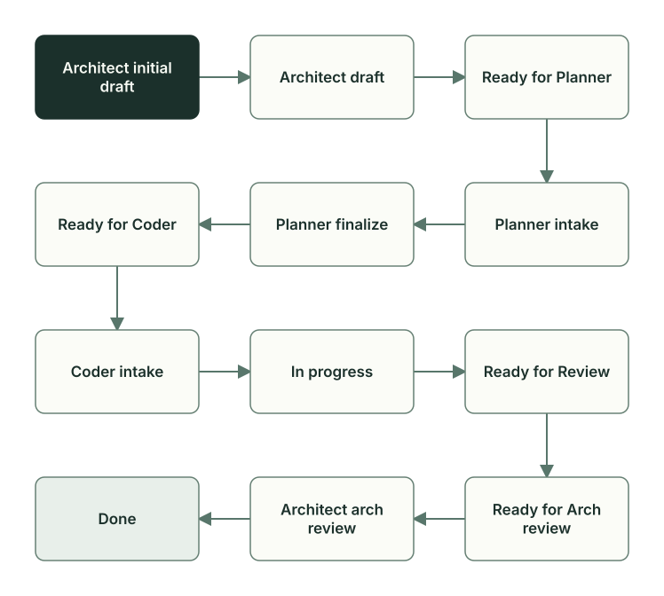

<!-- i18n: pair=docs/guides/learn/plan-lifecycle.md pair-sha256=da26b6bd887b4188134e8e39257429e3491c954c12e0d4eae1023d47df5a5673 self-sha256=6761198bc3a021f829185bfc5d502dbbad5698df5f28d0967586fc8ef8debd24 -->
# План и его статусы

[English](plan-lifecycle.md) · **Русский**

План — файл задачи в `docs/plans/`. В нём записаны цель, границы задачи, решения, вопросы и журнал проверок. Статус в шапке плана показывает, чей сейчас ход: по нему координатор Manager запускает следующую роль, а вы, владелец задачи (Owner), видите, где она.

## Файл плана

Имя файла — дата и время создания и тема: `docs/plans/YYMMDD_HHMM_topic.md`. Так планы сортируются по времени создания и не путаются. План задачи «какие товары пора пополнить» называется `260928_0006_get_reorder_candidates.md`: его создали 28 сентября 2026 года в 00:06. Черновик кода и ревью получают то же имя: `260928_0006_get_reorder_candidates__code_draft.md` в `docs/code_drafts/` и `260928_0006_get_reorder_candidates.md` в `docs/code_reviews/`.

План заводит скилл `$planveyor-plan-draft` в чате Codex: он создаёт план по [шаблону](../../plans/_template.md) со статусом `Architect initial draft`. Черновик кода Planner позже делает по [своему шаблону](../../code_drafts/_template.md). Роли Architect, Planner, Coder и Reviewer и разделы, которые пишет каждая, описывает глава [«Роли и файлы задачи»](roles-artifacts.ru.md); полный словарь статусов приводят [правила планов](../../plans/README.md).

В [sibling](glossary.ru.md) задачу ведут в одном из двух режимов: в окне Manager (режим TUI) или командами `planveyor sibling …` (ручной режим в консоли). Оба работают с одним текущим планом, а сделать текущим другой можно командой `planveyor sibling plan docs/plans/YYMMDD_HHMM_topic.md`. Очередь из нескольких планов — отдельный режим Manager, его описывает [руководство запуска](../launch-and-role-modes.ru.md).

## Статусы и кто их ставит



Статус вида `Ready for …` передаёт работу следующей роли. Остальные статусы обычно ставит роль, которая сейчас работает.

| Статус | Кто ставит | Что происходит |
| --- | --- | --- |
| `Architect initial draft` | Architect | Architect обсуждает задачу с Owner и пишет раздел «Как я понял задачу» |
| `Architect draft` | Architect | Решений Owner больше не нужно, Architect оформляет план по шаблону |
| `Ready for Planner` | Architect | Решения записаны, план передан Planner |
| `Planner intake`, `Planner finalize` | Planner | Planner задаёт вопросы, затем составляет черновик кода |
| `Ready for Coder` | Planner | Черновик готов, предварительная проверка точного набора файлов плана пройдена |
| `Coder intake`, `In progress` | Coder | Coder задаёт вопросы, затем пишет код и запускает проверки |
| `Ready for Review` | Coder | Код и результаты проверок готовы к ревью |
| `Ready for Arch review` | Reviewer | Ревью записано, ход Architect |
| `Architect arch review` | Architect | Architect проверяет ревью и решает, принять ли работу |
| `Done` | Architect или команда `planveyor sibling close --commit` | Работа принята и закоммичена |

Работа может вернуться. С вопросом по смыслу задачи роль ставит `Ready for Architect response`; Architect отвечает в статусе `Architect response` и возвращает план в `Ready for Planner`. Пробел в плане Reviewer возвращает Planner статусом `Planner finalize`, ошибку реализации — Coder статусом `In progress`, а Architect при приёмке возвращает работу Coder статусом `Coder intake`. У Reviewer есть промежуточные статусы, например `Reviewer visual review` для задач с интерфейсом. План, который заменил новый, Architect помечает `Superseded`; планы в `Done` и `Superseded` не возобновляют. Порядок возвратов описывают [правила Manager](../../roles/manager.md).

`Done` записывают вместе с коммитом: статус ставят прямо перед коммитом, а если коммит не получился, возвращают `Architect arch review`. Когда роли запущены командами `planveyor sibling`, это делает `planveyor sibling close --commit` после вашего просмотра, при других запусках — сам Architect (раздел [«Кто делает коммит»](review-acceptance.ru.md#кто-делает-коммит)).

Закрытие идёт в два шага: коммит задачи и закрытие документов. Во втором шаге роли переносят в общие документы проекта то, что стоит закрепить, и предлагают отложенные задачи. Задача закончена, когда `close` ответит «План и документы закрыты»; порядок команд — в главе [«Закрытие задачи»](closeout.ru.md). Сам план удаляют после слияния в основную ветку, по решению Owner.

## Что читает и сообщает Oracle

Oracle — скрипт `scripts/plan_status_oracle.py`, из командной строки его вызывает `planveyor_plan_status_oracle`. Oracle читает план и связанные с ним файлы и ничего в них не меняет. По его ответу Manager выбирает следующую роль, а вы видите тот же ответ в сжатом виде через `planveyor sibling plan`.

Статус Oracle берёт только из шапки, из единственной строки `**Status:**`; если таких строк две, он завершается с кодом 3 и печатает обе. Запись `Done` в журнале или в сообщении роли статус не меняет. Ещё Oracle читает журнал вопросов, файл ревью и служебный блок `## Meta`. В этом блоке Architect записывает решение `machine_authority_decision`: появляется ли в задаче новая машиночитаемая запись или формат, по которым скрипты Planveyor сами пропускают, направляют, записывают или закрывают работу. Обычной задаче хватает короткой формы `not_applicable` с причиной; в GetReorderCandidates это `no_machine_authority_change`. Полная форма описывает саму запись: где она лежит, кто её пишет и читает, что будет при ошибке. Её подтверждает Owner ответом в журнале вопросов. Пока решения нет, оно не подтверждено, отклонено или записано дважды, линтер плана и Oracle не пускают план к Planner ([формат](../../plans/README.md#machine-authority-admission)).

В ответе с ключом `--json` чаще всего смотрят на статус (`status_norm`), открытые вопросы к Owner (`open_owner_questions`) и состояние ревью (`review_readback_state`). Поле `route_guard_triggered` значит, что Oracle нашёл противоречие и по текущему статусу работать дальше нельзя; причину и роль, к которой вернётся работа, называют `route_guard_reason` и `route_guard_next_owner`. Как вызвать Oracle для своего проекта, показывает руководство [«Жизненный цикл и пакеты»](../lifecycle-and-packets.ru.md).

## Набор файлов и две его проверки

Точный набор файлов плана — ровно те пути, которые проверяют вместе; в коммит задачи из них попадают изменённые. Скрипт `planveyor_plan_bundle` собирает его только из явно названных путей:

- целевые файлы из `code_draft_meta.targets` в черновике кода и удаляемые файлы из `code_draft_meta.deleted_paths`: их на диске уже может не быть, но они должны быть в последнем коммите;
- сам план и черновик кода;
- файл ревью из раздела плана `## Review artifacts`;
- приложения к ревью: файлы из `docs/code_reviews/assets/…`, на которые ссылается ревью, и отчёт линии рисков, на который ссылается журнал проверок.

Другие изменённые файлы рабочей копии в коммит задачи не войдут. Это решение записано в [ADR 004](../../adr/004-exact-bundle-truth-and-closeout.md).

План входит в набор, но целевым файлом не бывает: Reviewer фиксирует контрольную сумму целевых файлов ([как она устроена](review-acceptance.ru.md#файл-ревью)) и сам же дописывает в журнал проверок запись своей линии, так что сумма плана сразу бы устарела. Линтер плана (скрипт `scripts/plan_lint.py`, команда `planveyor_plan_lint`) отклоняет такой черновик с ошибкой `origin_plan_in_review_targets` ([правило](../../plans/README.md#planner-finalize-exact-executable-bundle-sync)).

Набор проверяют дважды. Предварительная проверка находит расхождения в списке до того, как Coder начнёт работу. Финальная после ревью подтверждает, что на месте всё, что пойдёт в коммит.

| | Предварительная проверка | Финальная проверка |
| --- | --- | --- |
| Команда | `planveyor_plan_bundle --preflight` | `planveyor_plan_bundle --check` |
| Кто и когда запускает | Planner перед `Ready for Coder` | Reviewer и Architect после ревью |
| Файл ревью | может ещё не существовать, помечается `PLANNED` | должен существовать |
| Целевые файлы, план, черновик | должны существовать | должны существовать |

Если объявленного файла нет на диске, проверка помечает его `MISSING-PATH` и завершается с ошибкой. На предварительной проверке это целевой файл, которого ещё нет или уже нет: список в черновике разошёлся с диском. Planner либо исправляет список, либо создаёт на месте нового файла заглушку со ссылкой на план и пометкой `replace before Ready for Review`, и Coder заменяет её до ревью. На финальной проверке обязательным становится и ревью: без его файла задача не закроется, пока Reviewer его не напишет.

Кроме этих двух проверок, перед diff Reviewer запускает `planveyor_plan_bundle --scope-check`. Эта команда проверяет только состав и целостность набора и печатает один JSON-документ `planveyor_plan_bundle_scope.v1`. Код выхода 0 означает только `scope_ok=true`: зелёным набор от этого не становится, и права передать работу или коммитить проверка не даёт; обычная ошибка состава набора, например отсутствующий целевой файл, даёт код 1. Объявленный, но ещё не написанный файл ревью и красное или устаревшее ревью остаются долгом задачи. Строгая финальная проверка `--check` после ревью остаётся прежней.

## Журнал проверок и вопросы

Раздел `## Evidence` — журнал проверок: роли дописывают в его конец, что запускали и с каким результатом. Пункт в разделе `## Acceptance criteria / DoD` отмечают `[x]` только по записи в журнале или файлу с результатом.

Вопросы пишут в журнал вопросов, раздел `## Q&A log`: номер, кому вопрос, блокирует ли он работу (`blocker`), нужен ли Owner (`needs_owner`) и `status=open`. Закрывает вопрос обычно роль, которая его задала, строкой `status=closed`, а переформулированный вопрос — строкой `status=superseded`. Ответ в чате закрытием не считается, и с открытыми вопросами линтер не пустит план в `Done`.

Для обычного вопроса к вам команда `planveyor sibling answer` записывает ответ в журнал вопросов с отметкой времени и закрывает вопрос. Если вопрос зарезервирован для подтверждения `machine_authority_decision`, команда передаёт ответ Architect, не закрывая вопрос сама. Если вопросов несколько, назовите номер, например `planveyor sibling answer Q2`; текст ответа команда попросит ввести. Если открытых вопросов нет, а план ещё в `Architect initial draft`, команда покажет раздел «Как я понял задачу» и передаст ваше решение Architect к следующему ходу, который запускает `planveyor sibling architect`.

## Как это было: план GetReorderCandidates

Задачу вели 28 сентября 2026 года, до команд `planveyor sibling`: `Done` и коммит делал сам Architect. Кто что сделал, рассказано в главе [«Роли и файлы задачи»](roles-artifacts.ru.md); здесь — как менялся сам план.

| Время | Статус | Что произошло |
| --- | --- | --- |
| 00:06 | `Architect initial draft` | Architect создал план |
| 00:13 | `Ready for Planner` | Линтер прошёл со второй попытки; решать с Owner было нечего, и план передан без `Architect draft` |
| 00:21 | `Ready for Coder` | Planner прошёл `Planner intake` и `Planner finalize`; предварительная проверка насчитала 19 файлов |
| 01:05 | `In progress` | Coder написал код; статус остался `In progress` до проверки на dev-базе |
| 01:40 | `Ready for Review` | Второй прогон на dev-базе прошёл, Coder передал работу |
| 01:54 | `Ready for Arch review` | Ревью без замечаний; финальная проверка насчитала 22 файла |
| 01:58 | `Architect arch review` | Линтер не пустил план в `Done` из-за раздела `## Post-merge gate` |
| 02:03–02:09 | `Done`, затем снова `Architect arch review` | Первая попытка закрытия не создала коммит, Architect вернул статус |
| 02:14–02:17 | `Done` | Вторая попытка: коммит `70526ee` с планом в статусе `Done` |

Первые передачи остались в журнале так (rc — код возврата команды; отрывки сокращены):

```markdown
- 2026-09-28 00:13 MSK: первый `planveyor_plan_lint` rc1 указал три недостатка формы
  (`Rollout packet handoff`, `Mode`, `Terminal outcome`); они исправлены. Повторный lint rc0
  с единственным ожидаемым WARN: Planner-owned code draft ещё не создан. …
- 2026-09-28 00:19 MSK (Planner): первый … `plan_lint` дал `rc=1` из-за отсутствовавшего в новом
  draft явного `NO SUGGESTIONS` review stamp; stamp добавлен. `planveyor_plan_bundle --preflight`
  дал `rc=0`, 19 paths, 16 targets, один repo root, 0 issues, review artifact `PLANNED`. …
  oracle: `status_norm=planner finalize`, `route_guard_triggered=false`, …,
  `owner_qna_readback_state=clean`.
- 2026-09-28 00:20 MSK (Planner): после review stamp … `plan_lint` дал `rc=0`; повторный
  `planveyor_plan_bundle --preflight` дал `rc=0`, 19 paths, 16 targets, 0 issues, review
  artifact `PLANNED`. …
```

Линтер плана дважды остановил передачу из-за формы. Сначала он нашёл три недочёта в плане Architect. Потом Planner записал в плане «предложений нет» (`NO SUGGESTIONS`), а в черновике кода не поставил ответную отметку, которую линтер в таком случае требует. Оба раза роль исправила файл и повторила проверку, и обе попытки остались в журнале. Записи Oracle подтверждают статус и то, что блокировок и открытых вопросов к Owner нет.

Двух новых SQL-файлов на этом шаге ещё не было, и предварительная проверка отметила бы их `MISSING-PATH`, поэтому Planner создал на их месте заглушки.

К финальной проверке набор вырос с 19 до 22 файлов за счёт трёх приложений к ревью:

| Откуда путь | Предварительная проверка, 00:19 | Финальная проверка, после ревью |
| --- | --- | --- |
| `code_draft_meta.targets`: 6 изменяемых и 10 неизменных файлов, от которых зависит проверка | 16 | 16 |
| План и черновик кода | 2 | 2 |
| Файл ревью из `## Review artifacts` | 1, помечен `PLANNED` | 1 |
| Приложения: квитанция оператора о прогоне на dev-базе, отчёт JUnit, отчёт линии рисков Reviewer | — | 3 |
| Всего | 19 | 22 |

В 01:58 Architect проверил, примет ли линтер план в статусе `Done`, не меняя сам файл:

```markdown
- 2026-09-28 01:58 MSK (Architect pre-Done lint): public `planveyor_plan_lint --as-status Done`
  дал `rc=1` только из-за открытого template `## Post-merge gate`. Локальный slice ещё не merged
  и не имеет Owner-only push/merge; gate ниже явно `N/A`, без ложного зачёта будущего аудита.
  Status сохранён `Architect arch review`, stage/commit до исправления не выполнялись.
```

Открытые пункты `## Post-merge gate` в `Done` недопустимы, и Architect заменил раздел строкой `N/A` с причиной (правило и текст — в главе [«Закрытие задачи»](closeout.ru.md)).

После этого проверка прошла, и Architect записал `Done`. Первая попытка закрытия в 02:09 коммит не создала: по ошибочной инструкции оператора Architect вызвал режим `--commit-exact`, рассчитанный на коммит документов ([«Закрытие задачи»](closeout.ru.md#закрытие-документов)). Architect снял `Done` и вернул `Architect arch review`, в 02:14 повторил закрытие обычным путём, и в 02:17 коммит `70526ee` унёс план со статусом `Done`. Сейчас, когда роли запущены командами `planveyor sibling`, эти шаги делает `planveyor sibling close --commit` и перед записью `Done` запускает тот же линтер.

## Что делает Owner

```sh
planveyor sibling plan
planveyor sibling plan docs/plans/YYMMDD_HHMM_topic.md
planveyor sibling answer Q2
```

`planveyor sibling plan` печатает текущий план, статус, открытые вопросы к вам с номерами и следующий шаг: `answer`, `architect`, `run`, `close` или причину остановки от Oracle; с путём к файлу команда делает текущим другой план. Полный порядок команд описывает [руководство по sibling](../stack-sibling.ru.md).

## Частые ошибки

- Править статус в шапке вручную, чтобы сдвинуть задачу. Статус ставит роль, чей это шаг, а `Done` — Architect или `close --commit`. Известное исключение — тупик после вопроса Reviewer к Architect: статус `Ready for Architect response` пока ставит сам Owner (F49 в главе [«Что уже работает и что дальше»](capabilities-boundaries.ru.md#границы-первой-версии)).
- Вписывать в целевые файлы каталог или файлы «для контекста». Целевыми бывают только файлы, которые задача меняет или на которых держится её проверка.
- Браться за следующий план, не закрыв документы текущего. Команды работают с текущим планом и о прежнем не напомнят.

Функции и тесты, о которых шла речь, — в [справочнике по коду](code-map.ru.md#план-и-его-статусы).

Дальше: [«Разработка, анализ и декомпозиция»](work-contours.ru.md).
