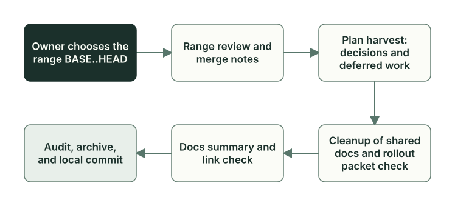

# Проверка после слияния

Эта глава для тех, кто сопровождает сам Planveyor. Если вы ведёте задачи в sibling, из этой темы вам сейчас нужен только раздел `## Post-merge gate` вашего плана; он разобран в главе [«Закрытие задачи»](closeout.md).

Проверка после слияния берёт диапазон коммитов `BASE..HEAD`, который уже попал в основную ветку, и смотрит на него целиком. Ревью каждой задачи видело только точный набор файлов своего плана, а после слияния ветки сошлись, конфликты разрешены и задачи работают вместе. Заодно проверка забирает из временных планов и ревью решения, правила и отложенную работу, прежде чем эти файлы удалят.

## Где она работает

Из коробки проверка после слияния сейчас работает только в самом Planveyor. В sibling для неё нет команды `planveyor sibling …`. Низкоуровневые команды фасад принимает и там, но им нужны два файла настроек в каталоге `docs/_meta/` проекта: `planveyor_merge_gate_policy.v1.json` и `review_range_policy.v1.json`. Шаблон sibling их не создаёт, и руководство по sibling не объясняет, как их написать. Когда эти файлы есть, движок создаёт и трекер, и план ревью диапазона, это проверяют его тесты. Целиком в sibling эту проверку ещё никто не проводил.

## Шаги

Проверку ведёт Manager в отдельном режиме merge. Порядок шагов хранит трекер слияния, локальный файл `.planveyor.merge_tracker.md`; его не коммитят. Следующий шаг Manager каждый раз узнаёт у скрипта `merge_tracker_oracle.py`. В работе у него одна роль за раз, а при любой ошибке скрипта он останавливается и возвращает ход Owner.



| Шаг трекера | Кто выполняет | Что получается |
| --- | --- | --- |
| `review_range` | Reviewer в две линии, затем Architect | Ревью диапазона и решение Architect по нему |
| `merge_notes` | Architect | Заметки о том, что вошло в диапазон |
| `plan_harvest` | Architect | Отчёт о сборе: решения и отложенная работа из планов и ревью диапазона |
| `canon_sweep` | Architect | Общие документы Planveyor сокращены до сути со ссылками; квитанция об этом |
| `packetization_gate` | Скрипт | Отчёт о пакетах адресной доставки (о них ниже) |
| `docs_finalize` | Architect | Квитанция с разделом предложений по процессу |
| `doc_lint` | Скрипт | Проверка ссылок и формата документов |
| `post_merge_audit` | Architect | Аудит: требования сверены с кодом, проверками, документами и ревью диапазона |
| `docs_hygiene_archive` | Скрипт | Закрытые планы диапазона, их черновики и ревью сохранены в поисковый архив |
| `docs_hygiene_suggest` | Скрипт | Список файлов, которые можно удалить, и готовая команда для Owner |
| `ready_to_push` | Скрипт | Итоговые квитанции и локальный коммит файлов проверки |

Квитанция здесь — файл в `docs/reviews/` с записью о выполненном шаге. Скрипты запускает Manager. Файл политики проекта может добавить свои шаги, например проверку миграций. Готовность всего диапазона подтверждает отчёт `planveyor_merge_bundle_report`: Manager запускает его на шаге `ready_to_push`, когда остальные шаги пройдены. После этого скрипт шага коммитит локально файлы проверки, которые принял отчёт, вместе с итоговыми квитанциями. `git push` делает Owner.

## Кто что делает

| Участник | Что делает |
| --- | --- |
| Owner | Выбирает диапазон или ветку для слияния. Отвечает, когда Manager остановился. Делает `git push` после локального коммита. Решает, удалять ли временные файлы, и удаляет их отдельным коммитом |
| Manager | Проходит шаги трекера по порядку, вызывает роли и скрипты. Отчётов ревью и аудита не пишет |
| Reviewer | Проверяет диапазон теми же двумя линиями, что и отдельную задачу |
| Architect | Разбирает ревью диапазона, пишет заметки, отчёт о сборе, квитанцию по документам и аудит, чистит общие документы |
| Coder | Разрешает конфликты при слиянии и чинит объявленную проектом проверку миграций |
| Planner | В этом режиме не участвует |

Кандидатов на удаление выдаёт скрипт шага `docs_hygiene_suggest`, а Architect в аудите сводит точный список и проверяет, что на эти файлы не останется ссылок.

## Слияние и запуск

Ветку можно слить вручную или поручить это Manager:

```sh
./bin/planveyor planveyor_merge_apply_collab_cmd --from <ветка>
```

Manager сливает ветку без `git push`. Конфликты разрешает Coder, а конфликт в опасных путях, например в миграциях или настройках окружения, сразу возвращается Owner. После слияния Manager сам переходит к проверке. Если ветка уже слита, проверку запускают отдельно:

```sh
./bin/planveyor planveyor_merge_collab_cmd --range <BASE>..<HEAD>
```

Вместо диапазона можно передать коммит слияния (`--range <MERGE_SHA>`) или `--range auto`: тогда берётся последний коммит слияния. Интерактивный вариант — `./bin/planveyor planveyor_merge_collab_tui`. Если Manager остановился, прочитайте названный шаг и причину, исправьте и запустите команду снова без `--range`: Manager продолжит по тому же трекеру.

Временные планы и ревью Owner удаляет отдельным коммитом, когда решит. Перед этим он заново запускает архив и список кандидатов для того же диапазона, потому что после проверки в документах могли появиться правки:

```sh
./bin/planveyor planveyor_docs_hygiene_archive --range <BASE>..<HEAD> --apply
./bin/planveyor planveyor_docs_hygiene_suggest --range <BASE>..<HEAD>
```

## Ревью диапазона

На шаге `review_range` скрипт `planveyor_review_range_init` заводит план типа `review-only` с черновиком кода и записывает в плане путь к файлу ревью: в `docs/doc_reviews/`, если в диапазоне только документы, иначе в `docs/code_reviews/`. Отчёт пишет Reviewer, по шаблону `_template_merge_range.md` и теми же двумя линиями. Когда отчёт готов, план переходит в `Ready for Arch review`. У плана ревью это значит «отчёт готов к разбору», и замечания S1 в нём допустимы.

Architect разбирает отчёт:

- блокирующих замечаний нет, риски S2 приняты осознанно: план ревью закрывается `Done`, проверка идёт дальше; неблокирующую работу можно вынести в новый план или в список отложенных задач;
- до продолжения нужно исправление: Architect заводит новый план со статусом `Architect initial draft`, план ревью помечает `Superseded`, и проверка останавливается. Когда исправление слито, Owner снова запускает `planveyor_merge_collab_cmd` на обновлённом диапазоне.

Коммита по плану ревью Architect не делает: эти файлы попадают в коммит шага `ready_to_push`. Повторное ревью переписывает тот же файл; второй файл ревью для того же диапазона заводят только явно, через `planveyor_review_range_init --force-new`. Аудит потом читает итоговый раздел этого ревью (`Lane synthesis / aggregate verdict`), отдельного ревью для аудита не запускают.

## Пакеты адресной доставки

Шаг `packetization_gate` нужен, когда диапазон меняет общие документы Planveyor, которые доставляются в другие проекты. Пакет нужен только для путей, у которых объявлен получатель; sibling сейчас пакетов не получает. Скрипт проверяет, что для таких изменений подготовлены пакеты адресной доставки ([«Обмен изменениями с Planveyor»](change-packets.md)), и пишет отчёт `packetization_gate.v1` по точному диапазону. Если пакета не хватает, шаг не засчитывается, пока пакет не создадут командой `planveyor_rollout_packet_create`. Аудит такого диапазона без действующего отчёта не пройдёт. Принял ли пакет проект-получатель, отчёт не показывает.

## Пример: шаблон ревью диапазона

В истории Planveyor и в SQL-проекте из сквозного примера настоящего запуска этой проверки нет. Вот начало шаблона ревью диапазона [`_template_merge_range.md`](../../code_reviews/_template_merge_range.md):

```markdown
# Code review — merge-range (BASE..HEAD)

**Date:** DD.MM.YYYY HH:MM
**Target:** RANGE=<base>..<head> (EXCLUDE_DOCS=<0|1>)
**Spec:** docs/plans/<origin_plan>.md | N/A (origin_plan_state=manual_range_review_no_origin_plan)
**Range:** BASE=<sha> .. HEAD=<sha|HEAD> (legacy/context only; helpers read `**Target:**`)
**Exclude docs:** yes/no
**Status:** Черновик | ✅ OK | ❌ S1 blocker(ы)
[…]
## Контекст диапазона (required)
- merge list: `git log --oneline --first-parent --merges BASE..HEAD`
- note: если были fixup‑коммиты после merge — они тоже входят в BASE..HEAD
```

В ревью одной задачи по текущему набору строка `**Target:**` хранит контрольную сумму набора (`BUNDLE=current bundle_sha256=…`), здесь в ней диапазон коммитов. Добавлены строки `**Range:**` и `**Exclude docs:**` и разделы о составе диапазона. Дальше идут те же разделы двух линий, итоговый раздел и шкала S1–S3.

Раздел `## Post-merge gate` в плане отдельной задачи эта проверка не заполняет: к её началу план уже в `Done` и не меняется (раздел разобран в главе [«Закрытие задачи»](closeout.md)). В итоговом разделе ревью задачи `GetReorderCandidates` осталась строка `audit_status: pending_post_merge_audit`: аудита после слияния в том проекте не было. Закрытию задачи это значение не мешает, линтер ревью проверяет только, что оно из допустимых.

Подробные правила шагов — в руководстве [«Lifecycle и пакеты»](../lifecycle-and-packets.md#post-merge-и-closeout) и в плейбуках [ревью диапазона](../../playbooks/review_merge_range.md), [аудита](../../playbooks/post_merge_audit.md), [сбора по планам](../../playbooks/post_merge_plan_harvest.md) и [гигиены документов](../../playbooks/post_merge_docs_hygiene.md).

Функции и тесты, о которых шла речь, — в [справочнике по коду](code-map.md#проверка-после-слияния).

Дальше: [«Тесты движка»](engine-tests.md).
