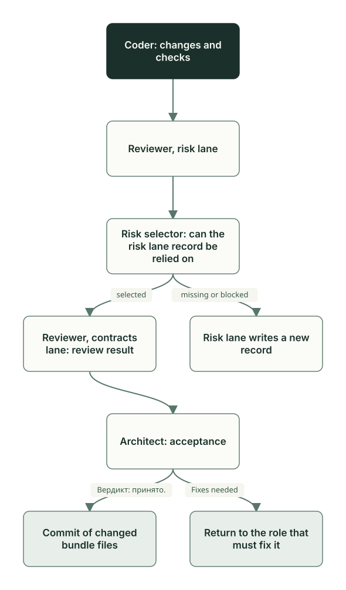

# Review and acceptance

**English** · [Русский](review-acceptance.ru.md)

Coder has finished and handed over the work. Now Reviewer checks it, and Architect accepts it or returns it. If the roles are launched with the `planveyor sibling` commands, Owner authorizes the commit after acceptance; otherwise, Architect makes the commit. Who all these participants are is told in the [Roles and task files](roles-artifacts.md) chapter.

## The review file

A task has one review file. Reviewer creates it and writes its path into the `## Review artifacts` section of the plan. If all target files of the task (Planner keeps their list in the code draft) lie in `docs/`, the review is stored in `docs/doc_reviews/<plan name>.md`; otherwise, in `docs/code_reviews/<plan name>.md`. When the first file outside `docs/` gets into the exact bundle of the plan, the path moves to `docs/code_reviews/`, and the plan, the draft, and the link to the review are brought in line together. A repeated review after fixes rewrites the same file; the plan check treats two review files in one plan as an error. The order of work is in the playbooks for [commit review](../../playbooks/review_staged_or_commit.md) (in Russian) and [docs review](../../playbooks/review_docs_staged_or_commit.md) (in Russian).

If the review covers the current bundle (`BUNDLE=current`, as in the example below), the `**Target:**` line in its header holds the checksum of the bytes of the target files (`bundle_sha256`). The conclusion of the review applies to these bytes. If Coder edits even one target file after the review, the checksum will no longer match, and the review will have to be repeated.

Reviewer sorts findings by severity. The scale is the same in all review templates:

| Level | What belongs here | What comes next |
| --- | --- | --- |
| S1 Blocker | The contract, data, or security is violated; the result diverges from the plan; a required check is skipped; a visual defect or an execution failure; a declared interface has wrong semantics; schema artifacts are wrong | The work goes back: to Coder (usually the `In progress` status) if the error is in the code, to Planner or Architect if there is a gap in the plan |
| S2 Risk | Tech debt, performance, maintainability; no test for an important edge case; weak input validation; incomplete defensive checks | Does not stop the handoff; the risk can be accepted deliberately |
| S3 Nit | Style, naming, minor cleanup | Does not stop the handoff |

Reviewer copies S2 and S3 findings into the `### Reviewer suggestions` section of the plan. At acceptance, Architect decides on each one: include it in the task or move it to the `Follow-ups (deferred)` section of the plan.

## Two Reviewer lanes

Reviewer checks the work in two lanes, each with its own job. In collab mode, whether in the Manager window (TUI mode) or in a `planveyor sibling run` launch, Manager starts them one after the other as two Codex agents: `reviewer_code_risk` and `reviewer_code_contracts`.



The risk lane looks for where the result can break: correctness, tests, security and privacy, external processes and timeouts, races, data and migrations, performance, behavior on failures. It writes its conclusion into the `## Evidence` section of the plan and the details as a separate file into the review assets. It leaves the plan status and the review result to the second lane.

Between the lanes, Manager calls the risk selector, `review_artifact_lint.py --select-risk-lane`. The script looks for the current risk lane record in the plan and answers as follows:

- `selected`: the record was found, and its detailed file passed the check; the script returns the line number in the plan and the run id;
- `missing`: the plan has no readable risk lane record;
- `blocked`: a record exists, but it cannot be relied on: there are several current records, the marks about replaced old records contradict each other, or the detailed file did not pass the check.

Manager starts the second lane only on `selected` and only if the record applies to the same bytes of the target files. On `missing` or `blocked`, the turn returns to the risk lane: it writes a new record, marks the old one, if there was one, as replaced, and the script runs again. Manager and Owner do not edit these records by hand.

The contracts lane checks the result against the plan: the decisions of Architect, the architecture, APIs and schemas, the documentation, the settings, and the truthfulness of the review itself. It finds the risk lane record with the same script and reads it itself, without a retelling by Manager. Then it combines both lanes into one review file: the sections of the two lanes, the final `Lane synthesis / aggregate verdict` section, and the status in the header. Only this lane sets the final status. If there are no S1 findings, the Reviewer questions are closed, and a task with a user interface has passed the visual check, the contracts lane moves the plan to `Ready for Arch review`, and the turn passes to Architect.

In collab mode, at the `Reviewer visual review` stage, where the user interface is checked, Manager starts only the contracts lane. The details are in the [Manager prompt](../../tools/prompts/manager_collab_pipeline.md) and the [Reviewer prompt](../../tools/prompts/reviewer_status_driven.md) (in Russian).

## How it went: the GetReorderCandidates review

The task ran before the `planveyor sibling` commands existed (see [Roles and task files](roles-artifacts.md)): the operator launched Reviewer, and one session went through both lanes in turn; in collab mode, these are two separate agents. The order was the same: the risk lane, the risk selector, the contracts lane.

The risk lane section in the review file, quoted as written in the project:

```markdown
## reviewer_code_risk
- Lane status: complete.
[…]
- Target snapshot: `BUNDLE=current bundle_sha256=d8214af66e8b6797b45ecdf059790ed5e584513a4a773d385d2ad043a22a1cb4`.
- Coverage domains: correctness, tests quality, security/privacy, subprocess/timeouts, races/locks/atomicity, data/migrations, performance, observability, integrations, supply chain, failure semantics.
- Findings: none.
- No findings reason: `sql/Northwind/GetReorderCandidates.sql` возвращает только `Discontinued=0` с положительным `INT` shortage, приводит все три nullable количества до арифметики, сортирует результат по `ProductID` и ничего не пишет. Семь `tSQLt.FakeTable` cases проверяют значения, исключения, NULL, пустую таблицу и smallint boundary; […] Safe fakes `40/40`, текущий JUnit и 15/15 SHA parity подтверждены.
- Support: `docs/code_reviews/assets/260928_0006_get_reorder_candidates/reviewer_code_risk_20260927T224952Z.json` (SHA-256 `8603d06ee2124c7b48502eba30ec65fa57b5e00c17c5ba590dbbca8c9fdd971d`).
- Limits: Reviewer не запускал SQL/setup/Extract/Publish/proof и не читал `.env.local` или raw SQL output. Первый actual RED `rc=2` остаётся историческим; current green относится к precommit HEAD и точным байтам, не к postcommit SQL или publication readiness. Историческое удаление DacFX marker напрямую не наблюдалось; названная в plan настройка — правдоподобное объяснение, не доказанная причина.
```

There are no findings, and the lane explains why. It checked the formula, the filter, and the row order in the procedure, the seven new procedure tests, the 40 harness tests without a database, and that the checksums of 15 executable and configuration files match the operator receipt, which is the operator's report on the run on the dev database. The `Support` line leads to the detailed file of the lane. Reviewer did not repeat the run of the operator: a local section of the review playbook allows accepting it if the files and the test set match ([Sibling: creation and upgrade](sibling-lifecycle.md#local-sections)).

The contracts lane recorded that the risk selector found this record:

```markdown
- Finalizer proof: `review_artifact_lint.py --select-risk-lane --origin-plan docs/plans/260928_0006_get_reorder_candidates.md --json` вернул `rc=0`, `state=selected`, `selected_line=272` и тот же target. […]
```

`selected_line=272` is the line of the plan where the risk lane record starts. The review result is `✅ OK`, with no open S1, S2, or S3 findings.

Architect first verified the bundle itself and only then accepted the work. The first two lines of its section in the same review file:

```markdown
## Arch review
- Architect verdict: ✅ OK; текущие AC1–AC5 подтверждены review и current proof оператора, AC6 закрывается только exact preflight/CAS commit этого же bundle.
- Самостоятельно открыты plan, draft, обе code lanes, SQL procedure/tests/runner, operator receipt, JUnit и immutable risk support. `planveyor_plan_bundle --print|--check` дал `rc=0`, ровно 22 paths/16 targets/1 root/0 issues; plan/doc lint и risk selector дали `rc=0`. Три asset SHA совпали с plan, 15 executable/config hashes совпали с operator receipt, десять сохранённых dependencies не отличаются от HEAD `60332b46eba26a9c09cf199184c45afe10e61f1b`.
```

The checks and the checksums matched. The last acceptance criterion, AC6, could be closed only by the commit of this bundle; at that time, Architect made commit `70526ee` itself.

The verdict is written in the old form: the section starts with the line `- Architect verdict: ✅ OK…`. The `planveyor sibling close` command accepts the `## Arch review` heading but not such a first line: it needs the line `Вердикт: принято.` (verdict: accepted).

## Architect acceptance

Architect accepts the work based on the plan and the review file, which it opens itself. It goes through the `### Arch review checklist` from the plan: the plan has one link to the review; the suggestions of Coder and Reviewer from the `## Suggestions log` section of the plan are sorted out; for a task with a user interface, it looks at the screenshots itself, although Reviewer does the visual check.

Outcomes:

- accept the work;
- return small fixes under the same plan: the `Coder intake` status, and the turn is with Coder again;
- if the plan needs rethinking, start a new plan and mark the current one `Superseded`.

When the roles are launched with the `planveyor sibling` commands (the `human_explicit` policy, described below), Architect records the acceptance in the same review file. `planveyor sibling close` counts it if:

- the file has exactly one second-level section with the heading `## Архитектурное ревью` or `## Arch review`; letter case does not matter;
- the first non-empty line of the section outside code blocks is exactly `Вердикт: принято.`; the reasoning goes below it.

`ОК`, `Вердикт: принято условно…` (verdict: accepted conditionally…), or `Вердикт: принято. Требуется исправление…` (verdict: accepted. A fix is required…) do not count as acceptance. If the review is stale, Owner still has a question, or the review has an S1, Architect does not accept the work.

For a plan of the `review-only` type, a separate review order, the `Ready for Arch review` status means that the report is ready for analysis; S1 findings are allowed in it. This is how, for example, a range review of commits after a merge is set up; see the [Post-merge check](postmerge.md) chapter.

## Who makes the commit

What Architect does after acceptance depends on the commit policy. The command that launched the roles sets it:

| How the roles are launched | Policy | What Architect does after acceptance | Who makes the commit |
| --- | --- | --- | --- |
| Manual console mode: `planveyor sibling architect` or `planveyor sibling run` | `human_explicit` | Writes `Вердикт: принято.`, leaves the `Architect arch review` status, and stops | Owner, with `planveyor sibling close --commit` |
| TUI mode (`planveyor sibling tui` or `planveyor_manager_collab_tui`) and any other launch, for example a single-role command (`planveyor_arch`) | `native_existing` | Checks the bundle itself, sets `Done`, and commits the changed files of the bundle locally | Architect |

In TUI mode, the role sandbox keeps `.git` read-only, so Architect asks for elevated permission to write to `.git`, and Owner approves each request in the Manager window with the one-time "Yes, proceed". Approval applies to a specific call, not to the whole closeout. The description is based on how the engine works. The corresponding route has been checked by live passes in Planveyor itself.

In both cases, Owner runs `git push`: the roles do not run it, and neither do the Planveyor commands. How role launch works is told in the [Launch: commands, wrappers, agent harnesses](runtime-launch.md) chapter.

The command writes the policy into the header of the role task as the line `COMMIT_POLICY=human_explicit` or `COMMIT_POLICY=native_existing`, and Manager passes this field in every message to the roles it starts. A role takes the value only from the current task. The `PLANVEYOR_SIBLING_COMMIT_POLICY` environment variable does not set the policy: a direct role launch with it still gets `native_existing`.

## What Owner does

In TUI mode, Owner drives the plan in the Manager window and approves there the requests of Architect to write to `.git`. You can look at the bundle with `planveyor sibling close` in another terminal: it only shows the state. Below is manual console mode:

```sh
planveyor sibling run              # Manager drives the work to acceptance
planveyor sibling close            # check the acceptance and look at the bundle
planveyor sibling close --commit   # authorize the commit
```

`planveyor sibling close` checks the acceptance first. On a refusal, the command changes nothing and names the next step:

| What `close` reports | What to do |
| --- | --- |
| The plan is not accepted by Architect yet | `planveyor sibling run` |
| Owner questions remain | `planveyor sibling answer`, then `architect` or `run`, whichever command asked for the decision |
| The current review is not accepted: it is stale or has a blocking finding | `planveyor sibling run`: the work goes back to the role that must fix it |
| The plan does not have exactly one review file, the file does not have exactly one acceptance section, or the first line of the section is not `Вердикт: принято.` | `planveyor sibling architect` |
| The bundle is already committed, but the plan is still at acceptance | `planveyor sibling architect` |
| The bundle did not pass the check | `planveyor sibling run` |
| The move to `Done` did not pass the plan check | Fix what the check named; for example, open items of `## Post-merge gate` (the [Task closeout](closeout.md) chapter) |
| The index has files outside the bundle | Commit them separately or remove them from the index, then repeat `close` |
| Files, the index, or the review changed during `close --commit` | Repeat `close`, then `close --commit` |

What happens after a successful `close --commit` is described in the [Task closeout](closeout.md) chapter. The full order of commands is in the [stack sibling guide](../stack-sibling.md#commit-and-docs-closeout).

## Common mistakes

- Owner adds `Вердикт: принято.` for Architect so that `close` passes. Only Architect writes this line.
- Owner takes the `Ready for Arch review` status for acceptance. Acceptance is the `Вердикт: принято.` line in the review.

The functions and tests mentioned here are in the [code map](code-map.md#review-and-acceptance).

Next: [Task closeout](closeout.md).
