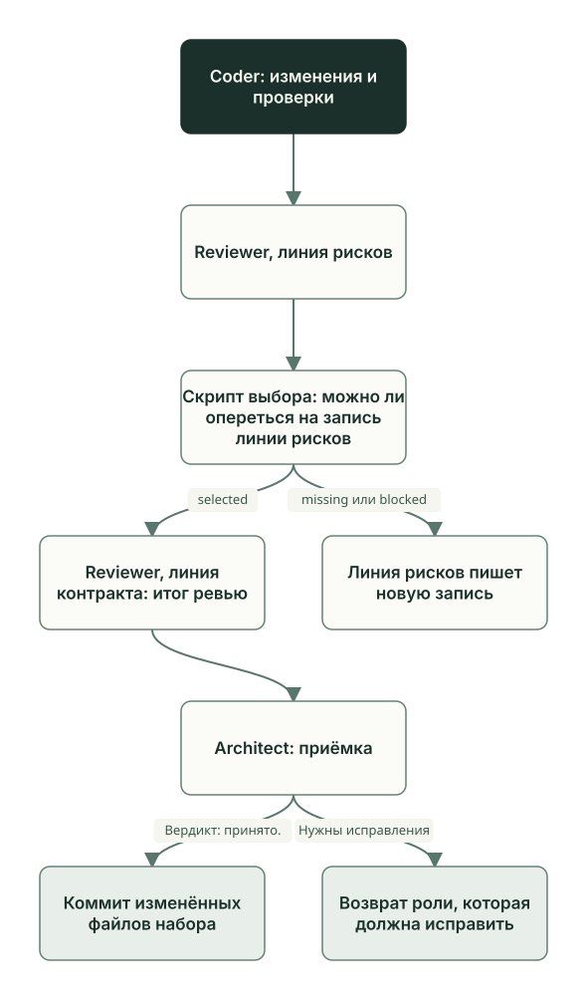

<!-- i18n: pair=docs/guides/learn/review-acceptance.md pair-sha256=3b7b5f114c7e0992253bae6ef753dc0130b5a479f8e649340ffdcf8dcf4cacdc self-sha256=db6f0fd613bcbd8a3de09d3868b1394d7a8cef546e1d213c18f99eadaaf15fcf -->
# Ревью и приёмка

[English](review-acceptance.md) · **Русский**

Coder закончил и передал работу. Теперь её проверяет Reviewer, а принимает или возвращает Architect. Если роли запущены командами `planveyor sibling`, после приёмки коммит разрешает Owner; иначе коммитит сам Architect. Кто все эти участники, рассказано в главе [«Роли и файлы задачи»](roles-artifacts.ru.md).

## Файл ревью

У задачи один файл ревью. Reviewer создаёт его и записывает путь в раздел плана `## Review artifacts`. Если все целевые файлы задачи (их список Planner ведёт в черновике кода) лежат в `docs/`, ревью хранится в `docs/doc_reviews/<имя плана>.md`, иначе — в `docs/code_reviews/<имя плана>.md`. Когда в точный набор файлов плана попадает первый файл вне `docs/`, путь переносят в `docs/code_reviews/`, а план, черновик и ссылку на ревью согласуют вместе. Повторное ревью после исправлений переписывает тот же файл; два файла ревью в одном плане проверка плана сочтёт ошибкой. Порядок работы — в плейбуках [ревью коммита](../../playbooks/review_staged_or_commit.md) и [ревью документов](../../playbooks/review_docs_staged_or_commit.md).

Если ревью идёт по текущему набору файлов (`BUNDLE=current`, как в примере ниже), строка `**Target:**` в его шапке хранит контрольную сумму байтов целевых файлов (`bundle_sha256`). Вывод ревью относится к этим байтам. Стоит Coder поправить после ревью хоть один целевой файл, сумма разойдётся, и ревью придётся повторить.

Замечания Reviewer делит по серьёзности. Шкала одна во всех шаблонах ревью:

| Уровень | Что сюда относится | Что дальше |
| --- | --- | --- |
| S1 Blocker | Нарушены контракт, данные или безопасность; результат расходится с планом; пропущена обязательная проверка; визуальная поломка или сбой выполнения; неверная семантика объявленного интерфейса; неверные артефакты схем | Работа возвращается: к Coder (обычно статус `In progress`), если ошибка в коде, к Planner или Architect, если пробел в плане |
| S2 Risk | Техдолг, производительность, поддерживаемость; нет теста на важный крайний случай; слабая проверка входных данных; неполные защитные проверки | Передачу не останавливает; риск можно принять осознанно |
| S3 Nit | Стиль, имена, мелкая чистка | Передачу не останавливает |

Замечания S2 и S3 Reviewer дублирует в раздел плана `### Reviewer suggestions`. При приёмке Architect решает по каждому: включить в задачу или вынести в раздел плана `Follow-ups (deferred)`.

## Две линии Reviewer

Reviewer проверяет работу двумя линиями, у каждой своя задача. В режиме collab — в окне Manager (режим TUI) или при запуске `planveyor sibling run` — Manager запускает их по очереди как два агента Codex: `reviewer_code_risk` и `reviewer_code_contracts`.



Линия рисков ищет, где результат может сломаться: корректность, тесты, безопасность и приватность, внешние процессы и тайм-ауты, гонки, данные и миграции, производительность, поведение при сбоях. Вывод она записывает в раздел плана `## Evidence`, подробности — отдельным файлом в приложения к ревью. Статус плана и итог ревью она оставляет второй линии.

Между линиями Manager вызывает скрипт выбора записи линии рисков, `review_artifact_lint.py --select-risk-lane`. Скрипт ищет в плане текущую запись линии рисков и отвечает так:

- `selected` — запись нашлась, её подробный файл прошёл проверку; скрипт возвращает номер строки в плане и идентификатор запуска;
- `missing` — разборчивой записи линии рисков в плане нет;
- `blocked` — запись есть, но опереться на неё нельзя: текущих записей несколько, отметки о замене старых записей противоречат друг другу или подробный файл не прошёл проверку.

Вторую линию Manager запускает только при `selected` и только если запись относится к тем же байтам целевых файлов. При `missing` или `blocked` ход возвращается линии рисков: она пишет новую запись, старую, если та была, помечает заменённой, и скрипт запускается снова. Manager и Owner эти записи вручную не правят.

Линия контракта сверяет результат с планом: решения Architect, архитектуру, API и схемы, документацию, настройки и правдивость самого ревью. Запись линии рисков она находит тем же скриптом и читает сама, без пересказа Manager. Затем сводит обе линии в один файл ревью: разделы двух линий, итоговый раздел `Lane synthesis / aggregate verdict` и статус в шапке. Итоговый статус ставит только она. Если замечаний S1 нет, вопросы Reviewer закрыты, а у задачи с интерфейсом пройдена визуальная проверка, линия контракта переводит план в `Ready for Arch review`, и ход переходит к Architect.

В режиме collab на стадии `Reviewer visual review`, где проверяют интерфейс, Manager запускает только линию контракта. Подробности — в [промпте Manager](../../tools/prompts/manager_collab_pipeline.md) и [промпте Reviewer](../../tools/prompts/reviewer_status_driven.md).

## Как это было: ревью GetReorderCandidates

Задача прошла до команд `planveyor sibling` (см. [«Роли и файлы задачи»](roles-artifacts.ru.md)): Reviewer запустил оператор, и обе линии по очереди прошла одна сессия; в режиме collab это два отдельных агента. Порядок был тот же: линия рисков, скрипт выбора, линия контракта.

Раздел линии рисков в файле ревью:

```markdown
## reviewer_code_risk
- Lane status: complete.
[…]
- Target snapshot: `BUNDLE=current bundle_sha256=d8214af66e8b6797b45ecdf059790ed5e584513a4a773d385d2ad043a22a1cb4`.
- Coverage domains: correctness, tests quality, security/privacy, subprocess/timeouts, races/locks/atomicity, data/migrations, performance, observability, integrations, supply chain, failure semantics.
- Findings: none.
- No findings reason: `sql/Northwind/GetReorderCandidates.sql` возвращает только `Discontinued=0` с положительным `INT` shortage, приводит все три nullable количества до арифметики, сортирует результат по `ProductID` и ничего не пишет. Семь `tSQLt.FakeTable` cases проверяют значения, исключения, NULL, пустую таблицу и smallint boundary; […] Safe fakes `40/40`, текущий JUnit и 15/15 SHA parity подтверждены.
- Support: `docs/code_reviews/assets/260928_0006_get_reorder_candidates/reviewer_code_risk_20260927T224952Z.json` (SHA-256 `8603d06ee2124c7b48502eba30ec65fa57b5e00c17c5ba590dbbca8c9fdd971d`).
- Limits: Reviewer не запускал SQL/setup/Extract/Publish/proof и не читал `.env.local` или raw SQL output. Первый actual RED `rc=2` остаётся историческим; current green относится к precommit HEAD и точным байтам, не к postcommit SQL или publication readiness. Историческое удаление DacFX marker напрямую не наблюдалось; названная в plan настройка — правдоподобное объяснение, не доказанная причина.
```

Замечаний нет, и линия объясняет почему. Она проверила формулу, фильтр и порядок строк в процедуре, семь новых тестов процедуры, 40 тестов обвязки без базы и совпадение контрольных сумм 15 исполняемых файлов и настроек с квитанцией оператора — его отчётом о прогоне на dev-базе. Строка `Support` ведёт на подробный файл линии. Прогон оператора Reviewer не повторял: локальный раздел плейбука ревью позволяет принять его, если файлы и набор тестов совпадают ([«Sibling: создание и обновление»](sibling-lifecycle.ru.md#локальные-разделы)).

Линия контракта записала, что скрипт выбора нашёл эту запись:

```markdown
- Finalizer proof: `review_artifact_lint.py --select-risk-lane --origin-plan docs/plans/260928_0006_get_reorder_candidates.md --json` вернул `rc=0`, `state=selected`, `selected_line=272` и тот же target. […]
```

`selected_line=272` — строка плана, с которой начинается запись линии рисков. Итог ревью — `✅ OK`, открытых замечаний S1, S2 и S3 нет.

Architect сначала сам сверил набор файлов и только потом принял работу. Первые две строки его раздела в том же файле ревью:

```markdown
## Arch review
- Architect verdict: ✅ OK; текущие AC1–AC5 подтверждены review и current proof оператора, AC6 закрывается только exact preflight/CAS commit этого же bundle.
- Самостоятельно открыты plan, draft, обе code lanes, SQL procedure/tests/runner, operator receipt, JUnit и immutable risk support. `planveyor_plan_bundle --print|--check` дал `rc=0`, ровно 22 paths/16 targets/1 root/0 issues; plan/doc lint и risk selector дали `rc=0`. Три asset SHA совпали с plan, 15 executable/config hashes совпали с operator receipt, десять сохранённых dependencies не отличаются от HEAD `60332b46eba26a9c09cf199184c45afe10e61f1b`.
```

Проверки и контрольные суммы сошлись. Последний критерий приёмки, AC6, закрывался только коммитом этого набора; коммит `70526ee` тогда делал сам Architect.

Вердикт записан в прежнем виде: раздел начинается строкой `- Architect verdict: ✅ OK…`. Заголовок `## Arch review` команда `planveyor sibling close` принимает, а такую первую строку — нет: ей нужна строка `Вердикт: принято.`.

## Приёмка Architect

Architect принимает работу по плану и файлу ревью, которые открывает сам. Он проходит чек-лист `### Arch review checklist` из плана: ссылка на ревью в плане одна; предложения Coder и Reviewer из раздела плана `## Suggestions log` разобраны; у задачи с интерфейсом он сам смотрит снимки экрана, хотя визуальную проверку делает Reviewer.

Исходы:

- принять работу;
- вернуть небольшие исправления по тому же плану: статус `Coder intake`, ход снова у Coder;
- если план нужно переосмыслить, завести новый план, а текущий пометить `Superseded`.

Когда роли запущены командами `planveyor sibling` (политика `human_explicit`, о ней ниже), приёмку Architect записывает в том же файле ревью. `planveyor sibling close` засчитывает её, если:

- в файле ровно один раздел второго уровня с заголовком `## Архитектурное ревью` или `## Arch review`, регистр букв не важен;
- первая непустая строка раздела вне блоков кода — ровно `Вердикт: принято.`; обоснование идёт ниже.

«ОК», «Вердикт: принято условно…» или «Вердикт: принято. Требуется исправление…» приёмкой не считаются. Если ревью устарело, у Owner остался вопрос или в ревью есть S1, Architect работу не принимает.

У плана типа `review-only`, отдельного заказа на ревью, статус `Ready for Arch review` значит, что отчёт готов к разбору; замечания S1 в нём допустимы. Так оформляют, например, ревью диапазона коммитов после слияния, см. главу [«Проверка после слияния»](postmerge.ru.md).

## Кто делает коммит

Что Architect делает после приёмки, зависит от политики коммита. Её задаёт команда, которой запущены роли:

| Как запущены роли | Политика | Что делает Architect после приёмки | Кто делает коммит |
| --- | --- | --- | --- |
| Ручной режим в консоли: `planveyor sibling architect` или `planveyor sibling run` | `human_explicit` | Пишет `Вердикт: принято.`, оставляет статус `Architect arch review` и останавливается | Owner, командой `planveyor sibling close --commit` |
| Режим TUI (`planveyor sibling tui` или `planveyor_manager_collab_tui`) и любой другой запуск, например отдельная команда роли (`planveyor_arch`) | `native_existing` | Сам проверяет набор файлов, ставит `Done` и локально коммитит изменённые файлы набора | Architect |

В режиме TUI песочница роли держит `.git` только на чтение, поэтому Architect запрашивает повышение прав на запись в `.git`, и Owner одобряет каждый запрос в окне Manager разовым «Yes, proceed». Одобрение относится к конкретному вызову, а не ко всему закрытию. Описание основано на устройстве движка. Соответствующий маршрут проверен живыми проходами в самом Planveyor.

`git push` в обоих случаях делает Owner: роли его не выполняют, команды Planveyor тоже. Как устроен запуск ролей, рассказывает глава [«Запуск: команды, обёртки, харнесы»](runtime-launch.ru.md).

Команда пишет политику в шапку задания роли строкой `COMMIT_POLICY=human_explicit` или `COMMIT_POLICY=native_existing`, а ролям, которых запускает Manager, он передаёт это поле в каждом сообщении. Роль берёт значение только из текущего задания. Переменная окружения `PLANVEYOR_SIBLING_COMMIT_POLICY` политику не задаёт: прямой запуск роли с ней всё равно получит `native_existing`.

## Что делает Owner

В режиме TUI Owner ведёт план в окне Manager и одобряет в нём запросы Architect на запись в `.git`. Набор файлов можно посмотреть командой `planveyor sibling close` в другом терминале: она только показывает состояние. Ниже — ручной режим в консоли:

```sh
planveyor sibling run              # Manager доводит работу до приёмки
planveyor sibling close            # проверить приёмку и посмотреть набор файлов
planveyor sibling close --commit   # разрешить коммит
```

`planveyor sibling close` сначала проверяет приёмку. При отказе команда ничего не меняет и называет следующий шаг:

| Что сообщает `close` | Что сделать |
| --- | --- |
| План ещё не принят Architect | `planveyor sibling run` |
| Остались вопросы Owner | `planveyor sibling answer`, затем `architect` или `run` — та команда, которая просила решение |
| Текущее ревью не принято: устарело или в нём есть блокирующее замечание | `planveyor sibling run`: работа вернётся к роли, которая должна исправить |
| В плане не один файл ревью, в файле не один раздел приёмки или первая строка раздела не `Вердикт: принято.` | `planveyor sibling architect` |
| Набор уже закоммичен, а план ещё на приёмке | `planveyor sibling architect` |
| Набор файлов не прошёл проверку | `planveyor sibling run` |
| Переход в `Done` не прошёл проверку плана | Исправить то, что назвала проверка; например, открытые пункты `## Post-merge gate` (глава [«Закрытие задачи»](closeout.ru.md)) |
| В индексе есть файлы вне набора | Закоммитить их отдельно или убрать из индекса, затем повторить `close` |
| Файлы, индекс или ревью изменились во время `close --commit` | Повторить `close`, затем `close --commit` |

Что происходит после успешного `close --commit`, описано в главе [«Закрытие задачи»](closeout.ru.md). Порядок команд целиком — в [руководстве по sibling](../stack-sibling.ru.md#коммит-и-закрытие-документов).

## Частые ошибки

- Owner дописывает `Вердикт: принято.` за Architect, чтобы `close` прошёл. Эту строку пишет только Architect.
- Owner принимает статус `Ready for Arch review` за приёмку. Приёмка — строка `Вердикт: принято.` в ревью.

Функции и тесты, о которых шла речь, — в [справочнике по коду](code-map.ru.md#ревью-и-приёмка).

Дальше: [«Закрытие задачи»](closeout.ru.md).
