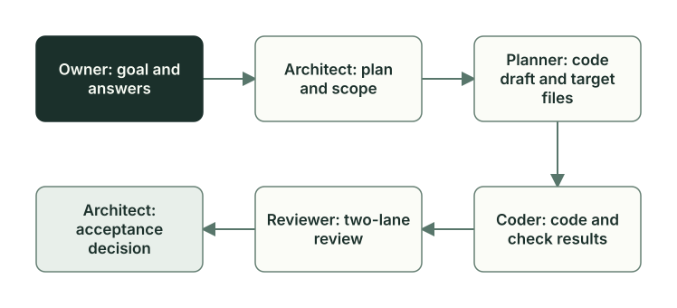

# Роли и файлы задачи

Planveyor делит задачу между участниками с разной ответственностью. Каждый делает свой шаг и записывает результат в файл, и следующий берёт работу из этого файла: переписку читать не нужно. Дальше всё показано на реальной задаче из SQL-проекта.

## Кто за что отвечает

Owner — человек, владелец проекта. Architect, Planner, Coder, Reviewer и Manager — сессии ИИ-клиента, по умолчанию Codex. Роль не привязана к конкретной модели: модель и уровень рассуждения для каждой роли задаёт [настройка Codex](../launch-and-role-modes.ru.md#настройка-codex), а клиент выбирается отдельно.

| Участник | За что отвечает | Что передаёт дальше | Чего не делает |
| --- | --- | --- | --- |
| Owner | Цель задачи и решения, которые принимает только человек | Цель, ответы на вопросы, разрешения на коммит | — |
| Architect | Что делать, в каких рамках и как принимать результат | План с решениями, в конце — вердикт о приёмке | Не пишет код продукта |
| Planner | Точный список файлов, шагов и проверок | Черновик кода (code draft) | Не реализует изменения |
| Coder | Код и тесты по черновику | Изменённые файлы и результаты проверок | Не расширяет задачу молча |
| Reviewer | Риски и соответствие результата плану | Ревью | Не исправляет код вместо Coder |
| Manager | Какую роль запустить по статусу плана | Ход следующей роли | Не правит план, ответы и код |

Ответы за Owner никто не придумывает. Если у Planner, Coder или Reviewer возникает вопрос по смыслу задачи, они возвращают его Architect. Architect отвечает сам или формулирует вопрос для Owner. Подробнее о полномочиях — в [документах ролей](../../roles/index.md).



На схеме обычный путь без возвратов. Вопрос или замечание может вернуть работу той роли, чей это файл: пробел в шагах — Planner, ошибку реализации — Coder, смысловой вопрос — Architect. Полный порядок возвратов описывают [правила Manager](../../roles/manager.md).

## Файлы задачи

| Файл | Что в нём | Кто пишет |
| --- | --- | --- |
| План, `docs/plans/ГГММДД_ЧЧММ_<тема>.md` | Цель, решения, границы задачи (`## Scope`), критерии приёмки, вопросы и ответы, статус, журнал проверок (`## Evidence`) | Architect; каждая следующая роль дописывает свою часть |
| Черновик кода, `docs/code_drafts/<имя плана>__code_draft.md` | Список целевых файлов (`code_draft_meta.targets`) и шаги для Coder | Planner |
| Ревью, `docs/code_reviews/<имя плана>.md` | Выводы двух линий Reviewer и вердикт Architect | Reviewer, затем Architect |
| Отложенные задачи, `docs/followups/` | Работа, которую решили сделать позже; у каждой записи свой владелец | Роли предлагают записи при закрытии документов, записывает их скрипт `followups_apply.py` |

По статусу в шапке плана (`**Status:**`) видно, какая роль работает сейчас. Скрипт Oracle читает статус вместе с файлами задачи и сообщает состояние плана и то, что мешает переходу, а Manager по этому ответу выбирает следующую роль; подробнее — в [главе о плане](plan-lifecycle.md). Шаблоны: [план](../../plans/_template.md), [черновик кода](../../code_drafts/_template.md). По ходу задачи отложенную работу отмечают в разделе плана `## Follow-ups (deferred)`, а при закрытии документов из неё получаются отдельные записи `followups.v2`. Сгенерированный индекс помогает их найти, но решений в нём не принимают.

## Как это было: задача GetReorderCandidates

28 сентября 2026 года роли решили эту задачу в SQL-проекте на Planveyor. Процедура `dbo.GetReorderCandidates` должна вернуть активные товары, которых на складе не хватает даже с учётом уже заказанной поставки. Данные и тесты задачи — в [сквозном примере](sql-example.md), а здесь — кто что сделал.

**Owner** дал задание одним абзацем: одна процедура только для чтения, формула дефицита, правила для `NULL`, порядок строк, семь случаев для тестов. В задании оговорено, что прогон на dev-базе делает оператор — человек или агент с доступом к этой базе; в Planveyor такой роли нет. Решения Owner принял заранее, поэтому формальных вопросов к нему не было; одно уточнение он дал по ходу работы Coder.

**Architect** записал план за 7 минут. Шапка плана в конце работы выглядела так:

```markdown
**Plan type:** dev
**Status:** Done
**Schema version:** plan.v2

**Handoff statuses (кто ставит):**
- `Ready for Planner` — Architect
- `Ready for Coder` — Planner
- `Ready for Review` — Coder
- `Ready for Arch review` — Reviewer
- `Done` — Architect
```

Два решения Architect особенно заметны дальше. Сравнение таблиц в тестах tSQLt не учитывает порядок строк, поэтому порядок проверяют отдельным прямым вызовом процедуры: товары кладут в порядке 30, 10, 20, а обвязка (скрипт, который собирает базу и запускает тесты) требует на выходе 10, 20, 30. Второе решение — включить в список целевых файлов и прежние файлы, от которых зависит проверка, даже если их не меняют. Линтер плана с первого раза нашёл три недочёта формы; Architect их исправил и передал план Planner.

**Planner** составил черновик кода за 5 минут. Главное в нём — список целевых файлов. Их 16: шесть меняет Coder, а десять по решению Architect входят в список без изменений. Вот шесть изменяемых:

```json
{"path": "scripts/sql.py", "kind": "py"},
{"path": "scripts/test_sql.py", "kind": "py"},
{"path": "sql/Northwind/GetReorderCandidates.sql", "kind": "sql"},
{"path": "sql/tests/GetReorderCandidatesTests.sql", "kind": "sql"},
{"path": "sql/tests/run-tests.sql", "kind": "sql"},
{"path": "README.md", "kind": "doc"}
```

Неизменные — например, `Makefile`, `global.json` и схема базы `sql/Northwind/Northwind.sql`.

Для двух новых SQL-файлов Planner создал заглушки, которые Coder обязан заменить до ревью. Предварительная проверка точного набора файлов плана насчитала 19: 16 целевых, план, черновик и ревью, которого пока нет.

**Coder** написал процедуру и тесты и поправил обвязку. Без настоящей базы прошло всё: 40 из 40 тестов обвязки, сборка без ошибок и предупреждений, линтер, проверка секретов. Прогон на dev-базе — за оператором, поэтому Coder передал работу ему и оставил статус `In progress`.

**Оператор** запустил `make db-proof`, и первый прогон упал через 5 секунд: обвязка остановилась ещё до публикации, потому что не смогла однозначно определить состояние тестовых классов в базе. Проверка показала, что у класса `SqlHarnessSmoke` нет метки tSQLt. Вероятная причина — настройка публикации DacFx `DropExtendedPropertiesNotInSource`, которая по умолчанию удаляет такие метки. Coder добавил в публикацию `/p:DropExtendedPropertiesNotInSource=false`, оператор восстановил метку, и второй запуск прошёл за 13 секунд: 8 тестов из 8, строки в порядке 10, 20, 30. Офлайн-тесты этого не показали: метка пропала в самой базе.

**Reviewer** проверял в две линии. Линия рисков ищет ошибки и опасные места, линия контракта сверяет результат с планом. Замечаний не нашла ни одна. В ревью Reviewer оговорил ограничения: сам он SQL не запускал, и зелёный прогон относится к коду до коммита. Финальная проверка набора насчитала 22 файла; откуда ещё три, показано в главе [«План и его статусы»](plan-lifecycle.md#как-это-было-план-getreordercandidates).

**Architect** сам сверил файлы и контрольные суммы, записал вердикт о приёмке и в 02:17 сделал коммит `70526ee` с 12 файлами: шесть изменённых целевых файлов, план, черновик, ревью и три приложения к нему. Десять неизменённых целевых файлов в коммит не попали. В 03:05 второй коммит `edac1b9` закрыл документы. В нём одно предложение по процессу: плейбук ревью ссылался на отчёт JUnit предыдущей задачи, а должен брать отчёт текущей (глава [«Закрытие задачи»](closeout.md)).

Это было ещё до команд `planveyor sibling`: роли запускал оператор, а коммит делал Architect. Теперь в sibling Owner ведёт задачу этими командами. Architect записывает вердикт и останавливается, а коммит делает команда `planveyor sibling close --commit` после того, как Owner посмотрел набор файлов. Порядок команд — в [руководстве по sibling](../stack-sibling.ru.md).

## Manager и проверка передачи

Manager — координатор. Он читает статус плана, запускает роль, чей сейчас ход, и смотрит, что она оставила. В задаче он не меняет план, ответы, код и настройки и коммитов не делает. За один запуск Manager проходит не больше 12 шагов; если задача не закончена, ту же команду запускают снова.

Прежде чем передать работу дальше, Manager просит роль, которая её сдаёт, ещё раз пройтись по своим файлам. Этот второй проход той же сессии называется CENSOR. Его делает Architect перед Planner, Planner перед Coder и Coder перед Reviewer: промпты [architect_censor.md](../../tools/prompts/architect_censor.md), [planner_censor.md](../../tools/prompts/planner_censor.md), [coder_censor.md](../../tools/prompts/coder_censor.md).

На втором проходе роль сверяет, всё ли обсуждённое записано в план и черновик, и дописывает пропущенное, не выходя за свои полномочия. Результат она отмечает в журнале проверок. Если всплыл вопрос по смыслу задачи, работа возвращается к Architect. Manager сам перечитывает результат прохода и привязывает его к номеру своего вызова. Отметка действует только для этой передачи: если план потом изменился, она уже не считается. CENSOR не заменяет ревью: это самопроверка перед передачей.

Для небольших правок второй проход можно пропустить (условия — в главе [«Запуск: команды, обёртки, клиенты»](runtime-launch.md#manager-collab)).

В задаче GetReorderCandidates роли запускал оператор, поэтому Manager и CENSOR в её файлах не видны. Как Manager запускает роли, рассказывает [глава о запуске](runtime-launch.md).

## Роль, промпт и обёртка

Роль задают три вещи:

- **документ роли** — за что роль отвечает и где её границы: [architect.md](../../roles/architect.md);
- **промпт фазы** — что делать при текущем статусе: [architect_status_driven.md](../../tools/prompts/architect_status_driven.md); для первого обсуждения задачи — отдельный [architect_draft_discussion.md](../../tools/prompts/architect_draft_discussion.md);
- **обёртка** — функция движка, которая готовит всё нужное и запускает сессию: `planveyor_arch()`, для первого обсуждения — `planveyor_arch_initial()`.

Промпт определяет, что роль делает, а обёртка — как её запускают. В sibling роль читает копию промпта из самого проекта. Общая часть промпта приходит из Planveyor и обновляется командой `planveyor sibling upgrade`, когда вы обновили копию Planveyor. Два [локальных раздела](sibling-lifecycle.md#локальные-разделы), «Локальные правила стека» и «Разрешённое локальное переопределение процесса», принадлежат проекту, и обновление их сохраняет.

## Частые ошибки

- Искать код продукта среди скриптов движка. Продукт и его проверки живут в sibling.
- Считать роль конкретной моделью.
- Принимать ответ роли «готово» за результат. Смотрите на изменённые файлы и свежую проверку.
- Поручать Manager исправить план. Он вернёт работу роли, которой принадлежит файл.
- Ссылаться на отчёты прошлой задачи, как плейбук ревью в примере выше. У каждой задачи свои отчёты.

Функции и тесты, о которых шла речь, — в [справочнике по коду](code-map.md#роли-и-файлы-задачи).

Дальше: [«Сквозной пример: какие товары пора пополнить»](sql-example.md).
