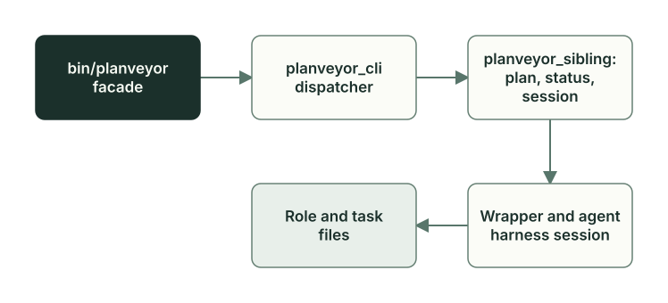

# Launch: commands, wrappers, agent harnesses

**English** · [Русский](runtime-launch.ru.md)

The `planveyor sibling architect` command goes all the way from the terminal to a model session: the engine selects the project, the phase prompt, the session, and the agent harness in which the role works. `planveyor sibling run` does the same for Manager, and then Manager drives the roles itself.

## Five links of one command



1. The `bin/planveyor` facade finds the Planveyor checkout and the project and runs the command in a separate clean process.
2. The `planveyor_cli()` dispatcher passes the commands of the `sibling` group to `planveyor_sibling()`.
3. `planveyor_sibling()` checks the plan and the status, prepares the session, and calls the role wrapper, here `planveyor_arch()`.
4. The wrapper builds the message for the role and continues its session in the selected agent harness, Codex by default.
5. The role works in the project and leaves its result in the task files: the plan, the code draft, the review.

Only the `architect`, `run`, and `tui` subcommands start a model. The Python scripts `scripts/sibling_runbook.py` and `scripts/sibling_closeout.py` carry out the other subcommands entirely. The order of commands for Owner is described in the [stack sibling guide](../stack-sibling.md), and the help, which needs no project, shows the whole set; the help text is in Russian:

```sh
planveyor sibling --help
```

```text
usage: planveyor sibling [-h]
                         {init,plan,architect,answer,run,tui,close,ready,upgrade}
                         ...

Обычный цикл sibling: init → plan → architect/answer → run → close → ready.

positional arguments:
  {init,plan,architect,answer,run,tui,close,ready,upgrade}
    init                создать sibling с вашей Git identity
    plan                выбрать или показать текущий plan
    architect           обсудить текущий plan с Architect
    answer              сохранить фактический Owner ответ
    run                 один ход Manager; human_explicit, закрытие через close
                        --commit
    tui                 открыть native Manager TUI; native_existing для
                        текущего plan
    close               показать точный набор или явно коммитить его
    ready               прочитать реальную готовность текущего sibling
    upgrade             обновить из выбранного runtime

options:
  -h, --help            show this help message and exit
```

In the help, `run` is one turn of Manager in collab mode with the `human_explicit` policy, and `tui` is the window of the same Manager with `native_existing`; more on them below.

## The facade and project selection

The facade does not load the engine into your shell. It starts a child `zsh -df` through `env -i`, with a minimal set of environment variables, so the functions, variables, and current directory of your shell stay as they were. Before the launch, the facade checks that it lies in a Git checkout of Planveyor with a commit in `HEAD` and that `rg` and `zsh` are available. In the code, `scripts/planveyor.zsh`, the module loading point, is also called the facade; this is a different level.

The facade selects the project as follows:

- `--project <absolute path>` before the command sets it explicitly;
- without the flag, the low-level `planveyor_*` commands work on Planveyor itself;
- the `sibling` group, except `init` and the help, takes the root of the Git repository of the current directory and refuses if this is Planveyor itself.

So you type a low-level command for your project from the root of the Planveyor checkout, with the flag:

```sh
./bin/planveyor --project ~/my-stack planveyor_arch_init
```

From here on, such commands are given by name only, and you run them the same way. `planveyor_entry_doctor` shows which Planveyor checkout and which project the facade selected, without starting a model.

The facade sets `PLANVEYOR_RUNTIME_ROOT` and `PLANVEYOR_PROJECT_ROOT` to the selected Planveyor checkout and project paths. It passes the following settings from the caller's environment to the child process:

- `PLANVEYOR_CODEX_HOME`, the Codex settings directory (Codex home). The facade does not pass the usual `CODEX_HOME`, and without `PLANVEYOR_CODEX_HOME` the roles work with `~/.codex`;
- `PLANVEYOR_CLAUDE_COMMAND`, `PLANVEYOR_CLAUDE_MODEL`, and `PLANVEYOR_CLAUDE_EFFORT`, the Claude Code settings;
- `CODEX_THREAD_ID`, if it is set: the id of the current Codex chat for the `## Plan provenance / session context` plan section.

Inside the process, `scripts/planveyor.zsh` is loaded, and `planveyor_cli()` takes control. It lets through only the commands from the allowed list and answers `unsupported child command` to the rest. Both it and `planveyor_sibling()` check that the facade started them; otherwise, they answer `commands must run through bin/planveyor`.

## Session and SID

A SID is the id of an agent harness session. The `*_init` commands start a session: for example, `planveyor_arch_init` starts Codex with the `architect_init.md` prompt and saves the SID from the output to the `.planveyor.session.architect` pointer. The pointer has three parts: the creation time, a `# meta:` line with the agent harness (`runner=codex`) and other fields, and the SID itself as the last line. Earlier values stay in `.planveyor.session.architect.log`, and the creation receipt lies in `.planveyor.init_runs/`.

The wrapper sends the next turns to the same session: Codex gets `exec … resume <SID>`, and Claude Code gets `--resume <SID>`. The session keeps the dialog with the role, but the source of truth for the task is the plan. The `PRE_STATUS_LINE` line in the message of every turn reminds the role of the status from the plan, and on a mismatch the role re-reads the plan instead of relying on its memory. The commands `planveyor_arch_resume`, `planveyor_planner_resume`, and the same commands for the other roles open the session in the agent harness so that you can talk to the role by hand.

The roles have seven session keys. This is the session table at the start of the `./bin/planveyor planveyor_help` output in a Planveyor checkout where no sessions have been started yet:

```text
### Sessions (manual dashboard)
role                     runner  sid  set
architect                codex
planner                  codex
coder                    codex
reviewer                 codex
reviewer_code_risk       codex
reviewer_code_contracts  codex
manager                  codex
```

The `reviewer` key belongs to the `planveyor_reviewer()` wrapper: it runs both Reviewer lanes in one session. `planveyor_reviewer_code_risk()` and `planveyor_reviewer_code_contracts()` have their own sessions, and the custom pipeline needs exactly these.

## What `architect` and `run` do

Both subcommands start with the `sibling_runbook.py` script. It reads the selected plan from `.planveyor.planpath` and asks Oracle for its status. For `architect`, the status must mean a turn of Architect: `Architect initial draft`, `Architect draft`, `Ready for Architect response`, `Architect response`, `Ready for Arch review`, or `Architect arch review`. With any other status, the command reports `Текущий status не принадлежит Architect; используйте planveyor sibling run.` (the current status does not belong to Architect; use planveyor sibling run) and does not touch the session.

Then the command prepares the session: Architect for `architect`, Manager for `run`. If the pointer exists, the command reads the session receipt in `.planveyor.init_runs/by_sid/<SID>/`. If the receipt belongs to another project or another Planveyor checkout, the command refuses and does not replace the session. If there is no receipt or it is stale, for example after a new commit in the project, the command starts a new session through `planveyor_arch_init` or `planveyor_manager_init`. It does the same without a pointer and when the `sessions/` directory of the Codex home has no file for this session.

Then the paths split:

- with the `Architect initial draft` status, `architect` calls `planveyor_arch_initial()` with the first-discussion prompt `architect_draft_discussion.md`; with the other statuses, it calls `planveyor_arch()` with [architect_status_driven.md](../../tools/prompts/architect_status_driven.md) (in Russian);
- `run` starts Manager in collab mode.

After the turn, both commands print the plan, its status, and the next step, as `planveyor sibling plan` does.

`tui` prepares the Manager session in the same way. Before that, the script asks Oracle whether the plan admits collab mode (`--manager-mode manager-collab`) and requires that the plan has no open Owner questions. Then the command calls `planveyor_manager_collab_tui` with `native_existing`; after the window closes, it prints neither the plan nor the next step.

## The role wrapper

A wrapper is an engine function that prepares one turn of a role and starts the agent harness. Architect (`planveyor_arch()`), Planner (`planveyor_planner()`), Coder (`planveyor_coder()`), Reviewer (`planveyor_reviewer()` and one per lane: `planveyor_reviewer_code_risk()`, `planveyor_reviewer_code_contracts()`), and Manager (`planveyor_manager()`) have their own wrappers. The `planveyor_arch_censor()`, `planveyor_planner_censor()`, and `planveyor_coder_censor()` wrappers start the CENSOR second pass. In it, the role that hands over the work goes through its files once more and adds what is missing before the work moves on; see the [Roles and task files](roles-artifacts.md) chapter for details.

A fragment of `planveyor_arch()` from [role_runtime.zsh](../../../scripts/planveyor/role_runtime.zsh), after the context check:

```zsh
local root=""
root="$(_planveyor_project_root)" || return $?
local prompt_body=""
prompt_body="$(_planveyor_role_prompt_body architect status_driven)" || return $?
local plan_path; plan_path="$(planveyor_planpath)" || return 1
local sid; sid="$(planveyor_session architect)" || return 1
_planveyor_session_authority_resume_validate architect "$sid" || return $?
```

The wrapper takes the project root, the phase prompt, the plan path from `.planveyor.planpath`, and the SID from the pointer, then checks that the session was created for this project. Then it prints `Plan status (pre)` and picks up the Owner answer if one waits in `.planveyor.owner_answers`. `planveyor sibling answer` puts there the answer given during the first discussion of the task and the answer to a question about the role's authority; the role closes a question about its authority itself. The command writes the answer to an ordinary question to the Q&A log of the plan right away. These parts make up the message: `ROLE=Architect`, `PLAN_PATH`, `PRE_STATUS_LINE`, the Python path `PYBIN`, the prompt text, and the Owner answer. The wrapper sends it to the same Codex session:

```zsh
printf '%s\n' "$payload" | _planveyor_with_role_env architect "$pybin" _planveyor_codex exec -c 'approval_policy="never"' --sandbox workspace-write "${codex_profile_args[@]}" resume "${sid}" -
```

Codex works in the `workspace-write` sandbox and does not ask for approvals. It takes the model and the reasoning effort from the top level of `config.toml`; for Architect, Planner, and Coder, you can choose a Codex profile with `planveyor_profile_set`. After the turn, the wrapper prints `Plan status (post)`. The role changes the status. `planveyor_arch()` only shows it, while the Planner and Coder wrappers roll back the handoff if the plan linter fails. If the role set `Done`, the Planner, Coder, and Reviewer wrappers refuse.

## Phase prompt and commit policy

`_planveyor_role_prompt_body <role> <phase>` selects the file by the role–phase pair. For Architect, the `status_driven` phase gives `architect_status_driven.md`, `draft_discussion` gives `architect_draft_discussion.md`, and `censor` gives `architect_censor.md`. In a sibling, the prompt is read from the copy in the project itself; in Planveyor, the shared one from `docs/tools/prompts/` is taken. Before the prompt text, the function prints two lines:

```text
COMMIT_POLICY=human_explicit
PLANVEYOR_RUNTIME_ROOT=<path to the Planveyor checkout>
```

`COMMIT_POLICY` tells the role who makes the commit. The value is `human_explicit` only when `planveyor sibling architect` or `planveyor sibling run` called the wrapper; in all other launches, the value is `native_existing`. The function learns this from the call chain: whether it contains `planveyor_sibling()`. What the roles do under each policy is shown in the [Who makes the commit](review-acceptance.md#who-makes-the-commit) section.

The role needs `PLANVEYOR_RUNTIME_ROOT` to call the facade of the same Planveyor checkout; there is an example at the end of the chapter.

## Agent harness: Codex or Claude Code

By default, all roles work in Codex. To assign another agent harness to a role, run `planveyor_runner_set <role> <runner>`: the choice is saved in `.planveyor.runner.<role>` in the project root, and `planveyor_runner <role>` shows it. Not all combinations are allowed:

| Role | Agent harness |
| --- | --- |
| Architect, Coder, Manager | `codex` only |
| Planner, Reviewer | `codex` or `claude` |

To any other combination, the command answers, for example, `Unsupported runner for role=coder: claude`. Both Reviewer lanes take the agent harness from the same `.planveyor.runner.reviewer` file.

The `claude` choice applies where a wrapper starts the role: in a single-role launch and in the custom pipeline. The wrapper calls `claude -p --resume <SID> --permission-mode acceptEdits`, and you can set the command, the model, and the reasoning effort through `PLANVEYOR_CLAUDE_COMMAND`, `PLANVEYOR_CLAUDE_MODEL`, and `PLANVEYOR_CLAUDE_EFFORT`. The launch guide distinguishes the supported Codex path of a sibling from the existing single-role and custom-pipeline Claude paths: Owner sets up the Claude Code sign-in, its permissions, and the model. In collab mode, which `planveyor sibling run` starts, all five role agents work in Codex, and the `claude` choice does not affect them.

## Modes: single role, Manager collab, custom pipeline

| Mode | How to start | Who starts the roles | Agent harness of the roles | Who commits |
| --- | --- | --- | --- | --- |
| Single-role launch | `planveyor_arch_init`, then `planveyor_arch`; the same for the other roles | Owner, one at a time | Codex; Planner and Reviewer can use Claude Code | Architect itself |
| TUI mode: the Manager window, in a sibling and in Planveyor itself | `planveyor_manager_init`, the approval step in `planveyor_manager_resume`, then `planveyor sibling tui` in a sibling or `planveyor_manager_collab_tui` in Planveyor itself | Manager, as nested Codex subagents | Codex only | Architect itself |
| Manual console mode, in a sibling | `planveyor sibling run` | Manager, as Codex agents, one turn up to acceptance | Codex only | Owner, with `planveyor sibling close --commit` |
| Manager custom pipeline | `planveyor_manager_custom_pipeline_tui` | Manager, one at a time through the wrappers | As in a single-role launch | Architect itself |

### Single-role launch

Owner chooses the role by the plan status and calls its wrapper through the facade. Each call is a separate launch of the agent harness (`codex exec … resume` or `claude -p --resume`), and this mode does not need the `[agents.*]` sections in `config.toml`. Here, the CENSOR second pass is started with the `planveyor_arch_censor`, `planveyor_planner_censor`, and `planveyor_coder_censor` wrappers. The docs closeout of a plan and the analysis and decomposition plans ([Development, analysis, and decomposition](work-contours.md)) still go through collab mode.

### Manager collab

In collab mode, the roles work as Codex agents inside the Manager session. `planveyor sibling run` calls `planveyor_manager_collab_cmd run <plan>`, and the command continues the Manager session in Codex once. The message contains `ROLE=Manager`, `PLAN_PATH`, `PRE_STATUS_LINE`, `PYBIN`, the text of [manager_collab_pipeline.md](../../tools/prompts/manager_collab_pipeline.md) (in Russian), and, as the last line, `MANAGER_CMD=run <plan>`.

`planveyor_manager_collab_tui` opens the same route of roles in an interactive Codex window. This is TUI mode, the main path in a sibling too ([Two ways to work on a plan](../stack-sibling.md#two-ways-to-work-on-a-plan)). The roles in it are nested subagents of the Manager session and live while the window is open. The policy is `native_existing`: Architect commits the exact bundle of the plan itself and, if the docs closeout requires it, the documents. In a sibling, the window is opened by `planveyor sibling tui`: it checks the selected plan and the Manager session and calls `planveyor_manager_collab_tui` with the same policy. Before it, start a new session with `planveyor --project "$PWD" planveyor_manager_init` and switch it to command approval requests, as in [Run the plan in TUI mode](../stack-sibling.md#run-the-plan-in-tui-mode). `planveyor sibling run` is manual console mode: one Manager turn up to the accepted Arch review, Owner makes the commits, and after a commit the next `run` starts a new Manager with new roles.

Manager is the main Codex session on the model from the top level of `config.toml`. It creates the roles as Codex agents with the call `spawn_agent(..., agent_type=<type>)`. There are five types; Owner describes them with `[agents.<type>]` sections in `config.toml`, and Planveyor does not create or rewrite these sections. A section refers to a role file (`config_file`), and this file sets the model and the reasoning effort.

| `agent_type` | Role | Agent name |
| --- | --- | --- |
| `architect` | Architect | `/root/architect_sol_xhigh_v2` |
| `planner` | Planner | `/root/planner_terra_ultra_v2` |
| `coder` | Coder | `/root/coder_terra_ultra_v2` |
| `reviewer_code_risk` | Reviewer, risk lane | `/root/reviewer_code_risk_sol_xhigh_v2` |
| `reviewer_code_contracts` | Reviewer, contracts lane | `/root/reviewer_code_contracts_sol_xhigh_v2` |

The agent names are fixed. They are addresses in the Codex task tree with the root `/root`, and the parts `sol`, `terra`, `xhigh`, and `ultra` do not set the model. The setup is described in the [Codex setup](../launch-and-role-modes.md#codex-setup) section of the launch guide.

How Manager drives the plan:

- Before each step, it reads the plan status through Oracle. It does not change the plan, the status, the code, the environment, or the agent harness choice.
- A role agent lives for the whole run. Manager keeps its name in `.planveyor.collab.agent.<role>`. After a Codex restart, Manager first looks for the agent with the `list_agents` call and only then creates it again.
- It hands work to the same agent with the `followup_task` call. One role works at a time.
- In one run, Manager makes no more than 12 steps on the active plan. At the limit, it stops with `Next: Owner`: in manual console mode, Owner repeats `planveyor sibling run`, and in TUI mode, Owner tells Manager in the same window to continue.

Manager starts the CENSOR second pass when a role has handed the work on. The role that handed over the work does the pass: Architect with the `Architect draft` or `Ready for Planner` status, Planner with `Ready for Coder`, Coder with `Ready for Review`. This is a separate `followup_task` to the same agent with the CENSOR prompt and a new `CENSOR_DISPATCH_ID`. Then Manager checks the record of the pass with the `censor_receipts_harvest.py` script, and the work goes on only in the `complete` state.

For small changes, the second pass can be skipped if the `planveyor_q_small_slice_json` script confirms before and after the role turn that the task fits the short route. The conditions are described in step 2a, `Native cold-start CENSOR gate`, of the [Manager prompt](../../tools/prompts/manager_collab_pipeline.md) and in the [Manager rules](../../roles/manager.md).

Merge mode starts the same agents except Planner and works with a range of already merged commits. It is started with `planveyor_merge_collab_cmd` or `planveyor_merge_collab_tui` (the same as `planveyor_manager_collab_tui --merge`); it is described in the [Post-merge check](postmerge.md) chapter. A queue of several plans (`planveyor_q_set`, `planveyor_manager_collab_tui --q`) is deferred in the first version and has not been checked by an end-to-end run. `planveyor sibling run` works with one selected plan.

### Manager custom pipeline

In the custom pipeline, Manager does not create agents: it calls `planveyor_custom_role_step <role> --plan <plan> --json` for one role after another, and each role works through its wrapper in its own session. You choose this mode when the roles need their own sessions instead of Codex agents, for example so that Planner or Reviewer work in Claude Code; it does not need the `[agents.*]` sections. Each step leaves its own launch receipt. The sessions are started in advance: `planveyor_manager_init`, `planveyor_arch_init`, `planveyor_planner_init`, `planveyor_coder_init`, `planveyor_reviewer_code_risk_init`, and `planveyor_reviewer_code_contracts_init`. The limit is the same, 12 steps. The algorithm of the mode is in [manager_custom_pipeline.md](../../tools/prompts/manager_custom_pipeline.md) (in Russian).

### ZCode

ZCode is one more agent harness, but you cannot choose it through `planveyor_runner_set`. It has its own Manager route, and this route works only in the Planveyor root: its launch files from `.zcode/` are not delivered to a sibling. In a sibling, ZCode fits a chat with the `/planveyor-plan-draft` skill, and Manager is started through the facade.

## Where things are

| Where | What is there |
| --- | --- |
| Planveyor checkout (runtime) | `bin/planveyor`, `scripts/`, shared rules and prompts; the modules are described in [scripts/planveyor/README.md](../../../scripts/planveyor/README.md) |
| Project, files under Git | The plan, the code draft, the review, the product code; in a sibling, also its own copy of the prompts and role rules |
| Project, `.planveyor.*` files outside Git | The selected plan, the session pointers, the agent harness choice, the names of the Manager agents, the session receipts, the Owner answer for the next turn |
| Codex home: `PLANVEYOR_CODEX_HOME` or `~/.codex` | `config.toml` with the model and the reasoning effort, five `[agents.*]` sections and the role files, the Codex sign-in |

The sibling template excludes `.planveyor.*` from Git: this is local state, and it must not get in the way of an upgrade. These files hold no project rules. The `.planveyor.planpath` pointer selects the plan but does not decide whether the next step may be taken: Oracle shows this from the plan itself.

## Example: launch traces in the GetReorderCandidates task

The GetReorderCandidates task from the [running example](sql-example.md) was done before the `planveyor sibling` commands existed: an operator started the roles by hand (see [Roles and task files](roles-artifacts.md)). The links of the launch are visible in its files too.

The review records for each Reviewer lane where it worked. The risk lane line:

```text
- Runner metadata: `runner_id=codex`, `session_key=reviewer`, `sid=<SID>`, `profile=N/A (why=not configured)`, `model=gpt-6-sol`, `reasoning_effort=ultra`.
```

The lane worked in Codex, in the session with the `reviewer` key, without a Codex profile; the model and the reasoning effort came from the Codex settings. The contracts lane has the same line: one `reviewer` session ran both lanes, as the `planveyor_reviewer()` wrapper does. In collab mode, they would have had two agents, `reviewer_code_risk` and `reviewer_code_contracts`.

The roles themselves called the engine through the facade of the Planveyor checkout from which they were started. Two commands from the `## Commands` section of the plan:

```sh
"$PLANVEYOR_RUNTIME_ROOT/bin/planveyor" --project "$PWD" planveyor_plan_lint docs/plans/260928_0006_get_reorder_candidates.md
"$PLANVEYOR_RUNTIME_ROOT/bin/planveyor" --project "$PWD" planveyor_plan_status_oracle --json docs/plans/260928_0006_get_reorder_candidates.md
```

## Common mistakes

- Setting the model in `[agents.planner]` and expecting it in a single-role launch of `planveyor_planner`: it takes the model from the top level of `config.toml` or from the `planveyor_profile_set` profile.
- Choosing the `claude` agent harness for Planner and expecting Claude Code from `planveyor sibling run`.
- Closing the TUI window after the implementation commit and expecting the same roles to close the documents: a new `sibling tui` or `run` does not restore the previous roles or a spent correction attempt. Stop and follow the closed-window row in [If a command stops](../stack-sibling.md#if-a-command-stops): Owner chooses the next step.

The functions and tests discussed here are in the [code map](code-map.md#launch-commands-wrappers-agent-harnesses).

Next: [How Planveyor changes itself](self-development.md).
