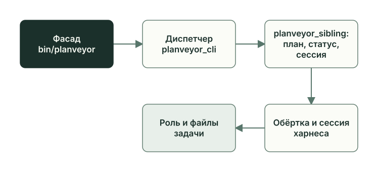

<!-- i18n: pair=docs/guides/learn/runtime-launch.md pair-sha256=da0762f909be00f6822959e82c26b2cf95b5e0d1dfae3f0439915172c44d8a50 self-sha256=e5f2a47a45e6cbaa7be759c8852ae47bf2bff33cce5d17a686b43b0f89d5b697 -->
# Запуск: команды, обёртки, харнесы

[English](runtime-launch.md) · **Русский**

Команда `planveyor sibling architect` проходит путь от терминала до сессии модели: движок выбирает проект, промпт фазы, сессию и агентный харнес, в котором работает роль. `planveyor sibling run` делает то же для Manager, а дальше Manager ведёт роли сам.

## Пять звеньев одной команды



1. Фасад `bin/planveyor` находит копию Planveyor и проект и запускает команду в отдельном чистом процессе.
2. Диспетчер `planveyor_cli()` передаёт команды группы `sibling` в `planveyor_sibling()`.
3. `planveyor_sibling()` сверяет план и статус, готовит сессию и вызывает обёртку роли, здесь `planveyor_arch()`.
4. Обёртка собирает сообщение для роли и продолжает её сессию в выбранном агентном харнесе, по умолчанию в Codex.
5. Роль работает в проекте и оставляет результат в файлах задачи: в плане, черновике кода, ревью.

Модель запускают только подкоманды `architect`, `run` и `tui`. Остальные подкоманды целиком выполняют Python-скрипты `scripts/sibling_runbook.py` и `scripts/sibling_closeout.py`. Порядок команд для Owner описан в [руководстве по sibling](../stack-sibling.ru.md), а весь набор показывает справка, которой не нужен проект:

```sh
planveyor sibling --help
```

```text
usage: planveyor sibling [-h]
                         {init,plan,architect,answer,run,tui,close,ready,upgrade}
                         ...

Обычный цикл sibling: init → plan → architect/answer → run → close → ready.

positional arguments:
  {init,plan,architect,answer,run,tui,close,ready,upgrade}
    init                создать sibling с вашей Git identity
    plan                выбрать или показать текущий plan
    architect           обсудить текущий plan с Architect
    answer              сохранить фактический Owner ответ
    run                 один ход Manager; human_explicit, закрытие через close
                        --commit
    tui                 открыть native Manager TUI; native_existing для
                        текущего plan
    close               показать точный набор или явно коммитить его
    ready               прочитать реальную готовность текущего sibling
    upgrade             обновить из выбранного runtime

options:
  -h, --help            show this help message and exit
```

В справке `run` — один ход Manager в режиме collab с политикой `human_explicit`, а `tui` — окно того же Manager с `native_existing`; о них ниже.

## Фасад и выбор проекта

Фасад не подключает движок к вашей оболочке. Он запускает дочерний `zsh -df` через `env -i`, с минимальным набором переменных окружения, поэтому функции, переменные и текущий каталог оболочки остаются прежними. Перед запуском фасад проверяет, что сам лежит в Git-копии Planveyor с коммитом в `HEAD` и что доступны `rg` и `zsh`. В коде фасадом называют и `scripts/planveyor.zsh`, точку загрузки модулей; это другой уровень.

Проект фасад выбирает так:

- `--project <абсолютный путь>` перед командой задаёт его явно;
- без флага низкоуровневые команды `planveyor_*` работают с самим Planveyor;
- группа `sibling`, кроме `init` и справки, берёт корень Git-репозитория текущего каталога и отказывает, если это сам Planveyor.

Поэтому низкоуровневую команду для своего проекта набирают из корня копии Planveyor с флагом:

```sh
./bin/planveyor --project ~/my-stack planveyor_arch_init
```

Дальше такие команды названы по имени, а запускают их так же. Какую копию Planveyor и какой проект выбрал фасад, без запуска модели показывает `planveyor_entry_doctor`.

Фасад задаёт `PLANVEYOR_RUNTIME_ROOT` и `PLANVEYOR_PROJECT_ROOT` — пути выбранной копии Planveyor и проекта. Из окружения вызывающей оболочки он передаёт в дочерний процесс следующие настройки:

- `PLANVEYOR_CODEX_HOME` — каталог настроек Codex (Codex home). Обычный `CODEX_HOME` фасад не передаёт, и без `PLANVEYOR_CODEX_HOME` роли работают с `~/.codex`;
- `PLANVEYOR_CLAUDE_COMMAND`, `PLANVEYOR_CLAUDE_MODEL`, `PLANVEYOR_CLAUDE_EFFORT` — настройки Claude Code;
- `CODEX_THREAD_ID`, если он задан, — id текущего чата Codex для раздела плана `## Plan provenance / session context`.

Внутри процесса загружается `scripts/planveyor.zsh`, и управление получает `planveyor_cli()`. Она пускает только команды из списка разрешённых и на остальное отвечает `unsupported child command`. И она, и `planveyor_sibling()` проверяют, что их запустил фасад, а иначе отвечают `commands must run through bin/planveyor`.

## Сессия и SID

SID — id сессии агентного харнеса. Сессию заводят команды `*_init`: например, `planveyor_arch_init` запускает Codex с промптом `architect_init.md` и сохраняет SID из вывода в указатель `.planveyor.session.architect`. В указателе три части: время создания, строка `# meta:` с харнесом (`runner=codex`) и другими полями, последней строкой сам SID. Прежние значения остаются в `.planveyor.session.architect.log`, а квитанция создания лежит в `.planveyor.init_runs/`.

Следующие ходы обёртка отправляет в ту же сессию: Codex получает `exec … resume <SID>`, Claude Code — `--resume <SID>`. Сессия хранит диалог с ролью, но источник истины по задаче — план. Строка `PRE_STATUS_LINE` в сообщении каждого хода напоминает роли статус из плана, и при расхождении роль перечитывает план, не полагаясь на память. Команды `planveyor_arch_resume`, `planveyor_planner_resume` и такие же для других ролей открывают сессию в харнесе, чтобы поговорить с ролью вручную.

У ролей семь ключей сессий. Так выглядит таблица сессий в начале вывода `./bin/planveyor planveyor_help` в копии Planveyor, где сессий ещё не заводили:

```text
### Sessions (manual dashboard)
role                     runner  sid  set
architect                codex
planner                  codex
coder                    codex
reviewer                 codex
reviewer_code_risk       codex
reviewer_code_contracts  codex
manager                  codex
```

Ключ `reviewer` принадлежит обёртке `planveyor_reviewer()`: она ведёт обе линии Reviewer в одной сессии. У `planveyor_reviewer_code_risk()` и `planveyor_reviewer_code_contracts()` сессии свои, и пошаговому режиму Manager нужны именно они.

## Что делают `architect` и `run`

Обе подкоманды начинают со скрипта `sibling_runbook.py`. Он читает выбранный план из `.planveyor.planpath` и спрашивает у Oracle его статус. Для `architect` статус должен означать ход Architect: `Architect initial draft`, `Architect draft`, `Ready for Architect response`, `Architect response`, `Ready for Arch review` или `Architect arch review`. При другом статусе команда сообщает «Текущий status не принадлежит Architect; используйте planveyor sibling run.» и сессию не трогает.

Затем команда готовит сессию: Architect для `architect`, Manager для `run`. Если указатель есть, она читает квитанцию сессии в `.planveyor.init_runs/by_sid/<SID>/`. Если квитанция принадлежит другому проекту или другой копии Planveyor, команда отказывает и сессию не заменяет. Если квитанции нет или она устарела, например после нового коммита в проекте, команда заводит новую сессию через `planveyor_arch_init` или `planveyor_manager_init`. Так же она поступает без указателя и тогда, когда в каталоге `sessions/` Codex home нет файла этой сессии.

Дальше пути расходятся:

- `architect` при статусе `Architect initial draft` вызывает `planveyor_arch_initial()` с промптом первого обсуждения `architect_draft_discussion.md`, при остальных статусах — `planveyor_arch()` с [architect_status_driven.md](../../tools/prompts/architect_status_driven.md);
- `run` запускает Manager в режиме collab.

После хода обе команды печатают план, его статус и следующий шаг, как `planveyor sibling plan`.

`tui` готовит сессию Manager так же. Перед этим скрипт спрашивает у Oracle, допускает ли план режим collab (`--manager-mode manager-collab`), и требует, чтобы в плане не было открытых вопросов к Owner. Затем команда вызывает `planveyor_manager_collab_tui` с `native_existing`; когда окно закроется, ни план, ни следующий шаг она не печатает.

## Обёртка роли

Обёртка — функция движка, которая готовит один ход роли и запускает агентный харнес. Свои обёртки есть у Architect (`planveyor_arch()`), Planner (`planveyor_planner()`), Coder (`planveyor_coder()`), Reviewer (`planveyor_reviewer()` и по одной на линию: `planveyor_reviewer_code_risk()`, `planveyor_reviewer_code_contracts()`) и Manager (`planveyor_manager()`). Обёртки `planveyor_arch_censor()`, `planveyor_planner_censor()` и `planveyor_coder_censor()` запускают второй проход CENSOR. В нём роль, которая сдаёт работу, ещё раз проходит по своим файлам и дописывает пропущенное, прежде чем работа уйдёт дальше; подробнее — в главе [«Роли и файлы задачи»](roles-artifacts.ru.md).

Фрагмент `planveyor_arch()` из [role_runtime.zsh](../../../scripts/planveyor/role_runtime.zsh) после проверки контекста:

```zsh
local root=""
root="$(_planveyor_project_root)" || return $?
local prompt_body=""
prompt_body="$(_planveyor_role_prompt_body architect status_driven)" || return $?
local plan_path; plan_path="$(planveyor_planpath)" || return 1
local sid; sid="$(planveyor_session architect)" || return 1
_planveyor_session_authority_resume_validate architect "$sid" || return $?
```

Обёртка берёт корень проекта, промпт фазы, путь плана из `.planveyor.planpath` и SID из указателя, затем проверяет, что сессия создана для этого проекта. Потом печатает `Plan status (pre)` и забирает ответ Owner, если он ждёт в `.planveyor.owner_answers`. Туда `planveyor sibling answer` кладёт ответ на первом обсуждении задачи и ответ на вопрос о полномочиях роли; вопрос о полномочиях роль закрывает сама. Ответ на обычный вопрос команда сразу записывает в журнал вопросов плана. Из этого складывается сообщение: `ROLE=Architect`, `PLAN_PATH`, `PRE_STATUS_LINE`, путь к Python `PYBIN`, текст промпта и ответ Owner. Обёртка отправляет его в ту же сессию Codex:

```zsh
printf '%s\n' "$payload" | _planveyor_with_role_env architect "$pybin" _planveyor_codex exec -c 'approval_policy="never"' --sandbox workspace-write "${codex_profile_args[@]}" resume "${sid}" -
```

Codex работает в песочнице `workspace-write` и подтверждений не спрашивает. Модель и уровень рассуждения он берёт из верхнего уровня `config.toml`; для Architect, Planner и Coder можно выбрать профиль Codex командой `planveyor_profile_set`. После хода обёртка печатает `Plan status (post)`. Статус меняет роль. `planveyor_arch()` его только показывает, а обёртки Planner и Coder откатывают передачу, если линтер плана не прошёл. Если роль поставила `Done`, обёртки Planner, Coder и Reviewer отказывают.

## Промпт фазы и политика коммита

`_planveyor_role_prompt_body <роль> <фаза>` выбирает файл по паре роль–фаза. Для Architect фаза `status_driven` даёт `architect_status_driven.md`, `draft_discussion` даёт `architect_draft_discussion.md`, `censor` даёт `architect_censor.md`. В sibling промпт читается из копии в самом проекте, в Planveyor берётся общий из `docs/tools/prompts/`. Перед текстом промпта функция выводит две строки:

```text
COMMIT_POLICY=human_explicit
PLANVEYOR_RUNTIME_ROOT=<путь к копии Planveyor>
```

`COMMIT_POLICY` говорит роли, кто делает коммит. Значение `human_explicit` бывает, только когда обёртку вызвала `planveyor sibling architect` или `planveyor sibling run`; во всех остальных запусках значение `native_existing`. Функция узнаёт это по цепочке вызовов: есть ли в ней `planveyor_sibling()`. Что делают роли при каждой политике, показано в разделе [«Кто делает коммит»](review-acceptance.ru.md#кто-делает-коммит).

`PLANVEYOR_RUNTIME_ROOT` нужен роли, чтобы вызывать фасад той же копии Planveyor; пример — в конце главы.

## Агентный харнес: Codex или Claude Code

По умолчанию все роли работают в Codex. Чтобы назначить роли другой агентный харнес, выполните `planveyor_runner_set <role> <runner>`: выбор сохранится в `.planveyor.runner.<role>` в корне проекта, а `planveyor_runner <role>` его покажет. Допустимы не все сочетания:

| Роль | Агентный харнес |
| --- | --- |
| Architect, Coder, Manager | только `codex` |
| Planner, Reviewer | `codex` или `claude` |

На другое сочетание команда отвечает, например, `Unsupported runner for role=coder: claude`. Обе линии Reviewer берут агентный харнес из одного файла `.planveyor.runner.reviewer`.

Выбор `claude` действует там, где роль запускает обёртка: при отдельном запуске роли и в пошаговом режиме Manager. Обёртка вызывает `claude -p --resume <SID> --permission-mode acceptEdits`, а команду, модель и уровень рассуждения можно задать через `PLANVEYOR_CLAUDE_COMMAND`, `PLANVEYOR_CLAUDE_MODEL` и `PLANVEYOR_CLAUDE_EFFORT`. Руководство запуска различает поддерживаемый Codex-путь sibling и существующие отдельные/custom-Claude пути: вход в Claude Code, его разрешения и модель Owner настраивает сам. В режиме collab, который запускает `planveyor sibling run`, все пять агентов ролей работают в Codex, и выбор `claude` на них не влияет.

## Режимы: одна роль, Manager collab, пошаговый Manager

| Режим | Как запустить | Кто запускает роли | Агентный харнес ролей | Кто коммитит |
| --- | --- | --- | --- | --- |
| Отдельная роль | `planveyor_arch_init`, затем `planveyor_arch`; так же для других ролей | Owner, по одной | Codex; Planner и Reviewer можно в Claude Code | Architect сам |
| Режим TUI: окно Manager, в sibling и в самом Planveyor | `planveyor_manager_init`, шаг с одобрениями в `planveyor_manager_resume`, затем `planveyor sibling tui` в sibling или `planveyor_manager_collab_tui` в самом Planveyor | Manager, вложенными субагентами Codex | только Codex | Architect сам |
| Ручной режим в консоли, в sibling | `planveyor sibling run` | Manager, агентами Codex, один ход до приёмки | только Codex | Owner командой `planveyor sibling close --commit` |
| Пошаговый режим Manager | `planveyor_manager_custom_pipeline_tui` | Manager, по очереди через обёртки | как при отдельном запуске | Architect сам |

### Отдельная роль

Owner сам выбирает роль по статусу плана и вызывает её обёртку через фасад. Каждый вызов — отдельный запуск харнеса (`codex exec … resume` или `claude -p --resume`), и разделы `[agents.*]` в `config.toml` этому режиму не нужны. Второй проход CENSOR здесь запускают обёртками `planveyor_arch_censor`, `planveyor_planner_censor` и `planveyor_coder_censor`. Закрытие документов плана, планы анализа и декомпозиции ([«Разработка, анализ и декомпозиция»](work-contours.ru.md)) всё равно идут через режим collab.

### Manager collab

В режиме collab роли работают агентами Codex внутри сессии Manager. `planveyor sibling run` вызывает `planveyor_manager_collab_cmd run <план>`, и команда один раз продолжает сессию Manager в Codex. Сообщение содержит `ROLE=Manager`, `PLAN_PATH`, `PRE_STATUS_LINE`, `PYBIN`, текст [manager_collab_pipeline.md](../../tools/prompts/manager_collab_pipeline.md) и последней строкой `MANAGER_CMD=run <план>`.

Тот же маршрут ролей в интерактивном окне Codex открывает `planveyor_manager_collab_tui`. Это режим TUI, основной путь и в sibling ([«Два режима работы с планом»](../stack-sibling.ru.md#два-режима-работы-с-планом)). Роли в нём — вложенные субагенты сессии Manager и живут, пока открыто окно. Политика — `native_existing`: Architect сам коммитит точный набор файлов плана и, если закрытие документов этого требует, документы. В sibling окно открывает `planveyor sibling tui`: команда проверяет выбранный план и сессию Manager и вызывает `planveyor_manager_collab_tui` с той же политикой. Перед этим заводят новую сессию командой `planveyor --project "$PWD" planveyor_manager_init` и включают в ней запросы одобрения команд, как в разделе [«Провести план в режиме TUI»](../stack-sibling.ru.md#провести-план-в-режиме-tui). `planveyor sibling run` — ручной режим в консоли: один ход Manager до принятой приёмки, коммиты делает Owner, и после коммита следующий `run` заводит нового Manager с новыми ролями.

Manager — главная сессия Codex на модели из верхнего уровня `config.toml`. Роли он создаёт агентами Codex вызовом `spawn_agent(..., agent_type=<тип>)`. Типов пять, Owner описывает их разделами `[agents.<тип>]` в `config.toml`; Planveyor эти разделы не создаёт и не переписывает. Раздел ссылается на файл роли (`config_file`), и модель с уровнем рассуждения задаёт этот файл.

| `agent_type` | Роль | Имя агента |
| --- | --- | --- |
| `architect` | Architect | `/root/architect_sol_xhigh_v2` |
| `planner` | Planner | `/root/planner_terra_ultra_v2` |
| `coder` | Coder | `/root/coder_terra_ultra_v2` |
| `reviewer_code_risk` | Reviewer, линия рисков | `/root/reviewer_code_risk_sol_xhigh_v2` |
| `reviewer_code_contracts` | Reviewer, линия контракта | `/root/reviewer_code_contracts_sol_xhigh_v2` |

Имена агентов постоянные. Это адреса в дереве задач Codex с корнем `/root`, и части `sol`, `terra`, `xhigh`, `ultra` модель не задают. Настройка описана в разделе [«Настройка Codex»](../launch-and-role-modes.ru.md#настройка-codex) руководства запуска.

Как Manager ведёт план:

- Перед каждым шагом он читает статус плана через Oracle. План, статус, код, окружение и выбор агентного харнеса он не меняет.
- Агент роли живёт весь запуск. Его имя Manager хранит в `.planveyor.collab.agent.<роль>`. Когда Codex перезапущен, Manager сначала ищет агента вызовом `list_agents` и только потом создаёт заново.
- Работу он передаёт тому же агенту вызовом `followup_task`. Одновременно работает одна роль.
- За один запуск Manager делает не больше 12 шагов по активному плану. На лимите он останавливается с `Next: Owner`: в ручном режиме Owner повторяет `planveyor sibling run`, а в режиме TUI Owner в том же окне просит Manager продолжить.

Второй проход CENSOR Manager запускает, когда роль передала работу дальше. Проход делает та роль, которая сдала работу: Architect при статусе `Architect draft` или `Ready for Planner`, Planner при `Ready for Coder`, Coder при `Ready for Review`. Это отдельный `followup_task` тому же агенту с промптом CENSOR и новым `CENSOR_DISPATCH_ID`. Потом Manager проверяет запись прохода скриптом `censor_receipts_harvest.py`, и работа идёт дальше только при состоянии `complete`.

Для небольших правок второй проход можно пропустить, если скрипт `planveyor_q_small_slice_json` до и после хода роли подтверждает, что задача подходит под короткий маршрут. Условия описаны в шаге 2a `Native cold-start CENSOR gate` [промпта Manager](../../tools/prompts/manager_collab_pipeline.md) и в [правилах Manager](../../roles/manager.md).

Режим merge поднимает тех же агентов, кроме Planner, и работает с диапазоном уже слитых коммитов. Его запускают `planveyor_merge_collab_cmd` или `planveyor_merge_collab_tui` (то же, что `planveyor_manager_collab_tui --merge`); он описан в главе [«Проверка после слияния»](postmerge.ru.md). Очередь из нескольких планов (`planveyor_q_set`, `planveyor_manager_collab_tui --q`) в первой версии отложена и сквозным прогоном не проверена. `planveyor sibling run` работает с одним выбранным планом.

### Пошаговый режим Manager (custom pipeline)

В пошаговом режиме Manager агентов не создаёт: он по очереди вызывает `planveyor_custom_role_step <роль> --plan <план> --json`, и каждая роль работает через обёртку в своей сессии. Режим выбирают, когда роли нужны в собственных сессиях вместо агентов Codex, например чтобы Planner или Reviewer работали в Claude Code; разделы `[agents.*]` ему не нужны. Каждый шаг оставляет свою квитанцию запуска. Сессии заводят заранее: `planveyor_manager_init`, `planveyor_arch_init`, `planveyor_planner_init`, `planveyor_coder_init`, `planveyor_reviewer_code_risk_init` и `planveyor_reviewer_code_contracts_init`. Лимит тот же, 12 шагов. Алгоритм режима — в [manager_custom_pipeline.md](../../tools/prompts/manager_custom_pipeline.md).

### ZCode

ZCode — ещё один агентный харнес, но выбрать его через `planveyor_runner_set` нельзя. У него свой маршрут Manager, и работает этот маршрут только в корне Planveyor: файлы его запуска из `.zcode/` в sibling не доставляются. В sibling ZCode подходит для чата со скиллом `/planveyor-plan-draft`, а Manager запускают через фасад.

## Где что лежит

| Где | Что там |
| --- | --- |
| Копия Planveyor, из которой идут команды (runtime) | `bin/planveyor`, `scripts/`, общие правила и промпты; модули описаны в [scripts/planveyor/README.md](../../../scripts/planveyor/README.ru.md) |
| Проект, файлы под Git | План, черновик кода, ревью, код продукта; в sibling ещё своя копия промптов и правил ролей |
| Проект, файлы `.planveyor.*` вне Git | Выбранный план, указатели сессий, выбор агентного харнеса, имена агентов Manager, квитанции сессий, ответ Owner для следующего хода |
| Codex home: `PLANVEYOR_CODEX_HOME` или `~/.codex` | `config.toml` с моделью и уровнем рассуждения, пять разделов `[agents.*]` и файлы ролей, вход в Codex |

Шаблон sibling исключает `.planveyor.*` из Git: это локальное состояние, и оно не должно мешать обновлению. Правил проекта в этих файлах нет. Указатель `.planveyor.planpath` выбирает план, но не решает, можно ли делать следующий шаг: это показывает Oracle по самому плану.

## Пример: следы запуска в задаче GetReorderCandidates

Задачу GetReorderCandidates из [сквозного примера](sql-example.ru.md) решали до команд `planveyor sibling`: роли вручную запускал оператор (см. [«Роли и файлы задачи»](roles-artifacts.ru.md)). Звенья запуска видны и в её файлах.

В ревью у каждой линии Reviewer записано, где она работала. Строка линии рисков:

```text
- Runner metadata: `runner_id=codex`, `session_key=reviewer`, `sid=<SID>`, `profile=N/A (why=not configured)`, `model=gpt-6-sol`, `reasoning_effort=ultra`.
```

Линия работала в Codex, в сессии с ключом `reviewer`, без профиля Codex; модель и уровень рассуждения пришли из настроек Codex. У линии контракта строка такая же: обе линии вела одна сессия `reviewer`, как у обёртки `planveyor_reviewer()`. В режиме collab у них были бы два агента, `reviewer_code_risk` и `reviewer_code_contracts`.

Сами роли вызывали движок через фасад той копии Planveyor, из которой их запустили. Две команды из раздела `## Commands` плана:

```sh
"$PLANVEYOR_RUNTIME_ROOT/bin/planveyor" --project "$PWD" planveyor_plan_lint docs/plans/260928_0006_get_reorder_candidates.md
"$PLANVEYOR_RUNTIME_ROOT/bin/planveyor" --project "$PWD" planveyor_plan_status_oracle --json docs/plans/260928_0006_get_reorder_candidates.md
```

## Частые ошибки

- Настроить модель в `[agents.planner]` и ждать её при отдельном запуске `planveyor_planner`: он берёт модель из верхнего уровня `config.toml` или из профиля `planveyor_profile_set`.
- Выбрать для Planner харнес `claude` и ждать Claude Code от `planveyor sibling run`.
- Закрыть окно TUI после коммита реализации и ждать, что документы закроют те же роли: новый `sibling tui` или `run` не восстанавливает прежние роли или потраченную попытку коррекции. Остановиться и действовать по строке о закрытом окне в разделе [«Если команда остановилась»](../stack-sibling.ru.md#если-команда-остановилась): следующий шаг выбирает Owner.

Функции и тесты, о которых шла речь, — в [справочнике по коду](code-map.ru.md#запуск-команды-обёртки-харнесы).

Дальше: [«Как Planveyor меняет себя»](self-development.ru.md).
