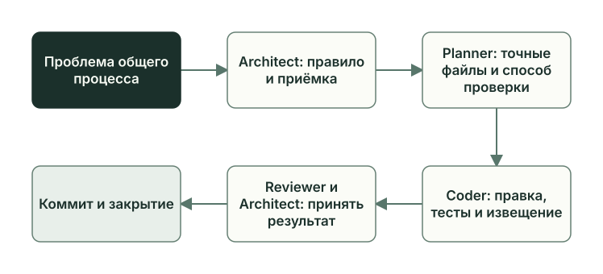

<!-- i18n: pair=docs/guides/learn/self-development.md pair-sha256=365e51dbc2c12e137e1ace47aa28bc8d3f53c48547e5adc9ae6f0c2db2f53a26 self-sha256=7bf5c89288bd4cc65eb54faf250b53062585f4232c477ec41e84eefa2dfcaaee -->
# Как Planveyor меняет себя

[English](self-development.md) · **Русский**

Изменения в Planveyor проходят тот же путь, что и задачи проектов: план, роли, ревью, приёмка Architect. Замечания ролей о самом процессе собираются в предложения (PI), и из них тоже вырастают такие планы.

## Что меняется и где лежит

| Слой | Что задаёт | Где лежит |
| --- | --- | --- |
| Документы ролей | Ответственность и границы роли | `docs/roles/` |
| Промпты и плейбуки | Инструкцию шага и подробный порядок работы | `docs/tools/prompts/`, `docs/playbooks/` |
| Скиллы | Помощь в чате, например создание плана | `skills/` |
| Шаблоны и метаданные | Формат файлов задачи и машиночитаемые словари, например `plan_vocab.json` | `docs/*/_template*`, `docs/_meta/` |
| Команды и обёртки | Подготовку сессии, проверки перед запуском и вызов агентного харнеса | `bin/planveyor`, `scripts/planveyor.zsh`, `scripts/planveyor/` |
| Вспомогательные скрипты и тесты | Проверки и обработку файлов задачи | `scripts/*.py`, `scripts/test_*.py` |
| Шаблон sibling | Файлы, которые получает новый проект | `copier_template/` |

Промпт объясняет модели, что делать, а скрипт проверяет данные и условия. Поэтому новое правило в промпте само проверкой не станет. Новой проверке в коде, если она меняет работу роли, нужен согласованный текст в промпте.

Правила для таких правок:

- Копию в `copier_template/` правят вместе с исходником в `docs/`; у скиллов исходник лежит в `skills/`, а копия в `copier_template/.agents/skills/`. Тест `test_template_copies_match_their_docs_sources_byte_for_byte` требует побайтного совпадения.
- Производные файлы руками не правят. `build_role_bundles.py` при создании сессии собирает из документов роли и промптов её XML-контекст `.tmp/role_bundles/<роль>.xml`, а сводки предложений по процессу в `docs/process_improvements/` пересобирает сборщик предложений.
- Общие файлы ничего не знают о стеке конкретного проекта. Команды, базы и проверки продукта sibling пишет в свои [локальные разделы](sibling-lifecycle.ru.md#локальные-разделы); обновление движка переносит их без изменений.

Одно изменение обычно задевает несколько слоёв сразу. Когда Manager научился явно продолжать начатый цикл закрытия документов (`planveyor_manager_collab_cmd run <план> --followups-capture-cycle-id <UUID>`), правка затронула 12 файлов: промпт Manager и его копию в `copier_template/`, руководство запуска, скрипты `docs_closeout.py` и `followups_capture.py`, обёртки в `scripts/planveyor.zsh` и `scripts/planveyor/role_runtime.zsh` и пять файлов тестов.

## Изменение в самом Planveyor

Когда меняют движок, проектом служит сам Planveyor: без `--project` фасад выбирает его корень. В документах этот режим называют Self-Planveyor, а Owner здесь — сопровождающий Planveyor, который ведёт изменение. План пишут по шаблону `docs/plans/_template.md` и кладут в `docs/plans/` Planveyor. Команды `planveyor sibling` работают только с sibling, а в корне Planveyor доступны лишь их справка и `sibling init`, которая создаёт новый проект. Поэтому план выбирают и ведут низкоуровневыми командами из [руководства запуска](../launch-and-role-modes.ru.md):

```zsh
./bin/planveyor planveyor_plan_set docs/plans/YYMMDD_HHMM_topic.md
./bin/planveyor planveyor_manager_init
./bin/planveyor planveyor_manager_resume
./bin/planveyor planveyor_manager_collab_tui
```

`planveyor_manager_init` заводит сессию Manager без запросов одобрения. Поэтому до работы Owner вводит `/permissions` в пустом окне `planveyor_manager_resume`, выбирает «Ask for approval» и выходит. После этого Owner одобряет в окне запросы Architect на запись в `.git`. Одобрение относится к конкретному вызову, а не ко всему закрытию задачи: при закрытии задачи в самом Planveyor окно отдельно спросило про `planveyor_plan_bundle --stage`, `planveyor_plan_closeout_preflight`, их повторный запуск и `git commit`, и Owner каждый раз отвечал разовым «Yes, proceed».

Если команды идут из отдельной копии Planveyor, передавайте каждой из них `--project <проект>`, как сказано в [руководстве запуска](../launch-and-role-modes.ru.md#роли-и-входы): без него команда возьмёт проектом саму эту копию, из какого бы каталога её ни вызвали.

Если план в статусе `Architect initial draft`, Manager начинает с обсуждения задачи с Architect; вопросы к Owner он задаёт в окне TUI и ждёт ответа. Политика коммита здесь `native_existing` (раздел [«Кто делает коммит»](review-acceptance.ru.md#кто-делает-коммит)): в обычном плане разработки после приёмки Architect сам коммитит точный набор файлов плана, а потом, если закрытие документов требует коммита, и документы. `git push` остаётся за Owner.



Какие проверки запускать перед ревью, описывает [CONTRIBUTING](../../../CONTRIBUTING.ru.md); маршруты и разница между ними — в главе [«Тесты движка»](engine-tests.ru.md).

Если новая проверка требует решения шире плана, работа возвращается к Architect. Ослаблять проверку, чтобы она прошла, нельзя. Работу за границами плана записывают отложенной задачей.

## Предложения по процессу (PI)

Обычно PI появляется при закрытии документов (глава [«Закрытие задачи»](closeout.ru.md)). Каждая из четырёх ролей отвечает разделом `Process improvements`: предложением или строкой `NO PROCESS IMPROVEMENTS — why: <причина>`, например с причиной `clean_run`. Общие промпты и плейбуки роль при этом не правит.

Путь записи PI:

1. Сбор. После ответа каждой роли Manager передаёт его сборщику предложений `process_improvements_collect.py`. Сборщик добавляет запись `### PI-NNN` со статусом `open` и приоритетом `P?` в файл `docs/process_improvements/YYMMDD_HHMM_topic__process_improvements_backlog.md`, названный по плану, и пересобирает три сводки: `index.md`, `deferred.md` и `promotion_surface.md`. Номера PI свои в каждом файле. Ошибка сборщика останавливает закрытие, с одним исключением: после ошибки формата в разделе `Process improvements` та же роль может дать один исправленный ответ.

   Автоматическая коррекция формата PI на этапе `general` допускает один дополнительный ответ той же роли, только если вспомогательный скрипт подтвердил отсутствие эффекта ошибки и принадлежность всех незакоммиченных изменений документации текущей PI-цепочке. Правки обычных документов вне этой цепочки блокируют коррекцию, даже если сами файлы не защищены. Повторная ошибка или повторный вход не возвращают потраченную попытку; работа останавливается для решения Owner.
2. Разбор. Architect называет файл, куда должна прийти правка (`target_canon_path`), репозиторий (`target_repo_scope`) и способ доставки (`delivery_mode`, таблица ниже). Owner меняет `P?` на `P0`, `P1` или `P2`: это срочность записи. Класс правки уже записан в `promotion_class`: `canon_update` для документов, шаблонов и плейбуков, `prompt_change` для промптов, `helper_change` для скриптов и обёрток, `routing_change` для изменений маршрута и очереди, `followup_plan` для создания плана отложенной задачи. После разбора запись получает статус `triaged`, `deferred` (с причиной и условием возврата) или `rejected` (с причиной). Поля записывает скрипт `process_improvements_triage.py`.
3. Привязка (в полях и скриптах — promotion). `process_improvements_promote.py` связывает запись с уже существующим исполнением, обычно с планом (`execution_kind=plan` и путь к плану в `execution_ref`). При успехе запись получает статус `promoted` и время `promoted_at`. План скрипт не создаёт: если файла нет, он отказывает, и запись остаётся `triaged`.
4. Исполнение. План проходит обычный путь с ревью и приёмкой.
5. Сверка. `process_improvements_reconcile.py --report` находит записи, чей план уже `Done`; с `--apply` они получают статус `handled`, ссылку `handled_ref` и время `handled_at`.

| `delivery_mode` | Что происходит |
| --- | --- |
| `source_only` | Правка остаётся в текущем репозитории |
| `source_plus_rollout` | Правка входит в правила этого репозитория, а потом пакетом едет в проект-получатель |
| `packet_only` | Этот репозиторий свои правила не меняет и готовит только пакет для проекта-получателя |
| `umbrella_mixed` | Запись требует отдельной декомпозиции с зонтичным планом |

Пакеты описаны в главе [«Обмен изменениями с Planveyor»](change-packets.ru.md); сейчас sibling их не получает ([F29](../../release_backlog.md#f29)).

Скрипты разбора, привязки и сверки роли в обычном ходе не вызывают: их запускают отдельной командой. Для привязки и сверки есть команды фасада `planveyor_process_improvements_promote` и `planveyor_process_improvements_reconcile`, для разбора — скрипт `process_improvements_triage.py`. Скрипты меняют только запись и сводки: план не создают, роли не запускают и очередь не включают. Решения по зрелым записям Architect фиксирует на шаге `plan_harvest` [проверки после слияния](postmerge.ru.md), в разделе `Process-improvement promotion decisions`. Записи `open`, `triaged` и `promoted` — ещё не сделанная работа; `handled` ставит сверка.

Второй источник записей — запрос из sibling в Planveyor. Команда `planveyor_upstream_request_import` превращает его в такую же запись `open`, дальше идёт тот же разбор (см. [«Обмен изменениями с Planveyor»](change-packets.ru.md)). Формат записи и правила собраны в [описании предложений по процессу](../../process_improvements/README.md).

На момент первого выпуска у самого Planveyor разбора ждали 27 собственных предложений в семи файлах, их список — в `docs/process_improvements/index.md`. Три из них, `PI-001`, `PI-002` и `PI-003` в `docs/process_improvements/release__process_improvements_backlog.md`, — `open` с `P?`; в [обязательствах первого релиза](../../release_backlog.md) они названы PI1–PI3.

## Пример: запись PI-001 в SQL-проекте

В SQL-проекте при закрытии документов задачи GetReorderCandidates появилась запись PI-001 (глава [«Закрытие задачи»](closeout.ru.md#как-это-было-документы-getreordercandidates)). Предложение дал Architect, Planner ответил `clean_run`, а Coder и Reviewer — `already_tracked`, потому что предложение уже записано. Номер PI-001 относится к файлу предложений проекта, с собственными предложениями Planveyor он не связан. Поля разбора, которые в той главе скрыты за «[…]», все пустые:

```markdown
- target_canon_path: `null`
- target_repo_scope: `null`
- delivery_mode: `null`
- execution_kind: `null`
- execution_ref: `null`
- delivery_refs: `null`
- handled_ref: `null`
- promoted_at: `null`
- handled_at: `null`
```

Ссылка на отчёт предыдущей задачи стоит в [локальном разделе](sibling-lifecycle.ru.md#локальные-разделы) плейбука ревью, поэтому разбор назначил бы доставку `source_only`, а правку провёл бы обычный план в самом проекте. Ошибку в общей части исправляют через запрос в Planveyor (глава [«Обмен изменениями с Planveyor»](change-packets.ru.md)).

На последнем коммите проекта `f4f707b` запись PI-001 всё ещё `open` с `P?`. Разбора, плана исполнения и статуса `handled` в истории проекта нет, а локальный раздел по-прежнему ссылается на отчёт предыдущей задачи.

## Как изменение доходит до sibling

Если изменение трогает общий контракт или механику, в ту же правку входит извещение (формат — в главе [«Обмен изменениями с Planveyor»](change-packets.ru.md#извещение-что-приносит-новая-версия)). Образец из истории разработки — извещение о правке трёх промптов CENSOR: `engine_changes` в нём пуст, а `sibling_actions` просит прочитать новые промпты и сохранить локальные разделы. До проекта изменение доходит обновлением: Owner обновляет копию Planveyor и запускает `planveyor sibling upgrade`, а роли проводят план обновления. Как это устроено и как прошло в SQL-проекте, рассказано в главе [«Sibling: создание и обновление»](sibling-lifecycle.ru.md#обновление-до-новой-версии-planveyor). SQL-проект обновляли ещё до команды `sibling upgrade`, низкоуровневой командой `planveyor_contract_upgrade`.

## Частые ошибки и что их ловит

| Ошибка | Что её ловит |
| --- | --- |
| Поправить промпт, плейбук или скилл и забыть копию в `copier_template/` | Тест `test_template_copies_match_their_docs_sources_byte_for_byte` |
| Потерять в промпте обязательную фразу или вернуть запрещённую | Тесты текста промптов, например в `scripts/test_censor_prompt_contract.py` и `scripts/test_planveyor_codex_agent_roles.py` |
| Закомментировать вызов линтера документов (doc lint) в `scripts/planveyor.zsh` или унести его в другую функцию | Проверка профильного контракта `check_planveyor_profile_contract.py`, замечание `doc_lint_gate` |
| Поправить общий промпт или плейбук при закрытии документов | `planveyor_docs_closeout` ставит причину `canon_delta_requires_process_improvement`, и закрытие такую правку не коммитит. Architect оформляет её как запись PI или переносит в отдельный действующий план; закрытие продолжается, когда в наборе файлов закрытия не осталось защищённой правки |
| Привязать запись PI к несуществующему плану | `process_improvements_promote.py` отказывает, запись остаётся `triaged` |
| Записать извещение без поля, с полем не того типа или с пустой либо многострочной строкой | Тест `test_current_notice_history_and_strict_notice_are_valid` в полном маршруте; у sibling обновление остановится до кандидата |
| Изменить общий контракт без извещения | Пункт проверки перед закрытием в [docs_architecture.md](../../playbooks/docs_architecture.md); без извещения план обновления в sibling не получит ни действий, ни проверок |

Функции и тесты, о которых шла речь, — в [справочнике по коду](code-map.ru.md#как-planveyor-меняет-себя).

Дальше: [«Проверка после слияния»](postmerge.ru.md).
