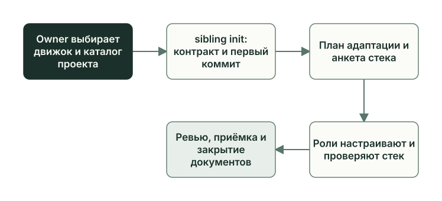
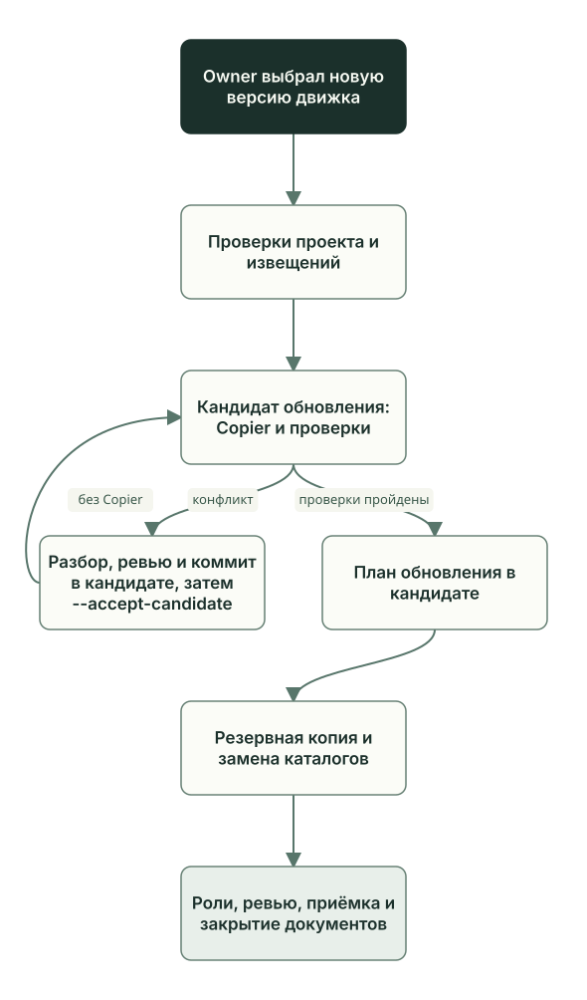

# Sibling: создание и обновление

Sibling — отдельный Git-репозиторий вашего проекта, созданный из Planveyor: код продукта, обвязка стека (`Makefile` и скрипты сборки и проверок), планы и правила ролей. Глава объясняет, что в нём принадлежит проекту, как `planveyor sibling init` создаёт проект и как `planveyor sibling upgrade` переносит в него новую версию Planveyor. Порядок команд описан в [руководстве по sibling](../stack-sibling.ru.md).

## Какой сценарий нужен

Выберите строку по тому, где должно появиться изменение: в вашем проекте или в Planveyor.

| Что нужно | Что делать | Что получится | Что ещё предстоит |
| --- | --- | --- | --- |
| Проекта ещё нет | `planveyor sibling init`, см. [создание проекта](../stack-sibling.ru.md#один-раз-среда-и-создание-проекта) | Новый репозиторий с контрактом Planveyor и первым коммитом от вашего имени в Git | Провести первый план: адаптацию под стек |
| Изменить продукт или правила стека | Обычный план в проекте, см. [план и его статусы](plan-lifecycle.md) | Изменённый код, проверки или локальные разделы правил | Ревью, приёмка, коммит и закрытие документов |
| Перейти на новую версию Planveyor | Обновить копию Planveyor, затем `planveyor sibling upgrade`, см. [новую версию](../stack-sibling.ru.md#получить-новую-версию-planveyor) | Перенесённый контракт, резервная копия и план обновления | Провести план обновления ролями до приёмки и закрытия документов |
| В проекте нашли общую проблему Planveyor | Запрос в Planveyor, см. [предложить изменение](../stack-sibling.ru.md#предложить-изменение-planveyor) | Проверенный файл запроса и, с вашего разрешения, issue в GitHub | Решение принимают в Planveyor; если предложение примут, исправление придёт новой версией. Отправка запроса исправления не гарантирует |

Запросы, извещения и адресные пакеты (rollout packet), которых sibling сейчас не получает, разобраны в главе [«Обмен изменениями с Planveyor»](change-packets.md).

## Пример: SQL-проект

Примеры взяты из SQL-проекта, где решали задачу `GetReorderCandidates` из сквозного примера раздела. Проект не опубликован, файлы его задачи лежат в [снимке](examples/sql/README.md). Вся его история уместилась в семь коммитов:

| Коммит | Когда | Что в нём |
| --- | --- | --- |
| `b2962f4` | 27.09, 19:05 | Init: контракт Planveyor, 105 файлов |
| `fb6f9bf` | 27.09, 20:41 | Адаптация под SQL Server: обвязка, настройки и локальные разделы, 28 файлов |
| `60332b4` | 28.09, 00:00 | Закрытие документов адаптации |
| `70526ee` | 28.09, 02:17 | Задача `GetReorderCandidates` |
| `edac1b9` | 28.09, 03:05 | Закрытие документов задачи |
| `6a353de` | 28.09, 11:06 | План обновления до следующей версии Planveyor, 7 файлов |
| `f4f707b` | 28.09, 11:15 | Статус `Done` и запись о приёмке в плане обновления |

Всё это было до команд `planveyor sibling`: роли и живые прогоны на dev-базе запускал оператор (см. [«Роли и файлы задачи»](roles-artifacts.md)), а коммиты делались без `planveyor sibling close --commit`. Как коммиты устроены сейчас, рассказано в разделе [«Кто делает коммит»](review-acceptance.md#кто-делает-коммит).

## Что принадлежит проекту, а что Planveyor

Из Planveyor проект получает контракт: документы ролей, промпты, плейбуки, шаблоны, записи архитектурных решений (ADR) и скиллы в `.agents/skills/`. Раскладывает и обновляет контракт Copier, инструмент шаблонов проектов. Версию Planveyor, из которой собран контракт, записывают два файла проекта: `.copier-answers.yml` (поле `_commit`) и `planveyor_contract_authority.v1.json` в `docs/_meta/`.

| Что | Кто владеет | Пример из SQL-проекта |
| --- | --- | --- |
| Общие правила ролей, промпты, плейбуки и шаблоны | Planveyor, приходят с контрактом | `docs/roles/`, `docs/tools/prompts/`, общая часть плейбука ревью `review_staged_or_commit.md` |
| Команды, обёртки и скрипты движка | Planveyor, остаются во внешней копии | `bin/planveyor` и `scripts/` движка живут только в копии Planveyor |
| Код продукта, обвязка стека, планы и ревью | Проект | Процедура [GetReorderCandidates.sql](examples/sql/sql/Northwind/GetReorderCandidates.sql), обвязка [sql.py](examples/sql/scripts/sql.py), `Makefile`, планы в `docs/plans/` |
| Локальные разделы правил ролей | Проект | Шесть целей `make` в правилах Coder; условие, при котором Reviewer не повторяет прогон на dev-базе |
| ИИ-клиент, учётные записи и dev-среда | Owner или тот, кто отвечает за dev-среду | `.env.local` с правами 0600, выделенная dev-база |
| Выбор версии движка и обновление | Owner | Переход на следующую версию Planveyor 28 сентября |

### Локальные разделы

Правила стека записаны в восьми файлах: в промптах `architect_status_driven.md`, `planner_status_driven.md`, `coder_status_driven.md`, `coder_migrations_gate.md`, `reviewer_status_driven.md` и в плейбуках `review_staged_or_commit.md`, `review_merge_range.md`, `post_merge_audit.md`. В каждом из них два раздела с постоянными заголовками: `## Локальные правила стека` и `## Разрешённое локальное переопределение процесса`. После init их текст принадлежит проекту, и Planveyor туда ничего не дописывает. Остальной текст этих файлов (общие правила, статусы, полномочия ролей) принадлежит Planveyor.

В контракте раздел приходит незаполненным:

```markdown
## Локальные правила стека

- Подготовка, build/test/smoke commands: N/A (why=stack-specific rule not configured)
```

После адаптации в SQL-проекте эта строка в правилах Coder начиналась так:

```markdown
- Подготовка, build/test/smoke commands: для текущей адаптации реализуй шесть interface targets `setup`, `db-extract`, `db-build`, `lint`, `check-secrets`, `db-proof` в `Makefile` и ignored local tools/cache/output до первого setup. …
```

Второй раздел нужен для отступлений от общего процесса. В SQL-проекте его заполнили только в плейбуке ревью. Reviewer может не повторять `make db-proof`, если файлы SQL, инструментов и настроек побайтно совпадают с теми, на которых оператор уже выполнил прогон, а набор тестов совпадает с отчётом JUnit этого прогона. Причина записана там же: повторная выкладка схемы (publish) в общую dev-базу может задеть чужое состояние. Статусы и маршрут ревью такое переопределение не меняет.

## Создание проекта

Команда `planveyor sibling init ~/my-stack` создаёт новый репозиторий вне копии Planveyor. Версию Planveyor она берёт из текущего коммита копии, поэтому всё в копии должно быть закоммичено. Первый коммит подписывается вашим именем и почтой из настроек Git или из флагов `--author-name` и `--author-email`. Каталог проекта должен быть новым или пустым.

Проект собирается во временном каталоге `.<имя>-init-…` рядом с целевым. Copier раскладывает контракт, команда создаёт репозиторий с веткой `main`, сохраняет в нём ваше имя и почту для следующих коммитов, делает коммит `Initialize Planveyor sibling contract` и проверяет контракт. Только после успешной проверки временный каталог занимает место проекта; если шаг не прошёл, он остаётся рядом для разбора.

Плана и анкеты стека init не создаёт. Команда заканчивается подсказкой: открыть проект в чате и поручить скиллу `$planveyor-plan-draft` создать и выбрать план адаптации под стек.



### Первый план: адаптация под стек

Скилл создаёт план и анкету стека `stack_brief.md` в `docs/` проекта по шаблону `docs/_template_stack_brief.md`. В анкете десять разделов: от назначения проекта и стека до живой цели (dev-базы или сервиса, с которыми работают живые проверки), того, кто эти проверки запускает, и того, что вне объёма. Если поле анкеты пустое, Architect задаёт Owner вопрос и предлагает ответ.

Дальше план идёт обычным путём, от Architect до приёмки. Coder пишет обвязку, проверки и локальные разделы, а Reviewer проверяет, что команды стека действительно проверяют продукт. В границы плана входят обвязка стека, корневой `README.md` проекта и локальные правила ролей. Адаптация закончена после закрытия документов (глава [«Закрытие задачи»](closeout.md)).

В SQL-проекте анкеты ещё не было: её шаблона в той версии Planveyor не было. Решения о стеке Owner дал в задании, и Architect записал их прямо в план адаптации `260927_1913_sql_server_adaptation`. Два пункта из его раздела `## Solution (high level)`:

```markdown
- В текущем sibling зафиксировать `.NET SDK 10.0.401`, `Microsoft.Build.Sql 2.3.0`, `tSQLt.Dacpacs 1.0.8083.3529` с `tSQLt.2019`, `SqlPackage 170.5.96`, SQLFluff `3.4.2` и `go-sqlcmd 1.10`. …
- `Makefile` предоставляет только существующий набор интерфейсов `setup`, `db-extract`, `db-build`, `lint`, `check-secrets`, `db-proof`; …
```

План охватил 22 целевых файла. Четырнадцать из них относятся к обвязке и настройкам, среди них `Makefile`, обвязка [sql.py](examples/sql/scripts/sql.py) и схема `sql/Northwind/Northwind.sql`. Ещё восемь — файлы с локальными разделами. Коммит адаптации `fb6f9bf` появился в 20:41, через 1 ч 36 мин после init. В нём 28 файлов: 22 целевых, план, черновик кода, ревью и три приложения к ревью.

## Обновление до новой версии Planveyor

Новую версию выбираете вы: обновите свою копию Planveyor, например командой `git pull` в ней. Сама команда обновления `git pull` не делает и ветку не переключает. Новая версия должна продолжать прежнюю историю и лежать на ветке или теге.

До обновления доведите текущий план до конца, включая закрытие документов, завершите сессии ролей и выйдите из каталога проекта. Обновление меняет каталоги местами, поэтому его запускают снаружи:

```sh
planveyor --project ~/my-stack sibling upgrade
```

Обычно команды `planveyor sibling` находят проект по текущему каталогу, а флаг `--project` указывает его явно.

### Как идёт обновление

1. **Проверки до копирования.** Команда убеждается, что в копии Planveyor и в проекте всё закоммичено, что каталог `.git` у проекта собственный (git worktree команда отклонит) и что новая версия продолжает прежнюю. Затем она сверяет проект с контрактом обеих версий: все ли файлы на месте и читаются ли локальные разделы. Если новая версия убирает из контракта файл, который проект изменил, или одни файлы контракта исчезают, а другие появляются, обновление остановится. Здесь же команда проверяет каждое извещение между версиями, то есть JSON-файл Planveyor о том, что изменилось и что сделать в проекте (подробно — в главе [«Обмен изменениями с Planveyor»](change-packets.md)).
2. **Кандидат обновления.** Команда копирует проект в каталог `.<имя>-upgrade-<12 знаков нового коммита>` рядом с ним и запускает в копии Copier. Затем она сравнивает локальные разделы с исходными побайтно, ищет следы конфликта (маркеры `<<<<<<<`, файлы `.rej`, неразрешённые конфликты в индексе Git) и проверяет контракт кандидата: все ли файлы на месте и записана ли новая версия. Любая проблема останавливает обновление, и исходный проект остаётся как был.
3. **План обновления.** Если всё чисто, команда создаёт в кандидате план адаптации обновления (дальше — план обновления) со статусом `Architect initial draft` и проверяет его линтером; если линтер не прошёл, исходный проект тоже не меняется. Имя плана складывается из даты, времени и коротких хешей обеих версий: `docs/plans/YYMMDD_HHMM_contract_upgrade_<старая>_<новая>.md`. В `## Scope` команда пишет обе версии движка, извещения и списком путей изменённые файлы контракта и движка (из `scripts`, `bin` и `Makefile`). Что изменилось по существу, роли выясняют сами, по извещениям и diff.
4. **Резервная копия и замена каталогов.** Только теперь исходный каталог переименовывается в резервную копию `.<имя>-before-<12 знаков нового коммита>`, а кандидат занимает его место. Если второе переименование не удалось, команда возвращает исходный каталог.
5. **Выбор плана.** Команда делает план обновления текущим, печатает путь резервной копии и сообщение «Контракт обновлён; адаптация ещё открыта.», а следующим шагом называет `planveyor sibling architect`.



План создаётся при любом успешном обновлении. После обычного обновления изменённые Copier файлы и новый план лежат в проекте незакоммиченными. Дальше план обновления проходит тот же цикл, что любая задача: `architect`, `run`, `close`, `close --commit` и закрытие документов.

### Как это прошло в SQL-проекте

План обновления появился 28 сентября в 09:45. Команда записала в него три изменённых файла контракта (`.copier-answers.yml`, `planveyor_contract_authority.v1.json` и плейбук ревью `review_staged_or_commit.md`), один файл тестов движка `scripts/test_consumer_contract.py` и одно извещение.

В тексте, который принадлежит Planveyor, обновление изменило одну строку. Copier вставил её в плейбук ревью прямо над локальными разделами, а сами разделы не тронул (коммит `6a353de`):

```diff
+При обновлении sibling укажи в локальном плане адаптации оба source commit и проверь сохранность bytes локальных секций до и после Copier.
+
 ## Локальные правила стека
```

Два других файла контракта хранят версию Planveyor, а файл тестов движка, как записал Architect, относится к самому Planveyor. Planner составил черновик кода с тремя целевыми файлами: теми самыми файлами контракта. Coder и Reviewer сверили 16 локальных разделов в восьми файлах с резервной копией, и все совпали побайтно. Обе линии Reviewer замечаний не нашли. В 11:06 коммит `6a353de` записал семь файлов: три файла контракта, план, черновик кода, ревью и приложение к ревью.

### Если обновление остановилось

До копирования команда останавливается и сообщает причину. Что делать:

- в проекте или в копии Planveyor есть незакоммиченные изменения, команда запущена изнутри проекта, проект открыт как git worktree: исправьте и запустите снова;
- в копии Planveyor та же версия, что в проекте, или версия, которая не продолжает его историю: выберите в копии нужную версию;
- занят путь кандидата: прошлый запуск остановился с кандидатом; доведите его разбор до `--accept-candidate` или уберите каталог кандидата и начните заново;
- новая версия убирает файл, который проект изменил, файлы контракта переименованы неоднозначно или занят путь резервной копии: такие случаи требуют отдельного разбора, обходного пути у команды нет;
- битое извещение лежит в истории Planveyor, и в проекте его не исправить: обновление через этот диапазон версий не пройдёт (пункт [F27](../../release_backlog.md#f27) «Обязательств первого релиза»). Сообщите о нём запросом в Planveyor.

С кандидатом обновление останавливается, если Copier завершился ошибкой, в кандидате остались следы конфликта, удалённый в новой версии файл контракта остался на месте, изменился или пропал текст локального раздела либо контракт кандидата не прошёл проверку. Исходный проект при этом остаётся как был, резервной копии ещё нет.

Сейчас `planveyor sibling upgrade` в этом случае завершается кодом 3 и показывает только предупреждение о замене каталогов: что не прошло и где кандидат, команда не печатает. Кандидат лежит рядом с проектом, в `.<имя>-upgrade-<12 знаков нового коммита>`. Точный путь назовёт повторный запуск той же команды: `candidate path already exists: …`. Причину ищите в самом кандидате: `git status` покажет неразрешённые конфликты и файлы `.rej`, поиск `<<<<<<<` найдёт маркеры конфликта, а сравнение восьми файлов кандидата с файлами проекта покажет изменённый локальный текст.

Плана обновления в кандидате ещё нет. Откройте каталог кандидата в обычном чате ИИ-клиента и попросите разобрать конфликты и проверить diff. После ревью закоммитьте результат в Git кандидата и примите кандидата снаружи той же командой с флагом:

```sh
planveyor --project ~/my-stack sibling upgrade --accept-candidate
```

Между остановкой и `--accept-candidate` не обновляйте копию Planveyor: нужна та же версия, с которой создан кандидат. Команда проверяет, что история кандидата продолжает историю проекта и в нём всё закоммичено. Затем она повторяет проверки первого шага и, уже без Copier, проверки кандидата из второго, создаёт план обновления и меняет каталоги местами.

### Где остаётся риск

Проверки обновления смысл изменений не оценивают. Работают ли команды вашего стека с новыми правилами, показывают план обновления, ревью и живые проверки ролей. С `--accept-candidate` команда не сверяет содержимое файлов контракта с новой версией шаблона, и правильность разбора конфликта подтверждает только ревью кандидата. Это тоже записано в пункте F27.

Резервная копия содержит весь проект, включая `.env.local` и локальное состояние. Никуда её не выкладывайте и удалите сами, когда план обновления принят.

### Если копия Planveyor ушла вперёд

Движок работает из внешней копии Planveyor, и за её версией нужно следить. Если вы обновили копию, а проект ещё нет, `planveyor sibling ready` и `planveyor --project ~/my-stack planveyor_consumer_doctor` сообщат `runtime commit … differs from contract …`. Doctor сверяет контракт проекта с версией движка. Тогда проведите обновление или выберите копию Planveyor той версии, что записана в `_commit` файла `.copier-answers.yml`.

## Что делает Owner

1. Создаёт проект и проводит план адаптации под стек: `planveyor sibling init ~/my-stack`, скилл `$planveyor-plan-draft`, затем `architect`, `answer`, `run`, `close`, `close --commit` ([адаптация под ваш стек](../stack-sibling.ru.md#адаптация-под-ваш-стек)).
2. Для новой версии обновляет копию Planveyor, доводит до конца текущий план, выходит из проекта и запускает обновление ([получить новую версию](../stack-sibling.ru.md#получить-новую-версию-planveyor)).
3. Открывает проект заново и проводит план обновления тем же циклом.
4. Если обновление остановилось с кандидатом, разбирает его в каталоге кандидата, коммитит результат и запускает `--accept-candidate`.
5. Удаляет резервную копию после принятия плана обновления.

## Частые ошибки

- Считать сообщение «Контракт обновлён» законченным обновлением. Обновление закончено, когда план обновления принят и документы закрыты.
- Записывать правила стека вне двух локальных разделов. При обновлении побайтно защищены только они.

Функции и тесты, о которых шла речь, — в [справочнике по коду](code-map.md#sibling-создание-и-обновление).

Дальше: [«Обмен изменениями с Planveyor»](change-packets.md).
