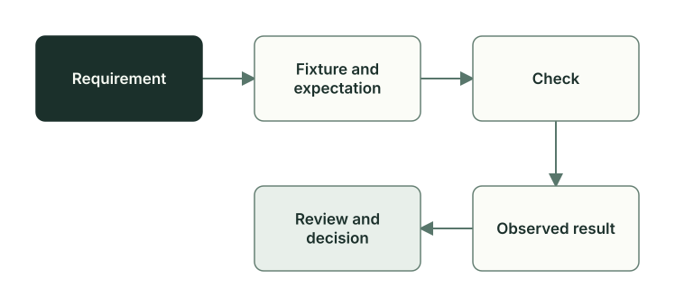

# Тесты и доказательства: чему можно доверять

Пока задача идёт от плана к коммиту, её проверяют несколько раз: скрипты Planveyor, тесты, живой прогон на dev-среде, Reviewer и Architect. У каждой проверки свой предел. Дальше это показано на задаче `GetReorderCandidates`: SQL-процедура находит товары, которые пора пополнить. Отдельно разобрано, когда зелёный результат перестаёт действовать.

## Какие бывают проверки

Кроме ролей в проверках участвует обвязка — скрипты проекта, которые собирают его, выкладывают в dev-среду и запускают тесты стека.

| Проверка | Кто запускает | Что доказывает | Чего не видит |
| --- | --- | --- | --- |
| Проверки формы: линтер плана, Oracle, проверка точного набора файлов плана | Роли перед передачей работы, Manager, команды `planveyor sibling` | План, черновик кода и ревью заполнены по правилам, статус допускает переход, объявленные файлы на месте | Работает ли код |
| Тесты без настоящей среды | Coder | Код и обвязка правильно обрабатывают подготовленные входы; проект собирается, линтер проходит | Как поведут себя настоящая база, сервис или внешний клиент |
| Живая проверка | Роль с доступом к dev-среде или человек | Изменённое поведение выдержало проверки в этой среде на этой версии файлов | Другие среды и следующие версии файлов |
| Ревью | Две линии Reviewer | Результат сверен с планом, отдельная линия искала риски, ревью привязано к версии целевых файлов | То, что Reviewer сам не запускал; это он пишет в ограничениях |
| Приёмка | Architect | Критерии приёмки выполнены, ревью не устарело | То, чего не видели прогоны и ревью, на которые она опирается |

Проверки формы находят пропущенный раздел плана или файл, которого нет на диске, но о бизнес-правиле ничего не знают. Тесты без среды подают коду фикстуры, подготовленные входы, и сравнивают результат с ожиданием; Coder запускает их по ходу работы. Живая проверка медленнее и требует доступа к среде, зато видит её настоящее состояние.

Тесты и проверки для изменённых файлов называет план. Обвязку стека берут из плана, `AGENTS.md` или правил проекта ([контракт тестов](../../tests.md), [выбор обвязки](../../testing_runbook.md)). Своих команд для языка, фреймворка, базы данных или интерфейса Planveyor не подставляет. Если объявленной обвязки нет, это блокер или явное `N/A` с причиной в плане.



Например, правило «учитывать ожидаемую поставку» проверяет тест `test_positive_shortage_and_units_on_order`. В его фикстуре у товара One порог пополнения 12, на складе 3, в заказе 4, и тест ждёт от процедуры дефицит 5. Остальные случаи собраны в таблицу в [сквозном примере](sql-example.md).

## Что увидела каждая проверка в задаче GetReorderCandidates

Кто что делал в этой задаче, рассказано в главе [«Роли и файлы задачи»](roles-artifacts.md), а как шёл живой прогон — в [сквозном примере](sql-example.md). Здесь те же события разложены по проверкам. Прогоны на dev-базе делал оператор и о каждом оставлял квитанцию: команду, время, версию файлов и результат.

| Проверка | Что показала | Чего не видела |
| --- | --- | --- |
| Линтер плана | При первом запуске нашёл три недочёта формы | Верна ли формула дефицита |
| Проверка набора файлов | До начала кода в наборе 19 файлов, ревью среди них ещё только запланировано; перед приёмкой 22 файла, все на месте | Что написано в этих файлах |
| 40 тестов обвязки, сборка, линтер SQL и проверка секретов, всё без базы | Обвязка отвергает пропущенные, лишние, повторные и упавшие результаты и неверный порядок строк; сборка прошла без ошибок и предупреждений | Состояние dev-базы: у тестового класса там не было метки tSQLt, которая делает схему классом тестов |
| Первый `make db-proof` | Обвязка остановилась до выкладки в базу: состояние тестовых классов неоднозначно | Саму процедуру: до SQL-тестов прогон не дошёл |
| Второй `make db-proof` | 8 тестов из 8; товары, добавленные как 30, 10, 20, пришли в порядке 10, 20, 30; контрольные суммы 15 файлов записаны в квитанцию | Код после коммита; почему пропала метка: причину назвали вероятной, но не доказанной |
| Ревью | Замечаний нет; 15 сумм из 15 совпали с файлами; 40 тестов обвязки прошли повторно | SQL: Reviewer его не запускал |
| Приёмка Architect | Набор из 22 файлов прошёл проверку, суммы совпали, вердикт записан | SQL Architect тоже не запускал; приёмка опирается на прогоны и ревью |

Свои границы и то, что он проверил сам, Reviewer записал в линии рисков (запись разобрана в главе [«Ревью и приёмка»](review-acceptance.md#как-это-было-ревью-getreordercandidates)). Так Architect и Owner видят, на что опирается вывод ревью.

## Что добавила живая проверка

До живого прогона у задачи всё было зелёным: 40 из 40 тестов обвязки, сборка, линтер, проверка секретов. Coder записал в план, что эти результаты не считаются успехом SQL, и оставил прогон на dev-базе оператору. Записи красного прогона сохранили, и план на них ссылается.

Исправление поменяло обвязку и её тесты, поэтому Coder запустил тесты обвязки заново. Получилось 39 из 40: подмена в одном тесте оставляла путь к отчёту JUnit в настоящем каталоге проекта, а там уже лежал отчёт красного прогона. Coder перенёс этот путь во временный каталог и получил 40 из 40.

## Доказательство относится к версии файлов

Зелёный результат действует только для тех файлов, на которых его получили. Поэтому каждая запись о проверке называет версию. Квитанция второго прогона начинается так:

```text
UTC start: 2026-09-27T22:26:39.501836+00:00
UTC end: 2026-09-27T22:26:52.922543+00:00
Elapsed seconds: 13.420
Command: `/usr/bin/make db-proof`
[…]
Source HEAD before/after: `60332b46eba26a9c09cf199184c45afe10e61f1b` / `60332b46eba26a9c09cf199184c45afe10e61f1b`
Outer actual rc: 0
[…]
Exact current 8-case JUnit matches and proof green: True
```

Ниже в квитанции перечислены контрольные суммы SHA-256 пятнадцати исполняемых и конфигурационных файлов. Reviewer и Architect сверили их с файлами на диске: 15 из 15. Значит, прогон шёл на тех же 15 файлах, которые потом приняли. `README.md` Coder поправил уже после прогона: к этой правке квитанция не относится; ревью проверяло README в новом виде.

Ревью привязано к версии так же. В его шапке записан снимок целевых файлов:

```markdown
**Target:** BUNDLE=current bundle_sha256=d8214af66e8b6797b45ecdf059790ed5e584513a4a773d385d2ad043a22a1cb4
```

Снимок — контрольная сумма содержимого всех 16 целевых файлов из черновика кода. Проверки Planveyor пересчитывают её по текущим файлам. Если после ревью изменился хотя бы один целевой файл, сумма не сходится и ревью перестаёт действовать: Oracle сообщает о блокере, а `planveyor sibling close` отказывает в коммите.

Прогон в примере сделан до коммита, после коммита SQL не запускали. Reviewer так и написал: зелёный результат относится к коду до коммита.

## Механизм, тест и принятая задача

Различайте три ступени: команда есть, тест есть, задача принята. Что следует из каждой, показывает таблица.

| Что вы видите | Что из этого следует | Что посмотреть дальше |
| --- | --- | --- |
| Команду и код, который её выполняет | Механизм есть | Ограничения в [руководстве запуска](../launch-and-role-modes.ru.md) и в главе [«Что уже работает и что дальше»](capabilities-boundaries.md) |
| Тест с названием и проверками | Поведение задано для входов этого теста | Сам тест: его фикстуры, что в нём подменено и какую ветку кода он проходит |
| Успешный отчёт о прогоне | Проверенные случаи прошли на указанной версии и в указанной среде | Команду, время, версию файлов и полный результат |
| Закрытый план | Задачу приняли и закоммитили | План, ревью, набор файлов и [закрытие задачи](closeout.md) |
| Пункт в списке обязательств | Есть намерение или обязательство | Его состояние и предел в [«Обязательствах первого релиза»](../../release_backlog.md) |

Каждой ступени нужно своё доказательство. Код, который запускает роли, ещё не говорит, что клиент модели доступен, а тест с подменённым клиентом Codex не доказывает живую сессию роли. Принятая задача в одном sibling не подтверждает, что Planveyor справится с другим стеком.

## Что делает Owner

Кто запускает живые проверки стека, вы выбираете в анкете стека при адаптации sibling: либо роли получают доступ к сети в настройках Codex, либо живые команды выполняет человек. Как во втором случае вернуть роли результат, красный или зелёный, показано в разделе «Что делает Owner» [сквозного примера](sql-example.md).

Перед коммитом посмотрите набор командой `planveyor sibling close`. Если ревью устарело, `close --commit` откажет ([«Закрытие задачи»](closeout.md)).

`planveyor sibling ready` живые проверки заново не запускает. Поэтому сами посмотрите, что проверки этой задачи действительно прошли: отчёт прошлой или чужой задачи их не заменяет.

В записи о проверке ищите пять вещей:

1. Изменение и точную версию файлов, к которой относится проверка.
2. Команду, проект и существенные условия среды, без секретов.
3. Фактический код возврата и названия случаев; отдельно пропущенные случаи, предупреждения и неприменимые проверки.
4. Какие критерии приёмки доказаны, а каким нужна другая проверка.
5. Ссылки на актуальные файлы для Reviewer и Architect.

Версию файлов, команду и код возврата видно в квитанции выше, остальное — в плане и ревью.

## Частые ошибки

- Принимать запись «Reviewer проверил» за повторный запуск проверок.
- Прятать красный прогон.
- Оценивать набор по числу тестов, не читая, что они проверяют.

Функции и тесты, о которых шла речь, — в [справочнике по коду](code-map.md#тесты-и-доказательства-чему-можно-доверять).

Как устроены тесты самого Planveyor, рассказано в главе [«Тесты движка»](engine-tests.md).

Дальше: [«Sibling: создание и обновление»](sibling-lifecycle.md).
