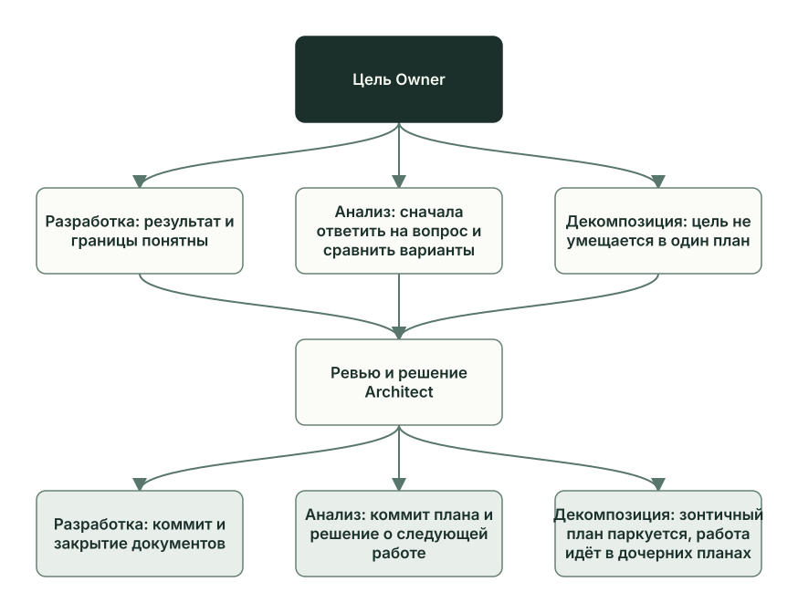

# Разработка, анализ и декомпозиция

Planveyor различает три вида работы, или контура: разработку, анализ и декомпозицию. Разработка сразу меняет файлы проекта. Анализ сначала отвечает на вопрос и выбирает, что делать дальше, а декомпозиция делит большую цель на несколько планов. Роли и статусы у всех трёх общие, различаются результат и то, чем заканчивается план.

## Три контура работы

| Контур | Когда выбирать | Что получается на выходе | Отметка в `plan_meta` |
| --- | --- | --- | --- |
| Разработка | Результат и границы понятны: можно назвать файлы и условия приёмки | Изменённые файлы, результаты проверок, ревью и коммит | Нет, это контур по умолчанию |
| Анализ | Нужно ответить на узкий вопрос по файлам репозитория и сравнить варианты | Проверенная таблица анализа и решение Architect о следующей работе | `wave_family = "analysis_wave"` |
| Декомпозиция | Большая цель принята, но в один план не помещается | Зонтичный план, дочерние планы с порядком выполнения и отложенные задачи | `phase_overlay = "decomposition_wave"` и `phase_state` |

Отметки стоят в объекте `plan_meta` блока `## Meta` плана. У декомпозиции поле `phase_state` равно `active`, пока цель делят, и `parked`, когда деление принято. Зонтичный план — главный план декомпозиции: в нём постановка задачи, карта дочерних планов и их порядок, а кода он не меняет.

Разработка — выбор по умолчанию, в том числе для небольших правок. Делить задачу стоит, когда один план перестаёт её удерживать: например, его несколько раз переписывают, а условия так и не устоялись. Длинное описание цели само по себе такой причиной не считается. [Плейбук декомпозиции](../../playbooks/decomposition_wave.md) предлагает заранее оценить число частей. Если часть одна, почти всегда хватает обычного плана разработки. Две-три части дают облегчённую декомпозицию, четыре и больше — полную, с долгоживущим зонтичным планом и отдельным ревью планов.

Анализ отвечает на вопрос, который можно проверить по файлам репозитория: документам, планам, коду. Открытое исследование рынка без таких источников в анализ не входит.



План разработки и план анализа после приёмки закрывают обычным путём: коммит, затем закрытие документов. Зонтичный план Architect паркует: ставит `phase_state = "parked"` и обычно статус `Ready for Planner`, и план остаётся справкой, пока идут дочерние планы. В `Done` Architect переводит его отдельным решением, когда все дочерние планы закончены.

Граница между контурами записана в [ADR 007](../../adr/007-planning-dev-contour-boundary.md). Планы анализа и декомпозиции меняют только документы: таблицу анализа, планы и записи отложенных задач. Код продукта меняется только в планах разработки. Если посреди разработки выясняется, что нужен широкий анализ или деление на части, роль останавливается и возвращает работу Architect статусом `Ready for Architect response`.

## Как работают роли

Роли здесь те же сессии ИИ-клиента, что и в разработке ([«Роли и файлы задачи»](roles-artifacts.md)), и Manager ведёт их по тем же статусам. Coder в планах анализа и декомпозиции пишет таблицу анализа или планы, код продукта он не трогает.

| Роль | В анализе | В декомпозиции |
| --- | --- | --- |
| Architect | Ставит вопрос, цель и ограничения; после ревью выбирает исход | Описывает задачу целиком: результат, для кого он, что мешает сейчас и что не входит; выбирает, по какому признаку делить |
| Planner | Решает, какие источники читать и как должна выглядеть таблица анализа | Описывает каждую часть: что она получает и отдаёт, от чего зависит, как её проверить; задаёт порядок частей |
| Coder | Читает источники и записывает в таблицу варианты, допущения и рекомендацию | Создаёт зонтичный план, дочерние планы и записи отложенных задач |
| Reviewer | Проверяет источники, неподтверждённые допущения и ясность рекомендации | Проверяет, что части покрывают цель, не дублируют друг друга и каждую можно принять отдельно |

В зонтичном плане `Ready for Review` означает, что написаны зонтичный и дочерние планы, а `Ready for Arch review` — что эти планы прошли ревью ([правила планов](../../plans/README.md)). Каждый дочерний план Coder создаёт по шаблону со статусом `Ready for Planner`: с него начинается собственный цикл этого плана.

Таблица анализа — раздел `## Analysis pack`. До статуса `Planner finalize` Architect и Planner заполняют её прямо в плане. При переходе на `Planner finalize` Planner переносит таблицу в отдельный файл `docs/analysis_packs/<plan_stem>.md` (`<plan_stem>` — имя файла плана без `.md`) и оставляет в плане одну строку со ссылкой, `analysis_pack_ref`. Дальше этот файл — единственный целевой файл черновика кода: Coder его заполняет, Reviewer проверяет. Перенос нужен потому, что план меняется во время ревью (см. [«План и его статусы»](plan-lifecycle.md)). Если после переноса оставить в плане строки `recommendation`, `route_recommendation`, `execution_budget` или `stale_trigger`, линтер плана выдаст ошибку `operational_duplicate`. Что делать, если статус уже поставили, а таблицу не перенесли, описывает [плейбук анализа](../../playbooks/analysis_wave.md).

Хранение таблицы анализа и запуск дочерних планов ещё дорабатывают, см. главу [«Что уже работает и что дальше»](capabilities-boundaries.md).

## Пять исходов анализа

Coder заканчивает анализ рекомендацией (`route_recommendation`): какой из пяти исходов он предлагает и почему. Рекомендация ещё не решение, и Manager по ней ничего не запускает. Исход выбирает Architect при приёмке (`Architect arch review`) и записывает его в раздел плана `## Promoted route artifact`.

| Исход | `accepted_route` | Что появляется | Следующий шаг |
| --- | --- | --- | --- |
| Разработка | `developer_wave` | Новый план разработки со ссылкой на план анализа (`seed_dev_plan`); он начинается с `Architect initial draft` | Обычный цикл нового плана |
| Декомпозиция | `decomposition_wave` | Зонтичный план декомпозиции (`decomposition_umbrella`) | Роли делят цель на дочерние планы |
| Вопрос Owner | `human_gate` | Вопрос или запрос одобрения в журнале вопросов (`owner_gate`) | Работа ждёт решения Owner |
| Отложить | `defer` | Запись отложенной задачи в `docs/followups/` с ответственным и причиной (`followup`) | Тему поднимают, когда выполнится записанное условие |
| Отклонить | `reject` | Запись об отказе с причиной (`rejection_receipt`) | Ничего не запускается |

Последние три исхода новой работы ролям сейчас не дают. Их выбирают, когда проверенная таблица анализа показывает, что начинать разработку или декомпозицию сейчас не стоит. У вопроса Owner и отложенной задачи должен быть записан повод вернуться к теме (`revisit_when`), иначе линтер плана выдаст ошибку. Пока у принятого исхода нет записи (`promoted_artifact_ref`) и следующего шага (`next_action`), план анализа не закроется.

## Как это выглядит в плане

Задача GetReorderCandidates из сквозного примера — обычная разработка. Owner заранее принял все решения, и в разделе «Как я понял задачу» Architect записал: «открытых решений к согласованию нет». Метки контуров в `plan_meta` пустые:

```json
"wave_family": null,
"phase_overlay": null,
"phase_state": null,
```

Разделы шаблона для анализа и декомпозиции план закрывает явным `N/A` с причиной:

```markdown
## Business decomposition framing
N/A (why=одна ограниченная процедура, не decomposition wave).

## Child plan map
N/A (why=обычный dev-plan без child graph).
…
## Analysis pack
N/A (why=не analysis wave).

## Promoted route artifact
N/A (why=не analysis wave).
```

Настоящего плана анализа пока нет ни в репозитории Planveyor, ни в SQL-проектах на нём. Его устройство задаёт [шаблон плана](../../plans/_template.md); так начинается таблица анализа в шаблоне (часть строк пропущена):

```markdown
## Analysis pack
| Field | Value |
| --- | --- |
| `analysis_subject` | `<bounded subject>` |
| `desired_outcome` | `<decision/route this analysis must enable>` |
…
| `scope_refs` | `<opened/read repo-backed refs; retrieval hits not read do not count>` |
…
| `options_considered` | `<options + trade-offs + rejected alternatives>` |
| `recommendation` | `<chosen answer / decision proposal>` |
…
| `route_recommendation` | `<developer_wave|decomposition_wave|human_gate|defer|reject> + reason + prerequisites + target refs` |
…
```

Предмет и цель анализа (`analysis_subject`, `desired_outcome`) записывает Architect. Coder записывает, какие источники он действительно открыл и прочитал (`scope_refs`), какие варианты рассмотрел и что рекомендует. После приёмки Architect заполняет раздел `## Promoted route artifact`: принятый исход (`accepted_route`), вид и путь созданного файла (`promoted_artifact_kind`, `promoted_artifact_ref`) и следующий шаг (`next_action`).

Декомпозицию пробовали в другом SQL-проекте на Planveyor, и она не завершена. Зонтичный план «аудит истории цен товаров» остановился на ревью (`Ready for Review`), три дочерних плана ждут Planner (`Ready for Planner`). Его отметки и ссылки на дочерние планы:

```json
"phase_overlay": "decomposition_wave",
"phase_state": "active",
"parent": null,
"next_plans": [
  "docs/plans/260930_2156_product_unit_price_history_table.md",
  "docs/plans/260930_2156_product_unit_price_history_trigger.md",
  "docs/plans/260930_2156_product_unit_price_history_queries.md"
],
```

Первый дочерний план создаёт таблицу истории цен, второй — триггер, который записывает изменения цены, третий — две процедуры чтения истории. Второй план ждёт первого, третий идёт после второго. Части три, поэтому деление облегчённое. Полная карта дочерних планов лежит в разделе `## Child plan map` зонтичного плана, порядок — в `## Execution queue`.

Подробные правила описывают плейбуки [анализа](../../playbooks/analysis_wave.md) и [декомпозиции](../../playbooks/decomposition_wave.md), допустимые значения отметок и исходов перечисляет [словарь плана](../../_meta/plan_vocab.json). Какие документы перечитать роли, вернувшись к такому плану после перерыва, перечисляет [короткая памятка](../planning_contour_continuity.md).

## Что делает Owner

- Заводя план через `$planveyor-plan-draft`, опишите, что нужно получить: изменение, ответ на вопрос или разбиение большой цели. Тип плана скилл выбирает вместе с Architect, окончательно контур определяет Architect ([руководство по sibling](../stack-sibling.md#следующая-задача-и-готовность)).
- План анализа ведите обычными командами `planveyor sibling architect`, `answer` и `run`, а после приёмки закройте как обычный план ([«Закрытие задачи»](closeout.md)).
- Только после этого сделайте текущим новый план, если Architect его создал: `planveyor sibling plan docs/plans/YYMMDD_HHMM_topic.md`. Первым шагом будет `planveyor sibling architect`.
- Для декомпозиции [плейбук](../../playbooks/decomposition_wave.md) предлагает отдельный вход, обёртку `planveyor_decomposition_collab_tui`. При таком запуске `Done` ставит и коммитит сам Architect ([«Кто делает коммит»](review-acceptance.md#кто-делает-коммит)). Продолжать декомпозицию можно командой `run`, но как довести её до конца командами sibling, пока не описано (см. [«Что уже работает и что дальше»](capabilities-boundaries.md)).
- Дочерние планы проходят каждый свой цикл. Очередь из них `planveyor sibling run` не создаёт: это отдельный режим Manager, его описывает [руководство запуска](../launch-and-role-modes.md).

## Частые ошибки

- Делить задачу потому, что её будет выполнять небольшая модель. Выбор модели не повод для декомпозиции.
- Создавать дочерние планы внутри обычного плана разработки. Сначала Architect переводит работу в декомпозицию.
- Считать запаркованный зонтичный план выполненной задачей. Работа продолжается в дочерних планах.

Функции и тесты, о которых шла речь, — в [справочнике по коду](code-map.md#разработка-анализ-и-декомпозиция).

Дальше: [«Ревью и приёмка»](review-acceptance.md).
